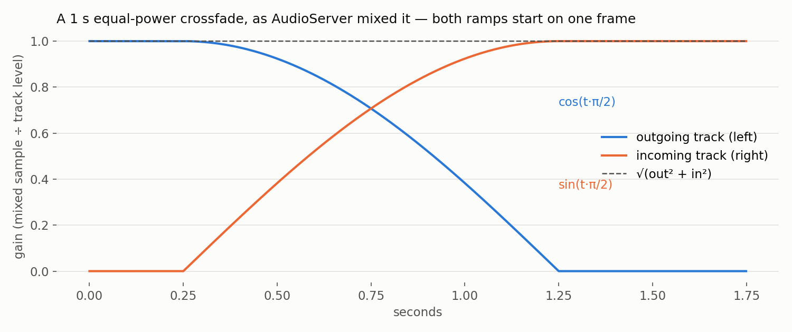
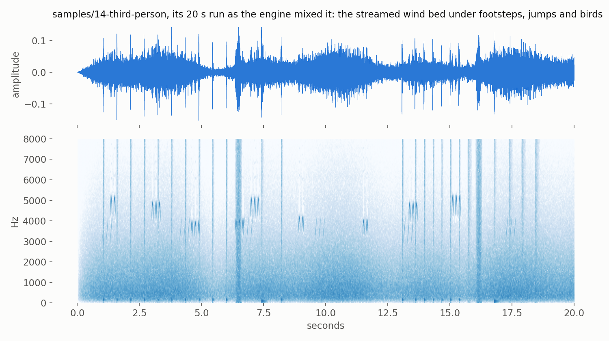
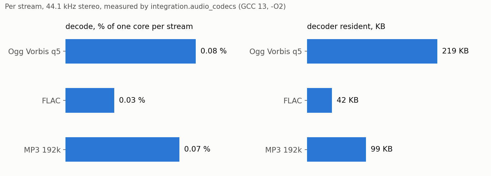

# Audio import and streaming

Issue #87's audio half: how a WAV, Ogg Vorbis, FLAC or MP3 file becomes a cooked track, how a
track streams — decoded ahead by jobs into a bounded ring, seeked and crossfaded on the audio thread
— and how a Swift game plays music and ambience. The contracts are `audio` ("Audio assets and
streaming"), `asset-import-pipeline` ("Audio import") and `native-abi` ("Streamed music and ambience
through the ABI") in [`openspec/specs/`](../../openspec/specs/README.md).

- [The pieces, and where they live](#the-pieces-and-where-they-live)
- [Importing a sound](#importing-a-sound)
- [The cooked track](#the-cooked-track)
- [Streaming a track](#streaming-a-track)
- [Music and ambience from Swift](#music-and-ambience-from-swift)
- [What it costs](#what-it-costs)
- [Testing](#testing)
- [Pitfalls](#pitfalls)
- [What is not built](#what-is-not-built)

## The pieces, and where they live

```
 source file ──► cy::import::AudioImporter ──► cooked track (.cyaudio, or a sub-asset in a bundle)
 (wav ogg flac mp3)   tools/import/src/audio.cpp      header + PCM, or header + the source's bitstream
                          │ decodes through
                          ▼
                 cy::audio::AudioCodecs  ◄── miniaudio_audio_codecs()   src/backends/audio-miniaudio
                 (servers/audio/decoder.h)   WAV/FLAC/MP3: ma_decoder · Vorbis: stb_vorbis push API

 cooked track ──► cy::audio::StreamPlayer ──refill job──► StreamSource ──► StreamRing ──► AudioServer
                  src/audio (cy::audio-streaming)  decode · convert · resample   SPSC     mix_streams()
```

| Layer | What | Header |
|---|---|---|
| 2 `servers/audio` | the cooked format, the decoder interface and the built-in PCM codec, the resampler, BS.1770 loudness, the ring, the stream source, the server's streams | `cooked_audio.h`, `decoder.h`, `resampler.h`, `loudness.h`, `stream.h`, `server.h` |
| 3 `backends/audio-miniaudio` | WAV, FLAC and MP3 through `ma_decoder`; Ogg Vorbis through stb_vorbis | `miniaudio_codecs.h` |
| 4 `audio` (`cy::audio-streaming`) | the stream player, refill executors, `FileByteSource` | `cy/audio/streaming.h` |
| 5/6 `abi`, `game_backend` | ABI 1.18 and the audio adapter | `cy_abi.h`, `audio_backend.h` |
| 7 `tools/import` | the importer and `cy_audio_cook` | `cy/import/audio.h` |

No `ma_` or `stb_vorbis` symbol appears outside `src/backends/audio-miniaudio/`; the layer checker
fails the build if one does.

## Importing a sound

The importer is registered with the built-ins, so a `.wav`, `.ogg`, `.oga`, `.flac` or `.mp3` in a
project is imported by the pipeline and the build graph like any other source (the editor's import
list projects the same registry). `.opus` is claimed and refused with the reason. Outside a project,
`cy_audio_cook` cooks one file with the importer's own option names:

```sh
cy_audio_cook --source content/audio/ambience/hillside_wind.ogg --out hillside_wind.cyaudio \
    --option mode=streamed --option normalise=loudness --option target-lufs=-20
```

| Option | Default | Effect |
|---|---|---|
| `mode` | `auto` | `decoded` (PCM in memory), `compressed` (the bitstream in memory), `streamed` (from disk); `auto` streams anything longer than `stream-threshold` (10 s) |
| `sample-rate` | `48000` | the rate of a PCM cook; `0` keeps the source's. A kept bitstream converts as it plays |
| `channels` | `keep` | `mono` (the channels' average) or `stereo` for a PCM cook |
| `spatial` | `false` | a 3D emitter: mono, whatever `channels` says |
| `loop` | `source` | the source's own loop (a WAV `smpl` chunk, `LOOPSTART` with `LOOPLENGTH` or `LOOPEND` comments), `off`, or `on` from `loop-start` to `loop-end` (source frames; `-1` is the edge) |
| `normalise` | `off` | `loudness` (to `target-lufs`) or `peak` (to `target-peak`): a playback GAIN, capped so the peak stays under `target-peak` |
| `trim-silence` | `false` | drop frames below `silence-threshold` (-60 dBFS) from both ends, never into the loop |

**Format by use.** A `decoded` cook is 16-bit PCM at the project rate: decoded, downmixed, resampled
by the engine's windowed-sinc resampler, quantised once. A `compressed` or `streamed` cook keeps the
source's Vorbis, FLAC or MP3 bitstream byte for byte — the engine has decoders and no encoders, and a
lossy re-encode is a second generation of loss — and records the played range and the loop beside
it. A WAV is always PCM. A stereo source for a 3D emitter cannot keep its bitstream (that would need a
re-encode to downmix), so it cooks to PCM and the import says `audio-downmixed-to-pcm`.

**Loudness** is measured over the played range of the final signal: ITU-R BS.1770-4 integrated
loudness (K-weighting derived for the actual rate, 400 ms blocks, the absolute and relative gates)
and the sample peak. Normalising writes `gain_db`; the samples are never rewritten.

**MP3** is gapless: the LAME header's encoder delay and padding are removed, so frame N of the
decode is frame N of what was encoded.

## The cooked track

An 80-byte little-endian header (`cooked_audio.h`) then the payload:

| Field | Meaning |
|---|---|
| `codec` | `pcm16`, `vorbis`, `flac`, `mp3` |
| `load_mode` | `decoded`, `compressed`, `streamed` |
| `channels`, `sample_rate` | of the decoded payload |
| `play_start`, `frame_count` | the played range, in decoded frames (trimming moves `play_start`) |
| `looping`, `loop_start`, `loop_end` | relative to `play_start`; `loop_end` 0 is the end |
| `peak_dbfs`, `integrated_lufs`, `gain_db` | measured, and the normalisation gain |

`parse_cooked_audio_header` reads the first 80 bytes only, which is all a streamed player reads
before it starts.

## Streaming a track

```cpp
cy::jobs::JobSystem jobs;          // started
cy::jobs::AsyncService async;      // started over `jobs`
cy::audio::JobRefillExecutor executor(jobs, async);
cy::audio::StreamPlayer player(server, executor, allocator);
cy::audio::StreamPlayerConfig config;
config.codecs = &cy::audio::miniaudio_audio_codecs();
(void)player.configure(config);

cy::audio::FileByteSource file;
(void)file.open("theme.cyaudio");
(void)player.add_track(cy::Name::intern("theme"), *cy::audio::track_from_cooked(file));

auto theme = player.play(cy::Name::intern("theme"), {.fade_in_seconds = 2.0F});
auto battle = player.crossfade(*theme, cy::Name::intern("battle"), 3.0F, {});
(void)player.seek(*battle, 30.0);
// once a frame, on the game thread:
player.pump();
```

**Three threads.** `pump()` (game thread) reaps finished streams, completes seeks, turns underruns
into diagnostics and schedules refills — it never decodes or reads a file. A refill (a job: on the
async service when the track is `streamed` and reads storage, on a worker when it is in memory) opens
the decoder, seeks, decodes up to `max_chunks` chunks, converts channels, resamples to the device
rate and writes the ring. The audio thread drains each ring through the stream's gain envelope;
nothing on it allocates or locks.

**The buffer guarantee.** A refill fills the ring to capacity. A stream with a ring of R frames does
not underrun while no refill is delayed by more than R frames less one mixer block — 0.5 s by
default. Past that, the missing frames are silence, `StreamStatus::underruns` counts them, the
server logs `audio.stream.underrun`, and the player records a `StreamDiagnostic` naming the track;
the stream carries on when refills return. Waiting for the ring to prime is not an underrun.

**Loops are seamless** because the source decodes to the loop's end, seeks the decoder to its start
and keeps writing: the resampler and the ring see one continuous signal.

**Crossfades are sample-aligned.** The incoming stream starts once its ring is primed, and the
player issues both envelopes in the same command batch, so both ramps begin on one mixer frame: the
outgoing gain falls as cos(t·π/2), the incoming rises as sin(t·π/2), and the outgoing stream stops
itself when its ramp ends.



**Seeks** fade the old position out over one mixer block, drop the ring, re-prime from the new
position (the decoder seeks in the next refill) and ramp the new position in over one block.

## Music and ambience from Swift

ABI 1.18 (`audio_find_track`, `audio_stream_play`, `_stop`, `_seek`, `_set_volume`, `_state`)
through CyberdyneKit:

```swift
let theme = try Audio.stream("frontier.theme", options: StreamOptions(fadeIn: 2))
let battle = try Audio.crossfade(from: theme, to: Audio.track("battle"), seconds: 3)
try battle?.seek(to: 30)
try battle?.setVolume(0.5, fade: 1)
try Audio.bus("Music").setVolume(0.2, fade: 2)   // a stream routed to the bus obeys it
if let state = try battle?.state() { print(state.position, state.underruns) }
```

The host registers tracks: `AudioAdapter::bind_streams(&player)` then
`AudioAdapter::add_track(name, track)`; `AudioAdapter::update` pumps the player. Like every audio
entry, the writes do nothing during a resimulated tick, and a stream handle is not simulation state.
`samples/14-third-person` streams its hillside wind this way (`game/Ambience.swift`), and falls back to
its in-memory loop when the host registered no track.



## What it costs

Measured on the development host (Linux, GCC 13, `-O2`), from the suites' own reports:

| | Ogg Vorbis (q5, 44.1 kHz stereo) | FLAC | MP3 (192 kbit/s) |
|---|---:|---:|---:|
| decode alone, % of one core | 0.08 | 0.03 | 0.07 |
| decoder resident | 219 KB | 42 KB | 99 KB |



A whole streamed Vorbis track — decode, 44.1→48 kHz conversion, ring writes — over ten minutes:
see `smoke.audio_stream_long`'s report (the PR records the figure). Per stream at the defaults: a
192 KB ring (0.5 s, 48 kHz stereo float), plus the decode side (the decoder, a 33 KB resampler
table, 8 KB of history, a chunk of staging); 488 KB peak for the Vorbis stream, and the same peak
after ten minutes as after one. A Vorbis open peaks higher once (the arena grows by doubling until the
headers fit, then is cut to what stb_vorbis reports needing).

## Testing

| Suite | What it holds |
|---|---|
| `integration.audio_stream` | the cooked format, the resampler (bit-exact passthrough, a 44.1→48 kHz sine within 1e-4, chunking changes nothing), EBU 3341's -23 LUFS, the ring, the fade curves, loops and seeks of the stream source |
| `integration.audio_mixer` | server streams: priming, underrun as silence and a count, the per-frame equal-power curve, flushes with declick, natural ends |
| `integration.audio_codecs` | WAV and FLAC decode to the reference exactly, Vorbis and MP3 frame-aligned; every codec's seek against its own decode from the start; decoder memory counted; decode cost |
| `smoke.audio_stream_long` | ten minutes of a looping Vorbis track: no underrun, constant peak memory |
| `integration.audio_streaming` | the player: starvation within and past the ring, seek, loop, crossfade, a ten-minute PCM track from disk in the memory of a one-minute one, refills on the job system with no blocking violation |
| `integration.import_audio` | the importer's cases, including the 3D-source WAV the exemption named |
| `integration.build_content` | an audio import as a build-graph node: deterministic and cached |
| `unit.abi`, `integration.game_backend_audio_streams`, `AudioStreamTests` | ABI 1.18 at the boundary, over a real player, and from Swift |

The fixtures in `content/audio/` encode one integer signal
(`tests/harness/include/cy/test/audio_signal.h`), so the codec suite compares decoded samples with
the signal itself, on every platform.

## Pitfalls

- **A `streamed` track's refill blocks on storage.** Run the player with `JobRefillExecutor`, which
  sends those refills to the async service; `InlineRefillExecutor` decodes on the calling thread and
  is for tools and tests.
- **A null device runs faster than real time.** A host that drives `NullAudioBackend::advance` in a
  loop (a test, a capture) must wait for in-flight refills before advancing, or it will hear
  underruns no device would cause (`refills_in_flight()`; see `samples/14-third-person`'s
  `update_audio`).
- **A refill shares the player's allocator across jobs.** Give the player a thread-safe allocator when
  refills run in parallel; `TrackingAllocator` is not.
- **A streamed MP3 that loops to a non-zero frame re-decodes its intro every lap.** dr_mp3 seeks
  forward one encoder delay short, so the engine seeks MP3 by decoding; the importer warns
  (`audio-mp3-loop-seek`). Use Vorbis or FLAC for looping music.
- **The two `cy::audio` modules declare different `SimulationTier`, `TierBudgets` and `EffectKind`.**
  The stream player is therefore its own target, `cy::audio-streaming`; do not link it into a binary
  through `cy::audio-acoustics`'s target.

## What is not built

- Opus and ADPCM decoding (the cooked format has room for both codecs).
- Loading cooked tracks through the asset system's packages: the player reads any `AudioByteSource`,
  and a package range is one, but no `AudioByteSource` over a mounted package exists yet.
- An editor audio-import panel beyond the registry's import list.
- Surround layouts: the cooked format, the resampler and the mixer are mono and stereo.
