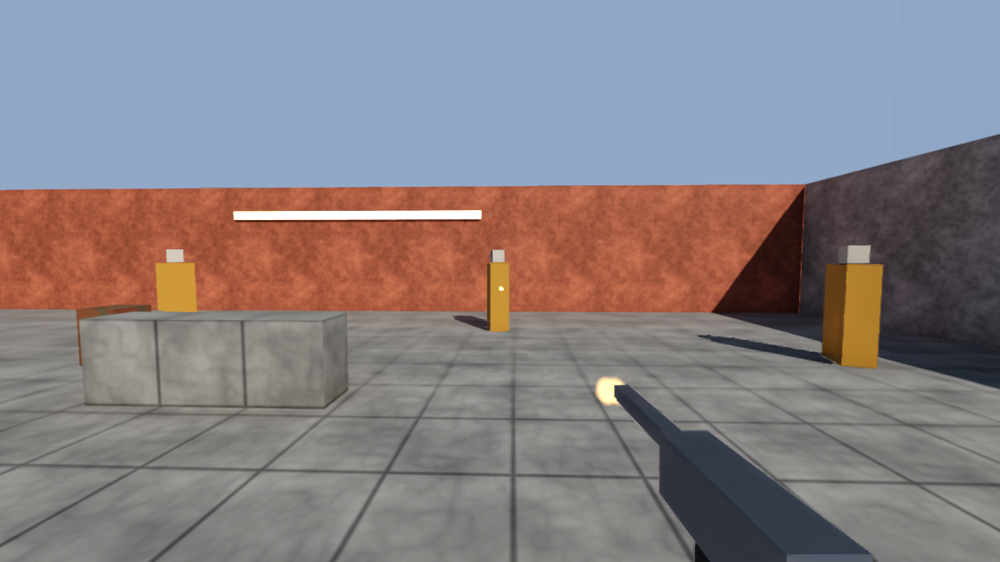

# A first-person game: the demo, and how it is built



`samples/15-first-person` is a small first-person shooter: a walled courtyard, a player written in
Swift, four targets driven by the engine's AI, and the session drawn through the engine's own frame
with the device GI and the temporal upscaler. This guide is the route through it — what the game
does and through which entries, how the host is put together, how a shot's aftermath reaches the
frame through ABI 1.15, how the targets think, what a frame costs, and what to watch for. The
sample's [README](../../samples/15-first-person/README.md) has the run commands and the pictures;
[the video](../design/videos/first-person-demo.mp4) is the whole session.

## 1. The shape

Three parts, as samples/13-rts-api: a Swift game module (`game/`), a C++ host that loads it over the
C ABI (`host/`), and tests that run the host as a separate process (`tests/`). The host builds the
level and binds adapters; **every decision about the player is the game's**, and every decision about
a target is the engine's AI.

| Host file | What it is |
|---|---|
| `arena.h` | the level as data: static boxes with their surfaces, props, targets, the weapon's parts, the content names, the collision layers |
| `bodies.h` | the arena in the Jolt world, and the one entity-to-body map the physics adapters see |
| `content.h` | the input actions and their bindings, and four generated sounds |
| `shot_effects.h` | two VFX systems (the muzzle burst and the sparks), the scorch decal material, the simulation world and the decal budget |
| `targets.h` | the AI targets |
| `illumination.h` | the arena's `IlluminationSystem` |
| `fps_host.h` | the servers, the adapters, the frame loop, the report |
| `render.h`, `render_content.h` | the frame |
| `script.h` | the scripted player |

## 2. The player in Swift

**Move in `onFixedUpdate`, look in `onUpdate`.** `CharacterController.move` is one fixed step by
definition; the first-person camera is presentation. The heading the walk uses is the view's aim
flattened onto the ground, recorded in `onUpdate`.

**Crouch by rebuilding the controller.** `CharacterController` has no resize, and that is fine: a
crouch destroys the character and creates a shorter one with the feet where they were. Standing back
up must not put a tall capsule into the beam the player is under, so the game first asks
`Physics.overlap(.capsule(...), at: standing, filter: solid.ignoring(self))` and stands only when it is
empty. Keep the test capsule a little thinner and a little higher than the real one, or the floor
under the feet and the wall at the shoulder refuse every stand.

**The aim crosses from the frame to the step.** A shot is a raycast, and a raycast in a fixed step
replays exactly; but the step may not ask the camera where the weapon points. So `onUpdate` records
the eye the last frame was drawn from (`camera.view().pose`) and the weapon's aim (`state().weaponAim`,
recoil included), and the next `onFixedUpdate` shoots along them:

```swift
// onUpdate
let drawn = try camera.view()
aim = (drawn.pose.position, try eye.state().weaponAim.normalised)

// onFixedUpdate
if try Input.action("weapon.fire").justPressed, cooldown == 0, let aim {
    let ray = Ray(origin: aim.origin, direction: aim.direction, maxDistance: 120)
    if let hit = try Physics.raycast(ray, filter: Layers.shot.ignoring(entity)) { … }
}
```

**A shot's aftermath is queued for the frame.** The flash (`Light.spawn`, ABI 1.11), the bursts
(`Effect.play`) and the mark (`Decal.spawn`, both ABI 1.15) are refused in a fixed step — a
resimulated tick would play them again — so the step queues the shot and the next `onUpdate` plays it,
kicks the recoil spring and plays the sounds.

**Place the burst where the weapon lens draws the barrel.** The weapon is drawn through its own,
narrower lens (ABI 1.13), so the barrel's tip in the world is not where the screen shows it. A burst at
the tip's true position hangs in the air beside the barrel. Scale the tip's offset in the eye's space
by `tan(fieldOfView / 2) / tan(weaponFieldOfView / 2)` across the view (keep its depth) and play there.

## 3. Effects and decals through ABI 1.15

The host registers what a game may play, by name — as it registers an audio cue:

```cpp
cy::game_backend::EffectsAdapter effects(allocator, simulation_world);
effects.add_effect("impact.sparks", sparks_system, /*spawn_seconds=*/0.05F);
cy::game_backend::DecalsAdapter decals(allocator, decal_budget);
decals.add_material("impact.scorch", /*index in the decal table=*/0);
cy::game_backend::bind_effects(host, &effects);
cy::game_backend::bind_decals(host, &decals);
// every frame, before the game's onUpdate:
decals.begin_frame(now_seconds);
```

and runs what it owns as it always does: `simulation_world.step(dt)` and `publish_sprites` into the
particle renderer, `decal_budget.decals()` into `AssemblyView::decals` and `pack_decal_table` relative
to the eye. The game resolves once and plays:

```swift
let sparks = try Effect.named("impact.sparks")
let scorch = try DecalMaterial.named("impact.scorch")
try sparks.play(at: hit.point, parameters: [n.x, n.y, n.z, 0, -hit.point.y, 0, 0, 0])
try Decal.spawn(.mark(scorch, at: hit.point, normal: hit.normal, radius: 0.14))
```

An effect's parameters are four floats a parameter in its declaration order: the sparks declare
`normal` (float3) and `floor` (float), so the eight floats above are the normal, padded, and the
floor's height in the effect's own space — particle positions are relative to where it was played.

**Give a burst a spawn duration.** A fire-and-forget instance is released when its last particle dies
*and it has stopped spawning*; nothing stops an instance a game forgot. `add_effect`'s `spawn_seconds`
(`vfx::EffectSpawn::spawn_seconds`) ends the spawn after that long — and after at least one sub-step,
so a burst shorter than a sub-step still spawns.

**A decal projects along its local −Z.** `Decal.Description.mark` turns +Z onto the surface's normal.
A mark on something that moves stays where it was spawned: the sample marks only the arena.

## 4. The targets

`cy::ai` from a host, end to end (`host/targets.cpp`):

- **Perception** is one `PerceptionScheduler::update` a tick over every standing target. Its
  `VisibilityHost` answers the whole batch with raycasts through the physics world — the player's own
  capsule left off the mask so the ray reaches the eyes, the observer's body on the ignore list.
- **The tree** is a `cy::graph::Graph` of `ai.*` nodes compiled with `compile_behaviour`. Every task
  succeeds the tick it runs, so the tree is walked from its root each tick and a target reacts the tick
  its knowledge changes.
- **One `think` call per agent.** `BehaviourHost` is not told which agent is asking, so the host thinks
  each agent with one-element spans and answers its conditions for that agent.
- **A hit is a perception.** The game owns health on a `Health` component; the host reads it after
  the game's step and turns a count that moved into `KnowledgeStore::perceive(..., SenseKind::Damage)`
  at the shot's source.

## 5. The frame

`FrameAssembly` and `FrameRecorder` with the standard material, as `samples/13-rts-api`'s map renderer:
the static boxes baked in world space with texture coordinates in metres (one stream, one run of
indices, a vertex offset a box), the moving boxes as the unit cube placed; the weapon's parts on their
own layer and `viewmodel::assembly_view` / `write_viewmodel` each frame; the decal table
`declare_upload`-ed before the assembly and `stage`-d after it; the particle renderer's extension in
the transparent stage; the flashes appended to the frame's lights; the GI, ambient occlusion and the
shadow map at the render extent; and the temporal upscaler at the frame's `Temporal` stage. The engine's
forward frame clears to black where nothing is drawn, so five emissive panels far round the courtyard
are its sky.

## 6. What it costs

1920x1080 on an RTX 5060 with the upscaler at Quality: **6.2 ms a frame** — 0.5 ms the game, 5.7 ms
the drawn frame — and 4.6 ms on the device, 2.3 of it the GI. Without the upscaler 13.3 ms (9.3 on the
device). `smoke.first_person_render` holds the total to 16.7 ms.

## 7. The suites

`integration.first_person_sample` holds the scripted run's digest and its controls, the controller's
paces and the crouch under the beam, every shot to the host's own raycast at the same moment, what a
hit does and what a shot leaves. `smoke.first_person_render` holds the picture to the game, the marks
and the sparks to where the raycasts hit, a golden still and the budget. Below them:
`unit.abi` (the 1.15 thunks), `integration.game_backend_effects` and `integration.game_backend_decals`
(the adapters over a real world and budget), `integration.vfx` (the spawn duration),
`integration.physics_jolt` (a small world's first contact), and CyberdyneKit's `EffectsTests`.

## 8. Pitfalls

- **The reference physics backend resolves no contacts.** A crate on it falls through the floor. A game
  whose props must land uses Jolt (`CY_PHYSICS`).
- **`Physics.overlap` reports entities, and drops bodies with none.** A static box with no entity in its
  user data is invisible to a headroom test; the sample gives the arena's boxes the `/Arena` node's.
- **Capture a shot before anything moves.** A host that wants to check a game's raycast must cast its
  own the moment the game's step returns, before the AI moves the targets and the world steps.
- **A pointer position is not mouse motion.** `Input.pointer().delta` sums the device's `MoveX`/`MoveY`;
  a host that injects only positions turns nobody.
- **A Jolt world's temp arena.** Before this change a 128-body world crashed on its first contact; the
  arena is now sized from Jolt's own constraint size (`integration.physics_jolt`).

## Playing it

`just play-fps` plays the arena in a window under the desktop play host — [Making a game
playable](playing-a-game.md) is how, step by step. The controls:

| | Keyboard and mouse | Pad |
|---|---|---|
| move, look | W A S D, the mouse | left stick, right stick |
| sprint, jump, crouch | left Shift, Space, C or left Ctrl | left stick pressed, south, east |
| fire, the sights, reload | left button, right button, R | right trigger, left trigger, west |
| pause | Esc | Start |

What the game adds when played, all in `game/Player.swift` and `game/Hud.swift`: a thirty-round
magazine that clicks on empty and reloads; a target shot down gets its health back ten seconds later
and the engine's AI stands it up (`Targets::rise`); the crosshair, a hit marker that reddens on a
kill, the magazine and the score; the look's sensitivity and inverted Y from the pause menu, applied
in the first-person camera's own sensitivity. The pad's look stick is a rate — 3.2 radians a second
at full deflection — turned into the counts the camera's one sensitivity turns back into radians.
`integration.first_person_play` and `smoke.first_person_play` are the suites.

## 9. What is not built

- The sparks collide with one plane, authored in the effect; the VFX system's own collision is not in
  this tree.
- The targets are boxes and topple as a body; there is no ragdoll and no animation.
- No HUD, no crosshair, no weapon switch, no ammunition.
- Drawn on Vulkan only; the sample adds no shader.
