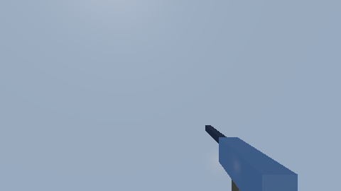
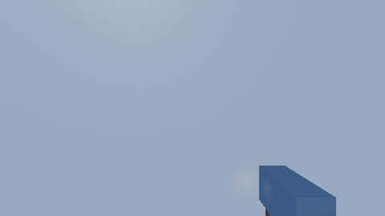
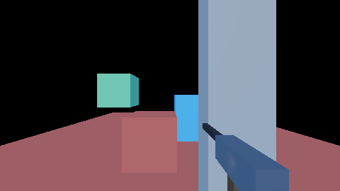

# The first-person weapon view

The arms and the weapon a first-person player holds, drawn with their own field of view and near
plane so they never clip into a wall — and the first-person camera that moves them: mouse look,
head bob, recoil and aiming down the sights. This guide is the route through
[`camera-system`](../../openspec/specs/camera-system/spec.md)'s "One camera, several views", the
modules that implement it and the suites that hold it.



*The weapon's barrel reaches 0.85 m; the wall is 0.45 m away. Through the weapon view every texel the
weapon covers in open air is still the weapon's (`render.weapon_view`).*



*The same boxes drawn as world geometry: the wall cuts the barrel and the front of the receiver off
— 4654 of 5995 texels left.*

## 1. The pieces

| Piece | Where | What it does |
|---|---|---|
| The weapon view | `src/rendering/viewmodel/` (`cy::rendering-viewmodel`) | the squeezed projection, `settings_from_views`, `assembly_view`, `ViewmodelFrame`, `write_viewmodel` |
| The assembly | `src/rendering/assembly/` | `AssemblyView::viewmodel`: the weapon view's own cull, its layers kept out of the world's, the mark `render::kInstanceViewmodel` and the shadow policy on its draws |
| The frame | `src/rendering/shaders/cy/frame.slang`, `src/rendering/pipeline/` | the viewmodel rows in the view block, `cyViewmodelDepthVertex` / `cyViewmodelForwardVertex` (and skinned), `PipelineSetup::viewmodel`, the recorder's weapon draws |
| The camera | `src/servers/camera/` (`first_person.h`, `view.h`) | `FirstPersonCamera`, `step_spring`, `first_person_eye`, `first_person_weapon`, `produce_weapon_view` |
| A game | ABI 1.13, `src/game_backend/first_person/`, CyberdyneKit's `FirstPersonCamera` | configure, feed, kick, reset and read a first-person camera and set its weapon view from C++ or Swift |

## 2. How the weapon view is drawn

**Into the world's frame, not over it.** One depth buffer, one prepass, one light loop, one temporal
resolve. What differs is the matrix a weapon vertex is pushed through: the weapon's own perspective
— its field of view, a near plane a centimetre out — with its depth squeezed into the slice of the
reversed-Z range nearest the eye:

```
z' = (1 - s) + s · z        s = ViewmodelSettings::depth_fraction, 1/16 by default
```

The x, y and w rows are untouched, so the weapon lands on the texels its own lens puts it on. Every
world surface beyond `world_near / (1 - s)` — 10.7 cm with a 10 cm near plane — has a depth below
`1 - s`, so it is behind every weapon fragment (`guaranteed_clear_distance`). The weapon keeps about
a million distinct depths inside its slice, so it still hides itself correctly.

**Lit where it is.** The vertex stage hands the forward pass the position the instance row put the
weapon at — camera-attached, in the world — so the weapon is lit by the lights around the player,
samples the world's shadow map, is fogged and takes the irradiance volume's light at its own
position. The cluster grid tiles the world's projection, so a weapon surface's light list is found
by projecting its position through the world's rows (`frameClusterPixel`); a position outside the
world's frustum, or nearer than its near plane, walks every light.

**Its own motion.** `ViewmodelFrame` keeps last frame's lens; the previous rows are that lens over
the camera's previous view rebased by its displacement (`previous_camera_relative_view`). A weapon
carried by a turning camera has no motion vector, so the temporal resolve keeps its history; a
weapon raised to the eye moves the way its narrowing lens moves it.

## 3. Turning it on in a frame

```cpp
using namespace cy::rendering;

// Once: the frame's pipelines with the weapon view's variants.
pipeline::PipelineSetup setup;
setup.viewmodel = true;

// The weapon view: the layers the arms and the weapon are on, its lens, its shadow policy.
viewmodel::ViewmodelSettings weapon;
weapon.layers = kWeaponLayer;                 // instances on this layer are the weapon view's
weapon.vertical_fov_radians = pose.viewmodel_fov_radians;
weapon.shadows.cast = false;                  // the default: receive, cast none, no contact term
viewmodel::ViewmodelFrame lens;               // held across frames

// Every frame, before assemble:
view.viewmodel = viewmodel::assembly_view(weapon, view.view, aspect);
// After assemble, before the upload is written:
const viewmodel::ViewmodelMatrices rows =
    lens.advance(weapon, aspect, relative_view, assembly.temporal());
viewmodel::write_viewmodel(rows, weapon, report.jitter, assembly.render_width(),
                           assembly.render_height(), upload.view);
```

The weapon's instances are ordinary instances on the weapon layer, their rows written every frame
from the eye — `camera::first_person_weapon(pose, eye)` composed with each part's offset — so they
are camera-attached and lit where they are.

From two render views of one evaluated camera, `viewmodel::settings_from_views(primary, weapon,
policy)` checks that they are one camera's — the same pose, distinct history identities — and
returns the settings; `camera::produce_weapon_view(camera, primary_request, lens, layers, out)` makes
the second view.

### The shadow policy

| `ViewmodelShadowPolicy` | Default | What it does |
|---|---|---|
| `receive` | on | the weapon samples the world's shadow map at its world position |
| `cast` | off | the weapon is drawn into the world's shadow map from where it is; off, arms floating at the eye cast nothing onto the floor and the weapon does not shadow itself |
| `contact` | off | the screen-space contact term; its depth is squeezed against the near plane, so the trace would find the weapon as its own occluder |

## 4. The first-person camera

`cy::camera::FirstPersonCamera` turns one frame's input into a `FirstPersonPose`: the look, the
eye's bob, both lenses, the weapon's placement in the eye's space and the three aims. It writes no
transform: the host's first-person rig places the eye at the character's head
(`first_person_eye(pose, head)`) and the weapon from it.

| Behaviour | How | Frame-rate independent because |
|---|---|---|
| Mouse look | device counts × `look.sensitivity`, × `aim_sensitivity` as the sights come up; the pitch clamped | it is a sum of deltas |
| Head bob | a phase advanced by the distance walked over the stride; an amplitude eased toward the speed's | distance, and a half-life |
| Recoil | `kick` adds angular velocity to a damped spring stepped by its exact solution | the closed form composes exactly |
| Aiming down the sights | a half-life toward 1 blends `hip_lens` → `aim_lens` (`camera::blend`), the weapon view's lens and the weapon's offset | a half-life |
| Motion reduction | `motion_scale` scales the bob and the view's share of the recoil together | — |

**The look's sensitivity is applied here, once.** Feed the device's deltas through an input action
with no `Sensitivity` processor on its binding; a binding that also scaled them would apply the
setting twice, which `camera-system` forbids.

**Three aims.** `aims.control_aim` is the player's look alone — what travels in a command and what a
server validates; `aims.view_aim` adds the recoil the camera takes (`recoil.camera_share`);
`aims.weapon_aim` adds the rest, which turns the weapon in the eye: shots follow the weapon while the
reticle stays on the control aim.

## 5. From Swift (ABI 1.13)

```swift
let eye = try FirstPersonCamera(camera: player, settings: FirstPersonSettings())
try eye.setWeaponView(WeaponView(layers: 1 << 5))   // the arms and the weapon's layer

// onUpdate:
try eye.feed(look: mouseDelta, speed: speed, aiming: aimHeld, airborne: !grounded)
if fired { try eye.kick(pitch: 3.0, yaw: .random(in: -0.4...0.4)) }
let state = try eye.state()   // the bob, the weapon's pose, both lenses, the aims
```

Every call is refused in `onFixedUpdate`: the camera is presentation, not authority. The host binds
`game_backend::FirstPersonAdapter` (`bind_first_person(host, &adapter)`), calls
`adapter.advance(seconds)` once a frame, and reads `adapter.pose(camera)` and
`adapter.viewmodel(camera)` — the renderer's own `ViewmodelSettings`, its lens following the sights
unless one was set.

## 6. Measured

`render.weapon_view` at 1920×1080 on an RTX 5060 (Vulkan), the composition scene below — a weapon of
five boxes reaching into a pillar, twelve world boxes, a lantern beside the weapon — the mean of 24
frames:

| | Prepass | Opaque | To the post-process |
|---|---|---|---|
| Weapon view | 0.050 ms | 0.103 ms | 0.259 ms |
| The same boxes as world geometry | 0.049 ms | 0.103 ms | 0.258 ms |

The weapon view costs a second cull of its own layers on the processor and a pipeline switch for its
draws; on the device it is the same draws.



*The depth composition `render.weapon_view` holds to `references/weapon_view_composition.png`: the
barrel reaches into the pillar and is drawn whole; every texel off the weapon is the world's, byte for
byte.*

## 7. Testing

| Suite | Kind | What it holds |
|---|---|---|
| `unit.render_viewmodel` | unit | the squeeze and its guarantee, `settings_from_views`, last frame's lens, the view-block words |
| `integration.viewmodel_assembly` | integration | the weapon view's own cull, its layers out of the world's, the mark and the shadow policy |
| `render.weapon_view` | render | off is the frame before (byte for byte); a weapon in a wall loses no texel; its own near plane; the composition golden; lit exactly as world geometry; the world's lens changed, not a texel or a byte of the weapon moved; no motion when carried, its lens's when raised; the shadow policy; 1080p |
| `unit.camera_system` | unit | the look and its sensitivity, the bob, the spring, the sights, motion reduction, the three aims, two views of one camera — each frame-rate case at 60 and 144 hertz |
| `unit.abi`, `integration.game_backend_first_person`, `FirstPersonTests` | unit / integration / Swift | ABI 1.13 |

The render suite is Vulkan only and skips loudly without a device. Metal and D3D12 compile the four
new entries (`just build-shaders --strict src samples`) and were not run.

## 8. Pitfalls

- A weapon instance on a world layer AND the weapon layer is the weapon view's: the world drops it.
- The weapon view needs the processor cull; a frame culled on the device refuses one.
- Screen-space effects see the weapon flattened against the near plane: depth of field blurs it as
  the nearest thing in view, ambient occlusion and the screen-space GI sample the light at the eye.
- A weapon draw ignores a `DrawPipelineFn`: a material variant's vertex stage would project it
  through the world's rows.
- A world surface nearer than `guaranteed_clear_distance` can still cut the weapon; keep the
  player's collision wider than it.

## 9. Not built yet

- A sample game that drives the first-person rig and the weapon view end to end.
- The weapon view in the selection mask and in virtual geometry.
- A per-material viewmodel vertex variant.
