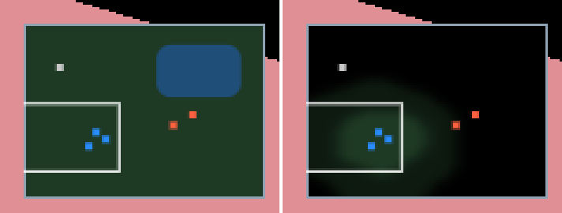

# Fog of war

What each team sees, has seen and remembers — kept as lockstep simulation state, drawn in the frame
and on the minimap, and driven from a Swift game through ABI 1.10. The worked example is
`samples/13-rts-api`.


## 1. The pieces

| Piece | Where | What it does |
|---|---|---|
| `cy::gameplay::fog::FogOfWar` | `src/gameplay/fog/` | the grid: per cell, a bit a team for "visible" and "ever visible"; ghosts of structures; the digest |
| `cy::game_backend::FogAdapter` | `src/game_backend/fog/` | ABI 1.10's backend: the entities that see, placed by the host each fixed step |
| `cy::rendering::fog_of_war::VisibilityField` | `src/rendering/fog_of_war/` | one team's grid faded on the frame's clock and packed for upload |
| `FogOfWarPass` | `src/rendering/fog_of_war/` | the frame's `FogOfWar` stage: the visibility texture uploaded and every surface fogged |
| `compose_minimap_fog` | `src/rendering/fog_of_war/` | the same field as the minimap's overlay page |
| `FogOfWar` (Swift) | `bindings/swift/Sources/CyberdyneKit/FogOfWar.swift` | `setVision`, `vision(of:)`, `revealRadius(of:)`, `cell(team:at:)`, `sight(team:of:)`, `status` |

The dependency runs one way: the renderer READS the grid (`write_states`) and links no gameplay
code. The fade, the soft edges and the colours are presentation, so two lockstep peers that draw
differently still agree about every cell and every legal order.

## 2. The rules the grid keeps

* A cell is VISIBLE to a team when its centre is within the reveal radius of one of the team's
  units, or an ally's (`share_vision`); EXPLORED when it ever was; UNEXPLORED otherwise.
* Integer arithmetic only: positions are Q32.32 metres located to 1/256 of a cell. The digest is the
  same on every platform (`unit.gameplay_fog` commits one).
* Another team's unit is VISIBLE when its cell is, HIDDEN otherwise. A STRUCTURE (`leaves_ghost`) a
  team saw is a GHOST where it was last seen until the team sees that place again: refreshed if it
  is still there, forgotten if it is not.
* Vision is a radius on a flat grid. There is no line-of-sight occlusion, height or cone yet.

## 3. Turn it on in a game

### The host

Keep the grid beside your other adapters, bind it, tell it where entities stand, and update it after
every fixed step — `samples/13-rts-api/host/fog.h` is the whole of it:

```cpp
cy::game_backend::FogAdapter fog(allocator);
cy::gameplay::fog::FogGridDescription grid;   // cells, cell size and origin, Q32.32
grid.width = 32;
grid.height = 32;
fog.create(grid);
fog.set_placer(&where_it_stands, &host);      // entity -> Q32.32 x, z; false once despawned
cy::game_backend::bind_fog(abi_host, &fog);
// every fixed step, after the simulation moved the units:
fog.update(tick);
```

### The game (Swift)

Give sight in `onCreate`, `onReady` or a fixed step — never in `onUpdate`, which is refused with
`.permissionDenied` because a frame must not decide what a player knows — and ask in any phase:

```swift
try FogOfWar.setVision(.init(team: 1, revealRadius: Fixed(7)), of: worker)
try FogOfWar.setVision(.init(team: 2, revealRadius: Fixed(8), leavesGhost: true), of: watchtower)

switch try FogOfWar.sight(team: 1, of: raider) {   // onUpdate: what the player may be shown
case .visible: dots.append(dot(at: raider))
case .ghost:   dots.append(dot(at: lastSeen))       // a structure, where it was last seen
case .hidden:  break
}
```

`samples/13-rts-api/game/Fog.swift` does exactly this for a squad, a barracks and an enemy camp of
two raiders and a watchtower.

### The frame

Turn the stage on, and each frame hand it the team's field and the camera:

```cpp
description.fog_of_war = true;                // AssemblyDescription; or assembly.set_fog_of_war(on)
// each frame:
fog.grid().write_states(team, states);
field.set_states(states);
field.advance(frame_seconds);                 // snap() on the first frame, a cut or a team switch
pass.set_frame({{projection, rotation_only_view, eye}, placement, style, &field});
sinks.fog_of_war = pass.stage();
```

And draw other teams' units as the team's sight decides: leave a HIDDEN unit out of the draw list,
draw a GHOST at `FogOfWar::ghost(team, id)`'s position. The pass then greys a ghost like the ground
it stands on. `samples/13-rts-api/host/render.cpp` (`--render <dir> --fog`) does both.

### The minimap

`compose_minimap_fog(field.texels(), …, region, width, height, style, out)` makes the overlay; upload
it with `UiRenderer::upload_atlas(page, Rgba8Unorm, …)` and show it on the HUD's minimap — the C++
`Hud::set_minimap_fog(page)` or the Swift `HudModel.fogPage`. It sits between the minimap's ground
and its dots.



## 4. Style and timing

`FogOfWarStyle`: an explored cell's brightness (0.45) and saturation (0.2), and the never-explored
colour (black). A point OFF THE GRID is never explored, whatever the edge cells hold — in the frame,
on the minimap and in `FogOfWar::at` — so size the grid over everything the frame draws:
`samples/13-rts-api` sizes it from the cooked map's bounds when it draws the RTS test map
(`host/fog_grid.h`). `FogFadeSettings`: a cell is revealed over 0.25 s and hidden over 0.75 s; zero snaps.
The stage runs on linear HDR after the temporal stage and before depth of field and bloom.

## 5. What it costs

On the RTX 5060 at 480x270: the stage is about 0.011 ms of device time a frame; the host's half (a
32 x 32 grid) a few microseconds; `samples/13-rts-api` with the GI draws a frame in 4.84 ms with the
fog against 4.68 ms without.

## 6. The suites

| Suite | What it holds |
|---|---|
| `unit.gameplay_fog` | the disc, explored against visible, flooring left of the origin, shared vision, units by sight, ghosts, refusals, the committed digest |
| `unit.render_fog_of_war` | the field against the grid, the fade, the smoothing, the shading, a point off the grid never explored, the minimap overlay, the constants |
| `unit.render_forward` | the stage's place in the frame and its refusals |
| `unit.abi`, `integration.game_backend_fog` | ABI 1.10's thunks and phases; the adapter through the table |
| `render.fog_of_war` | on a device: the texture is the grid, every pixel the host twin's, explored and unexplored ground, enemy units by sight, smooth edges, the fade, off against a reference, ground off the grid black |
| `render.rts_api_hud` (d) | the minimap's fog, Swift and C++ alike |
| `integration.rts_api_sample`, `smoke.rts_api_fog` | the Swift game: visions, the camp by sight, the refusal from a frame; drawn, with its cost |

The device suites ran on Vulkan. Metal and D3D12 compile the dispatch and have not run it.

## 7. Pitfalls

* **Giving sight from `onUpdate`** is refused. Record the decision in the frame and give the sight
  in the next fixed step, as a click becomes an order.
* **A float position is converted once**, rounded to Q32.32. Two peers that place a unit at the same
  float agree; two that computed the float differently do not — place lockstep units from their
  `Fixed` positions.
* **The fog does not hide geometry.** It darkens surfaces. An enemy you do not want seen must be left
  out of the draw list, which is the game's decision (`sight`).
* **A grid smaller than the world** leaves the ground past it black, never visible. Before this was
  fixed the stage read the nearest edge cell, so a 32 m grid under a 128 m map drew everything round
  it as seen.
* **`snap()` after a cut.** Otherwise a camera that jumps, or a switch to another team's view, fades
  the whole map in over the reveal time.
