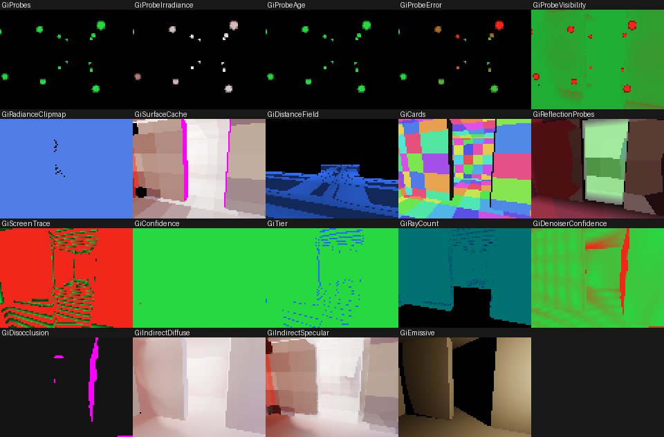
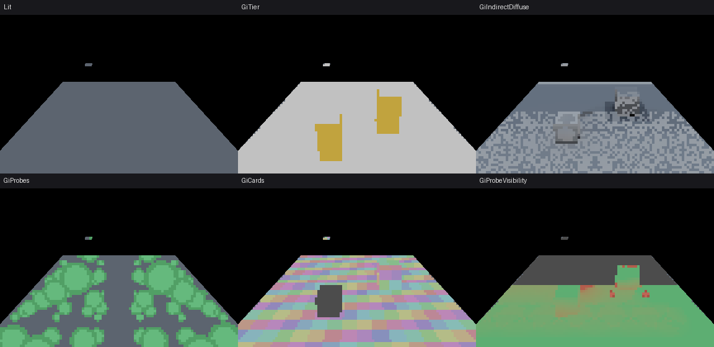

# Global illumination in CyberEngine

A walkthrough for a contributor or an agent: how CyberGI is put together, how its host and device
halves meet, how the tracing tiers are chosen, how a frame's pixels are lit by it and what that
costs, how emissive surfaces light a scene, how GI volumes override the global settings in a region,
how every result is held to the host oracle and the path tracer, and what is not built yet.

**Governed by**: [`rendering-global-illumination`](../../openspec/specs/rendering-global-illumination/spec.md)
and [`ray-tracing-infrastructure`](../../openspec/specs/ray-tracing-infrastructure/spec.md). The
module READMEs below are the reference; this guide is the route through them. Issue #35 is the plan
for the device half, in five stages.

| Where | What |
|---|---|
| [`src/rendering/gi/`](../../src/rendering/gi/README.md) | The host system and the oracle: the GI scene, the distance field, the surface and radiance caches, the tiers, the resolve, the bake's path tracer, the budget |
| [`src/rendering/gi_gpu/`](../../src/rendering/gi_gpu/README.md) | The device half: the scene upload, card lighting, the radiance cache's gather and query, the tiers, the per-pixel resolve and denoiser, the budget link |
| [`src/rendering/raytracing/`](../../src/rendering/raytracing/README.md) | The acceleration service: every decision about structures, and the mirror seam |
| [`src/rendering/raytracing_gpu/`](../../src/rendering/raytracing_gpu/README.md) | The service's structures built on a device |
| [`src/backends/rhi/`](../../src/backends/rhi/README.md) (`acceleration.h`) | Acceleration structures in the RHI, and the refusal of a device without them |
| [`src/rendering/light_probes/`](../../src/rendering/light_probes/README.md) | The irradiance volume, which the dynamic GI blends with under one rule |
| [`samples/12-beauty/`](../../samples/12-beauty/README.md) (`gi.h`) | The beauty shot lit by all of it: `--gi on`, `just capture-beauty-gi` |
| [Lighting authoring](lighting.md) | Lightmaps and baked volumes, which this system combines with rather than replaces |

## 1. One system, two halves, one oracle

`IlluminationSystem` (`gi/system.h`) wires named subsystems that meet only through the abstract
seams in `gi/lighting.h`. Each subsystem that does arithmetic has a host implementation, and each one
issue #35 moves to the device keeps that host implementation as its **oracle**: the device replaces
the arithmetic behind a seam, the host keeps every decision, and a suite runs both over one scene and
compares buffers.

| Stage | On the device | Seam | Suite |
|---|---|---|---|
| 1 | the distance field's clipmaps and the surface cards, uploaded incrementally | — (a mirror of `DistanceField`) | `render.gi_gpu` |
| 2 | the surface cache's card lighting | `SurfaceShadingBackend` | `render.gi_gpu` |
| 3 | the radiance cache's gather and query; the screen, software and hardware tiers; the acceleration structures | `ProbeGatherBackend`, `StructureMirror` | `render.gi_gpu_tracing` |
| 4 | the per-pixel resolve, the denoiser, the composite into the frame | `FramePassKind::ScreenSpaceGi`'s producer | `render.gi_gpu_resolve`, `render.gi_gpu_frame` |
| 5 | the device cost in `GiBudget`, the levers onto the device, the arbiter's ladder | `GpuGiBudget`, `apply_levers` | `render.gi_gpu_resolve` |

**Off is the frame it was.** With no `ScreenSpaceGi` producer attached, or attached with its words at
"none", the forward frame is byte for byte the frame before stage 4 (`render.gi_gpu_frame` (a), and
the committed references of the pipeline, ambient occlusion, fog and lightmap suites); the beauty
shot without `--gi on` is M11.c's still byte for byte (`just capture-beauty-gi`).

## 2. Putting the caches on the device

The choice is one installation per cache, and a null installation is the host again:

```cpp
using namespace cy::rendering;
gi_gpu::GpuGiScene scene;                              // the field, the cards, the lookup grid
scene.create(allocator, device, {});

gi_gpu::GpuSurfaceShading shading;                     // stage 2
shading.bind(scene, system.field(), system.surfaces().lookup_radius());
system.set_surface_shading(&shading);

rt_gpu::DeviceStructures structures;                   // stage 3: refuses without ray queries
if (structures.create(allocator, device, {})) {
    system.acceleration().set_mirror(&structures);
}
gi_gpu::GpuRadianceCache radiance;                     // stage 3
radiance.create(allocator, device, scene, {});
radiance.bind_field(system.field());
radiance.bind_hardware(&system.acceleration(), structures.created() ? &structures : nullptr);
system.set_probe_gather(&radiance);

// Each frame:
system.update(context);        // the host decides: placement, scroll, selection, budgets
shading.declare(graph);        // the cards it selected
structures.declare(graph);     // the structures the service built, refit or moved
radiance.declare(graph);       // the probes it selected, through radiance.world_tier()
// execute the graph; the next update() applies what came back
```

Every backend is **asynchronous by construction**: `submit` takes this update's selection, the work
runs when the graph executes, and the cache applies the results at the start of its next update. A
result for a page or a probe whose `revision` moved while it was in flight — it was invalidated,
retired or reseeded — is dropped, so a stale answer never undoes an invalidation.

## 3. The tiers, and the one predicate that chooses between them

`TieredTracer` (`gi/tracing.h`) is the one interface a consumer asks for radiance along a ray: the
**screen tier** first, against the depth buffer and last frame's colour; the **world tier** only when
the screen's confidence is below the escalation threshold and the budget allows; and the two
**blended** by the screen's confidence rather than switched. The world tier is either:

- **software** — a sphere trace of the sparse distance field, which every device can run; or
- **hardware** — a ray query over the acceleration service's structures.

Either way **a hit is a surface-cache lookup and never a material evaluation**; the tracers hold a
`RadianceLookup` and have no path to a material, which is why ray cost does not follow material
complexity and why the two tiers agree about what a surface looks like even when they disagree by a
voxel about where it is.

On the device, `GpuRadianceCache::world_tier()` is hardware exactly when the device reports
`Capability::RayTracing`, the service is active and its top level is built — the host's
`HardwareTracer::available()` with a device behind it. A device without ray queries and a profile
that switched them off therefore run one path, and the suite holds them to the same image bit for
bit. `GpuTierTracer` runs a batch through the tiers on their own (`GpuTierMode::Screen`,
`ScreenAccelerated`, `World`, `Tiered`).

The screen tier's device march is the host's fixed-step march with one addition: a
**nearest-depth pyramid** that proves runs of steps empty — in front of everything they could touch —
and skips them. It changes no answer (the suite compares with and without it bit for bit) and pays
where a ray crosses open screen. The engine's HZB keeps the furthest depth and proves occlusion; the
march needs the dual, so the screen tier builds it.

## 4. A frame's pixels: the resolve, the denoiser and the composite

The host oracle is `gi/screen_resolve.h`; the device is `gi_gpu::GpuScreenResolve`, the producer of
the forward frame's `ScreenSpaceGi` stage. A frame of it is seven stages; the resolve is the final
gather the lever names — the screen probes by default (below), the per-pixel gather this table
describes otherwise:

| Stage | Host function | What it does |
|---|---|---|
| unpack | — | the `DepthNormal` prepass as surfaces: position, view depth, normal, roughness |
| reproject | `screen_history` | each pixel's history pixel through `temporal-rendering`'s motion and classification; up to four invalidated boxes keep none |
| resolve | `resolve_screen_pixel` | the radiance cache traced to its probes (`sample_traced`), one cosine final-gather ray through the world tier, and the far-field sky, combined under `exclusion_for()`; the rough specular |
| accumulate, variance, filter | `Denoiser` | the shared denoiser, one dispatch a pass, its configuration read off the host denoiser |
| publish | `screen_upsample` | the grid back to the frame's pixels, joint-bilaterally, into two `Rgba16Sfloat` targets |

Attaching it to an assembled frame is three lines in the frame's hooks, and the composite is the
frame's own: `cy/frame.slang` samples the two targets through two slots of its texture table where
the irradiance volume's ambient sits, under the same double-counting rule (`frameGiAmbient`,
`frameGiAdmits`), with the specular through the split-sum environment BRDF:

```cpp
description.global_illumination = true;                       // AssemblyDescription
// before assemble, each frame:
system.update(context);
resolve.sync(system.radiance());
resolve.set_cache_frame(frame);
resolve.begin_frame(view, frame);                             // camera, unjittered world-to-clip, ...
assembly_view.screen_space_gi = resolve.import_diffuse(graph);
assembly_view.screen_space_gi_specular = resolve.import_specular(graph);
sinks.screen_space_gi = resolve.stage();
// once the upload exists:
resolve.set_jitter(jitter);
gi_gpu::write_gi_control(diffuse_slot, specular_slot, mode, upload.view.gi_control);
```

**The final-gather ray counts in full, whatever it met.** One ray a pixel is an estimate of the
hemisphere only on average over the directions drawn, so its weight in the combine must not depend
on the direction: its confidence decides only how much of its *value* the cache's answer stands in
for (a stale card, a hit no card covers, a back face). Weighting the ray by its own confidence — as
the resolve first did — let every ray that escaped to the certain sky outweigh one that met a card
shaded a few frames ago, and the beauty shot's shadowed faces resolved two thirds of their bounce.
`integration.render_gi_screen`'s stale-wall case holds every frame to the rule.

**The grid.** `set_divisor(2)` resolves, traces and denoises every other pixel each way and
upsamples against the full-resolution normals and depths; it is what `TracingResolution`'s first
step buys, because at 1080p the cache query and the denoiser cost more than the rays.

**The budget (stage 5).** `GpuGiBudget::observe` takes the stages' timestamps; `measured_ms()` is
what `FrameContext::measured_gi_ms` receives, and `GiBudget` tightens on it in its declared order.
`apply_levers` turns `TracingResolution` into the grid and the ray density and hands the denoiser's
quality to the resolve. `submit` reports the cost and the rung of the arbiter's GI ladder the levers
add up to; `apply` hands back the allocation and, only when granted, one relax step.

**The screen probes: the default gather.** `gi/screen_probes.h` (`ScreenProbeGather`) is the
resolve stage the frame runs unless `ScreenResolveSettings::gather` says `GiGather::PerPixel`:
probes on a screen grid in the class of Lumen's Screen Probe Gather. A frame of it is three device
passes in place of the per-pixel resolve, each the transcription of its host function:

| Pass | Host function | What it does |
|---|---|---|
| place | `ScreenProbeGather::place` | a uniform probe at the centre of every 8- or 16-pixel tile (`ScreenProbeSettings::spacing_pixels`); an adaptive probe on each half-tile cell whose centre the four uniform probes cannot interpolate — their bilinear, plane-distance and normal weights sum below one half: a depth step, a crease, the sky's edge |
| trace | `trace_probe` | 32 rays a probe through the world tier, one workgroup a probe; directions from a defensive mixture — a 4x4 guide over the hemisphere's equal-area square weighted by the probe's previous radiance (or the radiance cache's), beside uniform and cosine shares — each weighted by one over the mixture's density; the estimate in nine RGB second-order harmonics, blended with the history of the one previous probe that stands for it best where it lands |
| integrate | `integrate` | every cell of the resolve grid from the uniform and adaptive probes about it, by bilinear, plane-distance and normal weights, each probe's harmonics evaluated about the cell's own normal; the far sky beside it; the rough specular from the same harmonics in the reflection direction |

Harmonics rather than an octahedral map: what a pixel reads is irradiance about its own normal, and
the clamped cosine attenuates every band past the second to at most 1/24, so nine coefficients a
channel (27 floats) hold it where an 8x8 map is 192, evaluated in closed form per pixel. The
estimate is unbiased whatever the guide draws (an open sky to 0.3 %); the guide draws at most 0.9 of
the rays, because a cell it weighs zero is never drawn. A probe's rays leave its surface one
clearance away from any OTHER surface too, along the field's gradient (DDGI's relocation, for one
origin): a probe on a floor two centimetres from a 10 cm wall, lifted straight up, stepped inside
the wall and read the lit room's card, and one on a room's edge sent its rays out through the
ceiling to the sky. The denoiser downstream is the same, its cascade capped at one pass for the
probes' signal, which moves a tenth as much from frame to frame as the one-ray signal
(`screen_signal_config`).

**A scene from meshes.** `gi/mesh_cards.h` builds what the GI scene needs of any mesh: cards pooled
per world cell of a spacing and per facing (so a cylinder's slivers are not thousands of cards), and
a signed distance grid in the mesh's own space for the field to place by transform. The beauty shot
(`samples/12-beauty/gi.h`) is built that way from its six primitives and thirty-one instances.

## 5. Emissive surfaces

A surfel's `emission` is radiance. Ingested through `IlluminationSystem::ingest_cell`, every emitter
— the cards of one (instance, material) — is classified by `classify_emitters` (`gi/emissive.h`):

| | radiant power `pi * Y(L) * A` | area | what happens |
|---|---|---|---|
| cache only | below `promotion_power` | any | lights its surroundings through the surface cache's bounce |
| cache only | any | above `promotion_max_area_m2` | the same: large enough for the gather to sample densely |
| promoted | at least `promotion_power` | at most `promotion_max_area_m2` | its emission leaves the cache; each card becomes a `GiLight` with `emitter_area` |
| demoted | promoted, but past `max_promoted_lights` for the cell | | back in the cache, its power reported |

A promoted card is integrated by every consumer of `shaded_direct` — the surface cache, the device
card shading, the path tracer's next-event term, the irradiance volume capture — with
`emitter_form_factor`: Lambert's closed form over the card clipped to the receiver's horizon. It is
deterministic, so it has no variance at all, and its energy is exact rather than estimated. The
shadow is one ray to a point 30 cm in front of the card (`kEmitterShadowLiftMetres`).

**Why promote.** A small bright emitter left to a gather is hit by a few rays and returns an
enormous value when it is: fireflies. In the surface cache it is worse, because a card smaller than
the lookup cell answers every gather hit in that cell, so its energy is inflated by the cell's area
over its own. `integration.render_gi_emissive` measures both on a 30 cm lamp: promoted, the floor's
direct light is within 0.5% of the path tracer with a per-receiver ratio variance of 0.027 (the
reference's own noise); left to the cache, the variance is 4.6 and the receivers range from
nothing to 7.8 times their reference.

**Energy is never clamped.** `EmissiveLights::report()` gives `total = cached + promoted + demoted`
and `clamped_power`, which is zero and is checked.

## 6. GI volumes

A `GiVolume` (`gi/gi_volume.h`) is a box, a priority, a blend distance, a master weight, and the
parameters it SETS (`sets`, a bit per `GiVolumeParameter`):

| parameter | what it changes | decided |
|---|---|---|
| `Quality` | a probe's rays per update: Low 0.5x, Medium 1x, High 2x, Epic 4x | at probe placement |
| `ProbeDensity` | above one, probes at full density whatever the geometry; below one, the sparse lattice only | at probe placement |
| `UpdateRate` | how fast a probe ages in the scheduler, and how much its error weighs | at probe placement |
| `TierPreference` | `SoftwareOnly` keeps rays off the hardware tier; `WorldOnly` skips the screen tier | at placement (probes) and per sample (specular) |
| `DiffuseIntensity`, `SpecularIntensity` | scale the resolved indirect term | per sample |
| `FarFieldDistance` | where the far-field ramp begins | per sample |

Resolution is per parameter and per sample: starting from the global settings, the volumes that
reach the sample are applied from the lowest priority to the highest, each moving the value toward
its own by `weight * fade`. A higher priority therefore dominates, and the blend band interpolates
from the global value rather than switching. The tier preference switches at weight one half.
`set_volumes` validates every volume first and refuses the whole set on one bad volume, then
retires the probes in reach of every volume that sets a placement parameter, so the next update
places them again.

```cpp
GiVolume interior;
interior.bounds = Aabb::from_min_max({-4, 0, -3}, {4, 3, 3});
interior.priority = 10;
interior.blend_distance_metres = 1.0F;
interior.sets = gi_volume_bit(GiVolumeParameter::ProbeDensity) |
                gi_volume_bit(GiVolumeParameter::UpdateRate) |
                gi_volume_bit(GiVolumeParameter::Quality);
interior.probe_density = 2.0F;
interior.update_rate = 4.0F;
interior.quality = GiQuality::High;
gi.set_volumes({&interior, 1});
```

With no volume reaching a sample, everything resolves exactly as it did before volumes existed —
`integration.render_gi_volumes` checks that bit for bit.

## 6b. Moving objects, transparent ones, and fog

**Class an object once and let the class price its moves.** Register what moves with
`IlluminationSystem::add_object` and move it with `move_object`:

```cpp
gi::GiObjectDesc car;
car.id = 9;
car.mobility = gi::ObjectMobility::Movable;   // with its size, this makes it SlowDynamic
car.local_bounds = cy::Aabb::from_center_extents({}, {2.2F, 0.8F, 1.0F});
car.transform = placed;
car.field = &car_field;                         // optional: its own distance field
car.surfels = {car_cards.data(), car_cards.size()};
(void)system.add_object(car, frame);
// every frame it drives:
(void)system.move_object(9, transform, frame);  // coalesced; flushed once per interval
```

| Class | Derived when | What a move costs |
|---|---|---|
| `Static` | static mobility | its cards and field move now; the region is invalidated now |
| `SlowDynamic` | movable, at least `slow_dynamic_min_size_metres` (2.5) | one invalidation of the union of where it went, at most every `slow_dynamic_interval_frames` (8) |
| `FastDynamic` | movable, in between | nothing: it is proxy spheres that darken the indirect light under them and show in reflections |
| `TransientIgnored` | movable, under `transient_max_size_metres` (0.25) | nothing at all |

`has_class_override` wins over the derivation. A skinned `FastDynamic` object hands its posed spheres
to `pose_object` each frame; near the camera (`deformed_proxy_distance_metres * importance`) they are
its proxy, beyond it one sphere of its bounds' volume is.

**Thin transmission is one field on the surface.** Set `SurfaceProperties::transmission` to the
tinted fraction a leaf lets through and add `ResolveResult::transmitted` to the shaded colour; it is
the back face's indirect light. Zero is the opaque resolve, bit for bit.

**Fog reads the radiance cache.** `system.media_indirect(bounds, spacing, fallback, grid)` samples the
cache's mean radiance on a grid; wrap it in a `fog::FogIndirect` and set `FogLight::indirect`, and the
march (host and device) scatters it in place of the ambient term. No grid is the fog as it was.

True refraction and caustics are deferred: `set_refraction_solver` and `set_caustics_source` refuse.

## 6c. Asking why, and looking at it

```cpp
gi::ExplainSettings ask;
ask.frame = frame;
const gi::IlluminationQuery why = system.explain(point, normal, surface, ask);
// why.cause: Lit, Occluded, Unconverged, MissingProbes, LowConfidence or Invalidated
// why.probes[i]: weight = falloff * facing * visibility, age, error, leak_suspect
const gi::GiProfile cost = system.profile();   // after the frame's queries, before the next update
```

`explain` answers with the resolve's own function, so the answer is bit for bit what the frame was
lit with. A **leak suspect** is a probe that contributes although the distance field blocks the line
from it to the point: the probe-visibility view paints those surfaces red and the probes as red
discs. `profile()` gives the six stage costs, rays per tier, hit rates and the frame's
invalidations attributed to the change that filed them.

The nineteen debug views (`gi/debug_views.h`) are `render::DebugViewMode`s of the same names
(`GiTier`, `GiProbeVisibility`, `GiSurfaceCache`, ...). Draw one with `gi::render_gi_debug_view` for
the frame's camera and surface buffer, upload it with `lightmaps::GiDebugOverlayTexture`, and
`lightmaps::write_gi_debug_view(mode, slot, view)` makes the forward pass draw it where it is
opaque. `LightmapDensity` and `LightmapCharts` are drawn by the frame itself.



## 6d. Tuning it while the world runs

Four calls change the GI of a running world without `configure()`'s full rebuild. They are what a
game's options menu, a level script and the editor all reach — the editor through its document, a
Swift game through ABI 1.9 — so an author sees exactly what a player gets.

```cpp
gi::GiRuntimeSettings settings = system.runtime_settings();
settings.quality = gi::GiQuality::High;        // the global probe quality, a volume's where one reaches
settings.tier = gi::GiTierPreference::Automatic;
settings.hardware_ray_tracing = false;           // exactly a device without ray queries
settings.budget_ms = 2.5F;                       // the allocation the next update holds to
(void)system.set_runtime_settings(settings);

const gi::EmitterRule out{gi::kAnyEmitter, lamp_glass_material, gi::EmitterOverride::Off};
(void)system.set_emitter_rules({&out, 1}, frame); // the lamp is put out

(void)system.set_object_class(cart_id, true, gi::IlluminationClass::Static, frame);
```

| Call | What changes | What it costs |
|---|---|---|
| `set_runtime_settings` | mode, global quality and tier, the hardware tier's profile switch, the budget | a quality or tier change retires every probe (both are decided at placement); the switch keeps its structures; nothing else is touched |
| `set_emitter_rules` | per material, per instance or both: `Automatic`, `CacheOnly`, `Promote`, `Off` — the most specific rule wins | only cells with an emitter are classified again, from the cards they came in with; a promoted light that leaves or arrives invalidates what it lights |
| `set_object_class` | an object's class, or back to the derivation | entering Static or SlowDynamic places its cards and its own field now; leaving takes them out now, keeping the field for the way back |

Untouched, each is the configured system bit for bit (`integration.render_gi_runtime`'s "the
run-time settings start as the configured ones, and applying them is a no-op",
`render_gi_emissive`'s "with no rule, classification under rules is the measurement's"). A lamp put
out and lit again shades the floor under it to the same bits it had (`render_gi_emissive`); an
object made Static at run time resolves every point to the same bits as one added Static
(`render_gi_classes`). A scaled object's cards now carry the area of its scaled surface, so a
scaled lamp's power is the world's — before, a lamp carded over a unit square and placed at a
third of its size emitted over a whole square metre, eleven times its power.

## 6e. From the editor

The Lighting & Lightmaps panel has a global illumination half; every edit is a registered,
undoable `gi.*` command with an MCP tool of the same name ([editor/README.md](../../editor/README.md),
"Global illumination").

| Command | The document | The engine |
|---|---|---|
| `gi.settings.set` | `GiSettings` on the world's one "Global Illumination" node | `set_runtime_settings` |
| `gi.volume.create`, `gi.volume.set` | a node whose transform is the box (translation the centre, scale the size: the move and scale gizmos place and size it) and a `GiVolume` with its `sets` mask | `set_volumes` |
| `gi.object.set-class` | `GiObject` on a placed object (also the Inspector's row) | `set_object_class` |
| `gi.emission.set` | `GiEmission` on the world's one rule node for a material | `set_emitter_rules` |
| `gi.report`, `gi.status` | — | `illumination.report`: settings, tier, convergence, cost per stage, rays, hit rates, every emitter's class and every object's, and `explain()` at a clicked pixel |
| `viewport.view-mode.gi-*` | — | the nineteen GI debug views, drawn by the runtime over its own frame |

The runtime (`samples/05b-editor-window/runtime/gi_runtime.h`) reads the document into the engine's
`cy::editor::IlluminationPreview` (`src/editor_backend`), which rebuilds the GI only when geometry,
materials or lights changed and applies everything else in place through the calls of section 6d.
The view the viewport asked for (`GizmoIntent::debug_view`) is drawn on the processor at a quarter
of the frame's resolution and composited by the forward frame where it is opaque; back on Lit the
frame is byte for byte the frame before (`smoke.editor_authored_frame_vulkan`'s GI case).



## 6f. From a Swift game

```swift
var settings = try Illumination.settings                 // a graphics options menu
settings.quality = .high
try Illumination.apply(settings)

let crypt = try GIVolume.place(.init(                    // a level's important interior
    bounds: (min: Vec3(x: -8, y: 0, z: -8), max: Vec3(x: 8, y: 4, z: 8)),
    overrides: [.quality(.epic), .updateRate(2)]))
try Illumination.setClass(.fastDynamic, of: cart)        // it moves every frame
try Illumination.setEmission(.off, of: torch)            // the guard put the torch out

let light = try Illumination.irradiance(at: thief.position)   // onUpdate
if light.luminance < 0.05 { hidden = true }                    // act on it in the next step
```

`irradiance(at:normal:)` is `indirect_diffuse` at the point; with no normal, the mean over the six
axis directions — what a body standing there receives. Every call is refused in `onFixedUpdate`
(illumination is presentation, so the simulation never depends on it), which is why an AI reads the
light in its frame update and acts on it in the next fixed step. `integration.swift_illumination`
runs a real Swift module against the GI suites' room: the light at a guard's spot is the system's
own six-direction mean to the micro-unit, and putting the lamp out by its material's name halves it.
The C reference is [src/abi/README.md](../../src/abi/README.md), "What ABI 1.9 adds".

## 7. Measuring it: against the oracle, and against the engines it competes with

"Better than Lumen or Unity's adaptive probe volumes" is only worth saying as numbers a suite fails on.
The claims and where each is measured:

| Claim | Measured by | Today (RTX 5060) |
|---|---|---|
| The device computes what the host computes | `render.gi_gpu`, `render.gi_gpu_tracing`, `render.gi_gpu_resolve` | card radiance 3.7e-8, probe payloads 5.7e-8, the query 1.2e-7; the per-pixel resolve, denoiser and upsample about 1e-7 mean relative, both tiers, the history exact |
| Hardware and software tiers agree within a stated bound | `render.gi_gpu_tracing`, `integration.render_gi_fallback` | 0.0209 against a 0.10 tolerance |
| Losing ray queries is not a visible event | `render.gi_gpu_tracing` | the switch alone moves the image 0.074; an ordinary frame 0.142 |
| No light through a wall | `integration.render_gi_screen`; `smoke.gi_gpu_probe_quality`; `integration.render_gi_screen_probes` | a lit room and a sealed one behind a 10 cm wall: at 40x24, the per-pixel gather's sealed room mean 2.6e-5 of the lit room's, its worst pixel 7.6e-3; at 1920x1080 the screen probes' (the default) 0 and 0 through both tiers, the per-pixel gather's 2.5e-5 and 4.1e-2 (software) — the path tracer says zero |
| Close to the path tracer | `smoke.gi_gpu_probe_quality`; `integration.render_gi_screen`; `just capture-beauty-gi` | at 1920x1080 over 220 points, the screen probes 0.076 (software) / 0.066 (hardware) relative, the per-pixel gather 0.078 / 0.065; at 40x24 the per-pixel gather 0.112 (the probes alone 0.436), 0.148 on a half-resolution grid; the beauty shot (per pixel) 0.126 over 288 pixels against the exact triangles, where the flat sky term it replaces is 0.385 |
| Fast convergence after a change | `smoke.gi_gpu_probe_quality`; `smoke.render_gi_screen_convergence` | a light moved 4.9 m, within 10 % of the new light's converged frame: at 1920x1080 the screen probes in 14 (software) / 13 (hardware) frames, the per-pixel gather in 9 / 11; at 40x24 the per-pixel gather in 11 (bound 14) |
| Temporally stable | `smoke.gi_gpu_probe_quality`; `integration.render_gi_screen` | a converged still view at 1920x1080 moves 0.0019 / 0.0017 a frame through the screen probes, 0.0023 / 0.0017 per pixel; at 40x24 per pixel 0.0034, where the one-ray signal under it moves 0.451 |
| Off is the frame it was | `render.gi_gpu_frame`, `just capture-beauty-gi` | byte for byte, the stage attached with its words at none, through either gather; the beauty shot without `--gi on` |
| A leak is named, not guessed at | `integration.render_gi_pipeline` (the visibility term), `integration.render_gi_volume`, `integration.render_gi_diagnostics` (leak suspects) | the divider's face takes 0.075 of its probe weight from probes the field says cannot see it (0.135 before the per-axis visibility test); the rest is doorway-edge probes |
| A moving body darkens what it stands on, invalidating nothing | `integration.render_gi_classes` | a FastDynamic character's proxy within 0.044 of the open light of the path tracer tracing a triangle sphere; a projectile files 0 invalidations, a vehicle 8 in 32 frames |
| Leaves transmit, fog is lit by the cache | `integration.render_gi_media`, `render.volumetric_fog` (g) | thin transmission 0.123 and the medium's grid 0.125 (mean relative) from the path tracer; the device fog within 2.3e-5 of the host march |
| Emitters lit without fireflies, within a stated error | `integration.render_gi_emissive` | a promoted 30 cm lamp 0.5 % from the path tracer with a per-receiver ratio variance of 0.027 (the reference's noise); left to the cache, 4.6; a promoted panel 2.0 % |
| A region gets the quality it is marked for, within one budget | `integration.render_gi_volumes` | 3.9x the probe updates and 2x the rays in the marked interior, the frame's probe budget unchanged; no volume reaching a point is bit for bit no volume at all |
| Tuning it live changes only what it says | `integration.render_gi_runtime`, `integration.render_gi_emissive`, `integration.render_gi_classes` | untouched settings, no rule and a class set at run time are each the configured system bit for bit; a lamp put out and relit shades its floor to the same bits; Epic quality is 4x the rays of every probe placed after it |
| A game reads the light where a body stands | `integration.game_backend_illumination`, `integration.swift_illumination` | the sample is `indirect_diffuse`'s own answer bit for bit (the six-direction mean for a body); a lamp put out from a script takes the luminance under it from 2.150 to 1.038 in the adapter and from 2.149 to 1.032 through Swift |
| Every GI view in the editor's viewport, and Lit as before | `smoke.editor_authored_frame_vulkan`, `integration.editor_window_illumination` | 11 136 of 11 200 opaque view texels change the frame, every one of 13 376 clear texels keeps it, and back on Lit the frame is byte for byte the frame before |
| Explicit cost | `smoke.gi_gpu_probe_quality`'s cost cases; `render.gi_gpu_tracing`'s and `render.gi_gpu_resolve`'s; the beauty shot's report | gather at budget 0.078 ms (software) / 0.043 ms (hardware). The GI at 1920x1080, every stage: the screen probes (16 px) 5.5 ms (hardware) / 6.4 ms (software), 2.4 / 3.3 ms on the half-resolution grid; every 8 px 8.6 / 12.1 ms; the per-pixel gather 11.6 / 15.2 ms, 3.15 ms on the half grid, 2.24 ms with the denoiser lever too. For a 3840x2160 output the probes are 21.9 / 25.2 ms native (per pixel 46.7) and 9.7 / 11.3 ms at the upscaler's 1440p (per pixel 20.8). The beauty shot (per pixel) 14.8 ms (hardware) / 29.7 ms (software), 5.6 / 11.1 ms on the half grid. Stage 5 holds a 960x540 frame to its allocation by dropping from 3.97 ms to 0.75 ms in the declared lever order |

**The path tracer as the reference.** `PathTracer` (`gi/bake.h`) is the same tracer the lightmap bake uses, over the same GI scene. For a
reference over cards turn on `set_emission_footprints(true)`: a hit then takes the emission of the
card whose square holds it, rather than of the nearest card — without it an emitter smaller than its
neighbours' spacing loses its corners and the reference reads 5.6% low (measured, and the reason the
mode exists). Compare in the units the caches use: `irradiance()` returns the mean cosine-weighted
incoming radiance, which is a card's `direct + accumulated / albedo`.

Report the energy over a set of receivers and the per-receiver error separately: the first averages
the reference's noise out, the second includes it. `render_gi_emissive`'s `Agreement` does both,
and prints them.

### How this compares with Unreal's Lumen and Unity's GI

No head-to-head run exists: neither engine runs in this repository, and no one scene has been
measured in all three. What can be stated is CyberGI's MEASURED number on each axis of the program
goal beside what the other two DOCUMENT about the same axis; where a vendor publishes no number, the
cell says so rather than inventing one. Every CyberGI number below is a test that fails when it
regresses.

| Axis | CyberGI (measured, RTX 5060 where a device is involved) | Unreal Engine 5, Lumen (documented) | Unity 6, Adaptive Probe Volumes and Enlighten (documented) |
|---|---|---|---|
| Error against a path-traced reference | at 1920x1080 in the GI test room (220 points), the screen probes 0.076 (software) / 0.066 (hardware) mean relative, the per-pixel gather 0.078 / 0.065; 0.112 per pixel at 40x24, 0.126 on the beauty shot against the exact triangles; held below 0.16, the probes within 0.02 of the per-pixel gather | no error figure against a reference is published | APV stores what the baker path-traced, so a probe's value is a bake's; the error of sampling probes between them is not published |
| Convergence after a light moves | within 10 % of the new light's converged frame after a 4.9 m move: the screen probes in 14 (software) / 13 (hardware) frames at 1080p, the per-pixel gather in 9 / 11 (11 at 40x24); held at 14 | accumulated over frames; update speed is a set of tuning variables, no frame count is published | a probe volume is re-baked or blended between pre-baked lighting scenarios; Enlighten updates a moved light's bounce over several frames over static geometry only |
| Light through a thin wall | a sealed room behind a 10 cm wall at 1080p: through the screen probes none at all, both tiers; through the per-pixel gather a mean 2.5e-5 of the lit room's light and a worst pixel 4.1e-2 (software); at 40x24 per pixel 2.6e-5 and 7.6e-3 (held below 1e-3 and 2e-2) | the documentation advises walls of at least 10 cm for the software tracer to avoid leaking | leaking between probes is a documented APV artefact, reduced by its Virtual Offset and leak-reduction settings; no figure |
| Temporal stability | a converged still view at 1080p moves 0.0019 (software) / 0.0017 (hardware) a frame through the screen probes, 0.0023 / 0.0017 per pixel; 0.0034 per pixel at 40x24, where the one-ray signal under it moves 0.451 (held below 0.01) | no figure | baked probes do not move at all, and do not respond to a light that does |
| Emissive lighting | a promoted 30 cm lamp within 0.5 % of the path tracer with a per-receiver ratio variance of 0.027; left to the cache the same lamp is 4.6 — promotion is the measurement, or an author's rule | emissive surfaces light through the GI's gather; the documentation recommends real lights for small bright emitters, which are noisy | emissive surfaces contribute to the bake; realtime emission through Enlighten |
| Hardware ray tracing with a bounded software fallback | the tiers agree to 0.0209 (held at 0.10); switching moves the image 0.074 where an ordinary frame moves 0.142 | hardware and software tracing are both offered; the difference between them is not bounded in the documentation | runtime probe GI does not trace rays; ray-traced GI is a separate HDRP feature |
| Cost at 1080p | the whole GI through the screen probes 5.5 ms (hardware) / 6.4 ms (software) at authored quality, 2.4 / 3.3 ms on the half-resolution grid; per pixel 11.6 / 15.2 ms, 3.15 ms on the half grid; a 960x540 frame held to its allocation from 3.97 ms to 0.75 ms | budgets are documented per scalability level for consoles; no RTX 5060 figure | a probe lookup per pixel at runtime; the bake's cost is offline |
| Control from tools and code | every setting, volume, class and emitter rule from the editor (undoable, MCP) and from a Swift game (ABI 1.9); all nineteen debug views in the viewport; `explain()` at a clicked point | post-process volume settings, console variables, visualization modes | the Lighting window, probe volume baking sets and lighting scenarios, a scripting API |

What the table supports, and only that: on every axis where a number exists, CyberGI's is stated,
held by a test and reproducible from this repository; on error against a reference, leaking at
10 cm, convergence and stability neither vendor publishes a number to compare it with. The screen
probes, Lumen's own technique, cost CyberGI half of what its per-pixel gather did at 1080p for the
same error, no leak, and two or three frames more to settle after a light moves. What it does not
support: that CyberGI is cheaper — at full resolution its default is 5.5 ms through the hardware
tier, a third of a 60 fps frame, and only the half-resolution grid reaches 2.4 ms; that it was ever measured
beside either engine on one scene; or anything about consoles, Windows or Apple devices, where the
hardware tier refuses (section 10); or that the editor's GI views are interactive — the
editor-hosted runtime draws them on the host, about 35 ms for the probe view at 320x180 and 240 ms
for indirect diffuse (`smoke.editor_gi_cost`, GCC 13), where Lumen's visualization modes are drawn
by the GPU frame.

## 8. Running and changing it

```sh
just build-engine
just test-integration -R render_gi            # the host system and the oracle, no device
CY_RENDER_UPDATE_GOLDEN=1 build/dev/cy_test_integration_render_gi_debug_views   # rewrite the view goldens
just test-unit -R render_raytracing           # the service and its mirror, no device
just test-render -R gi_gpu                    # the device suites; skipped where there is no device
just test-integration -R render_gi_screen_probes   # the screen probes' properties, on the host
just test-smoke -R gi_screen_probes           # their quality at 128x72 on the host
just test-smoke -R gi_gpu_probe_quality       # both gathers' quality and cost at 1080p and 4K, on the device
python3 src/rendering/gi_gpu/shaders/regenerate.py --slangc build/dev/Development/bin/slangc
just build-shaders --strict src samples       # every entry point for SPIR-V, MSL and DXIL
just quality-shader-headers                   # the committed headers are what the sources compile to
```

A device shader is a **transcription**: each function names the host function it transcribes and
writes it in the same order, because a reordering that is equal in exact arithmetic is a test failure
in float. Change the host function and its transcription together, regenerate the headers, and run
both suites. The [Slang guide](slang.md) has the shader rules.

## 9. Pitfalls this code has already met

- **A signed remainder is not a modulo on every driver.** The RTX 5060 answered `-4 % 9` with 0 when
  the divisor was read at run time. Toroidal addressing (`giWrap`) is unsigned arithmetic for that
  reason; a power-of-two window hid the defect for a whole stage.
- **Host-written device buffers belong in device-local memory.** A march reads its scene per step;
  from system memory a 1080p screen batch took 44 ms instead of about one. Use
  `MemoryUse::HostVisibleDeviceLocal`, which falls back where the device has no resizable BAR.
- **Import a shared buffer once per graph.** Two `import_buffer` calls of one handle are two
  resources and the graph derives no barrier between them; `RenderGraph::import_buffer_once` is the
  call when another module's passes touch the same buffer.
- **One Vulkan device at a time in a process.** The backend loads entry points through volk, which
  holds one device's table; a suite that compares a device with and without ray queries creates them
  one after the other.
- **Exact ties are a property of the scene.** A dyadic scene puts hits exactly on a card's lookup
  sphere or between two cards; the lookup's tie rule (`card_lookup_prefers`) and an off-lattice
  lookup radius keep a comparison about the transcription rather than about the last bit.

- **A snapshot of a cache nothing has shaded is empty.** `CardSnapshot` skips invalid pages, so the
  first card update gathers nothing; emission reaches a neighbour at the second.
- **`scene().ingest_cell` does not classify emitters.** It still lights every emitter through the
  cache. `IlluminationSystem::ingest_cell` classifies, and `evict_cell` releases what it allocated.
- **A volume that only sets intensity or far field re-places nothing** — those are per sample. One
  that sets density, rate, quality or tier re-places its region's probes, which then converge again.
- **Compare a struct's floats as bits field by field, not with `memcmp`**: `GiRegionSettings` has
  padding.
- **`HostVisibleDeviceLocal` is not always device-local.** The resolve's surface buffer, 72 bytes a
  pixel at 1080p, landed in system memory when the small BAR heap was full and the frame's timing
  spiked to tens of milliseconds; it is device-local now, written through an upload copy the graph
  orders.
- **A stochastic sample must not be weighted by what it met.** See section 4: the final-gather ray's
  weight is constant and its confidence decides how much of its value a stand-in supplies.
- **A brick's last voxel needs its far corner.** The field stored four samples per brick axis, so the
  last voxel of every brick was flat and a 10 cm wall at a brick face vanished from one side; bricks
  store five now (`kBrickSampleEdge`), and `integration.render_gi_pipeline` keeps the wall.
- **The GI's lights are in the bake's units.** A card is shaded as `albedo * direct`, so a light in
  lux makes every bounce pi times the frame's `albedo / pi * E`. `lightmap_bake` divides its lights by
  pi for that reason (bake.h) and so does the beauty shot; a caller that hands the system lux is
  lighting its bounce pi times too bright.
- **Cards must cover what a ray can reach.** A hit no card covers is answered by the cache's stand-in
  at best. The beauty shot first carded only the gravel the camera sees, and a column's shadowed face
  — which sees the ground out to the horizon — resolved a third of its bounce.
- **Fit the GI's sky to the frame's.** `SkyTerm` is a gradient with no sun aureole, and a low sun's
  aureole is most of a clear sky's light: fitted to the atmosphere's zenith and horizon alone, the
  beauty shot's sky lit an upward face with a third of the frame's sky term. Scale it so an upward
  face receives the frame's mean sky radiance (`samples/12-beauty/gi.cpp`'s `fit_sky`).

## 10. What is not built yet

- **The screen tier in the screen probes' rays.** The probes trace the world tiers, as the per-pixel
  gather does: the resolve has no previous frame's lit colour to march against, which the device
  screen tier (`GpuTierTracer`) reads.
- **The default gather at ~4 ms at 1080p, full resolution.** The probes' own passes are 1.8 ms
  (hardware) / 2.7 ms (software); the shared denoiser's full-resolution accumulation, variance and
  one filter pass are 3.1 ms more, so the frame is 5.5 / 6.4 ms. The half-resolution grid
  (`TracingResolution`) is 2.4 / 3.3 ms.
- **A light that moves settles two or three frames later through the probes** (14 / 13 frames at
  1080p against the per-pixel gather's 9 / 11): a probe's history is a second accumulation before
  the denoiser's. Each frame of history more costs about two frames (four: 18).
- **The beauty shot's numbers are the per-pixel gather's.** `just capture-beauty-gi` now photographs
  the screen probes (the default); the 0.126 and 14.8 ms above were measured per pixel and the
  committed stills are from before the change.

- **Card shading and the probe gather in the beauty shot run on the host.** The shot uses the device
  resolve and denoiser; its caches are updated by the host system, which costs about 19 ms of
  processor time a frame at 12 782 cards. The device card shading and gather (stages 2 and 3) are
  the installation that removes it.
- **`samples/10-world`**: the world shades per vertex in its own shader with no depth and normal
  prepass and no shadowed sun of its own; it needs the terrain in the GI scene (cards and a
  heightfield distance grid per chunk) and its ambient replaced before it can take the GI.
- **DXR and Metal acceleration structures**: the RHI vocabulary is theirs too, and both backends
  refuse until they implement it; the software tier answers.
- **Promoted emitters in the frame's own lights**: the forward frame's clustered lights and the
  stochastic many-light path do not read `frame_lights()` yet; the frame reads the GI's two targets
  and nothing else of this system.
- **GI volumes and probe quality on the device gather**: placement, density and the update rate are
  host decisions and hold on both paths; the device gather traces the update's ray count through
  the frame's tier for every probe, so `Quality` and `TierPreference` reach probes on the host
  gather only.
- **The editor's GI is the host's**: the editor-hosted runtime lights the authored world with the
  host `IlluminationSystem` and draws its views on the processor at a quarter of the frame's
  resolution, every frame the view is selected (at 320x180, about 35 ms for the probe view and
  240 ms for indirect diffuse), so a GI view mode runs the viewport at a few frames a second — a diagnostic,
  not the frame's per-pixel GI; the editor's lit frame is not yet lit by
  the device GI. Materials are a cooked material's base colour and emission, or the frame's default
  grey (material graphs light as grey). The Swift API sets no transmission and does not tune the
  per-pixel resolve's own settings (grid divisor, denoiser) yet. Every requirement of the row maps to
  a test case in `tools/roadmap/requirements-coverage.toml`; the notes there say what each does not
  cover yet.
- **A directional depth per probe for `sample`**: six axis distances cannot tell a doorway's edge
  from a wall, and those probes still leak into `sample`'s answer (the diagnostics name them);
  `sample_traced` — the per-pixel resolve's — traces each probe instead.
- **The profile in the one trace**: `GiProfile` is a structured report; it is not emitted into
  `diagnostics-profiling-and-crash`'s trace.
