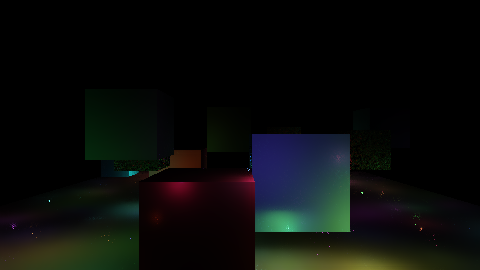
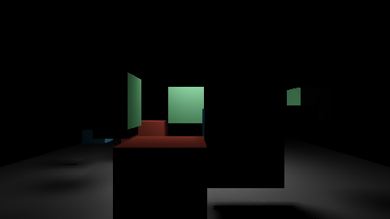

# Many lights and area lights

Hundreds to thousands of dynamic lights in one frame, lights with a surface — rect, disc, sphere and
tube — and lights a game makes for a moment. This guide is the route through
[`rendering-lighting-and-shadows`](../../openspec/specs/rendering-lighting-and-shadows/spec.md), the
modules that implement it and the suites that hold it.


*A thousand lights over a forty-metre plaza at 1920×1080, assigned on the device: 0.19 ms to assign,
0.70 ms from the end of the depth prepass to the end of the opaque pass (RTX 5060, Vulkan).*

## 1. The pieces

| Piece | Where | What it does |
|---|---|---|
| Light kinds and mobility | `src/servers/render/` (`model.h`) | `LightKind` `Rect`, `Disc`, `Sphere`, `Tube`; `LightDescription::source_width`, `source_height`, `two_sided`; `LightMobility` |
| The record and the host twins | `src/rendering/lighting/` | `build_gpu_light` packs an area light into the 64-byte `GpuLight`; `area_shading.h` shades it on the host; `many_light.h` the reservoir algebra and `LightingPathSelector`; `transient_lights.h` the pool of lights for a moment |
| The device half | `src/rendering/lights_gpu/` | `LtcTableTexture` (the LTC table), `GpuLightAssignment` (cluster lists on the device), `ManyLightsPass` (the stochastic path) |
| The shading | `src/rendering/shaders/cy/light.slang`, `frame.slang` | `shadeAreaLight`, the cluster loop, the stochastic path's resolve |
| CyberGI | `src/rendering/gi_gpu/` (`frame_lights.h`) | `append_gi_lights`: an area light as emitter squares radiating its flux |
| A game's lights | ABI 1.11, `src/game_backend/lights/`, CyberdyneKit's `Light` | spawn, move and end lights from C++ or Swift |
| The editor | `scene.create-light`, the `LightSource` component | rect, disc, sphere and tube lights, sized in metres |

## 2. Area lights

An area light's intensity is luminance, in nits (`default_unit_for` returns `Nit` for the four
kinds), and its size is in metres:

| Kind | `source_width` | `source_height` | Faces |
|---|---|---|---|
| `Rect` | width, along the transform's right axis | height, along its up axis | forward (local −Z); both with `two_sided` |
| `Disc` | diameter | — | forward; both with `two_sided` |
| `Sphere` | diameter | — | every direction |
| `Tube` | length, along the right axis | diameter | its side; the caps are dark |

```cpp
render::LightDescription panel;
panel.kind = render::LightKind::Rect;
panel.transform.translation = Vec3{0.0F, 2.8F, -3.0F};
panel.transform.rotation = Quat::look_rotation(Vec3{0.0F, -1.0F, 0.0F}, Vec3{0.0F, 0.0F, -1.0F});
panel.source_width = 1.2F;
panel.source_height = 0.4F;
panel.intensity = 4000.0F;  // nits
panel.range = 0.0F;         // derived from the brightness: where it falls to 0.01 lux
```


*A rect, a disc, a sphere and a tube light a room, with the LTC table named (`render.area_lights`
(e)).*

The diffuse term is the emitting polygon's form factor; the specular term is the LTC integral, which
needs the table. A frame names it by uploading `LtcTableTexture` once into its texture table and
calling `write_ltc_slot(slot, view)` each frame. Without the table an area light shades its diffuse
term only — never a wrong specular.

Accuracy, against a Monte-Carlo integration over the surface (`integration.render_area_lights`):
the diffuse term is within 0.001% for a rect, 0.17% for a disc, 1.8% for a sphere and 1.3% for a
tube; the specular term is 3.2% of its peak on average, 11.1% at worst. On the device, every lit
floor pixel is the host's `shade_area_light` within 0.3% (`render.area_lights` (b)).

### Mobility

`LightDescription::mobility` is `Movable` by default. A `Static` light is the bake's: the frame keeps
its index (a placeholder record) and shades nothing of it, so it costs no cluster entry and no
candidate. `Stationary` and `Movable` are shaded directly.

## 3. Many lights

### The clustered path, assigned on the device

```cpp
rendering::assembly::AssemblyDescription description;
description.device_light_assignment = true;   // the frame reads the device's lists

GpuLightAssignment assignment;
assignment.create(allocator, device, LightAssignmentDescription{grid});  // the assembly's grid
// Each frame, before the upload:
LightAssignmentFrame frame;
frame.lights = assembly.light_elements();
frame.host = &assembly.clusters();          // the decals' lists, assigned on the host
frame.tan_half_fov_y = std::tan(fov_y * 0.5F);
frame.aspect = width / height;
assignment.set_frame(frame);
upload.cluster_headers_buffer = assignment.headers();
upload.cluster_indices_buffer = assignment.indices();
upload.lights_buffer = assignment.lights();
sinks.cluster_assignment = assignment.stage();
```

Each depth slice of a tile keeps its nearest 64 lights; `assignment.statistics().overflow` counts the
ones dropped at that bound. The light records are read from a device-local copy.

### The stochastic path

When a scene has more lights reaching a pixel than a cluster keeps, or the clustered lighting costs
more than the frame arbiter grants the shading, the frame changes path: each pixel draws 16
candidates in proportion to power, resamples them into a reservoir, reuses last frame's and its
neighbours' reservoirs, traces one visibility ray for the selected light, and denoises the result.



*Four hundred coloured lights, a tenth of them area lights, shadowed by the boxes on the stochastic
path (`render.many_lights` (j)).*

```cpp
ManyLightsSettings settings;
settings.path.enabled = true;
settings.path.denoising_available = true;   // refused without
ManyLightsPass pass;
pass.create(allocator, device, ManyLightsPassDescription{width, height}, settings);
// Each frame, after the upload: pass.set_frame(ManyLightsFrame{...}); sinks.many_lights = pass.stage();

// Each frame: decide, then draw.
rendering::LightingPathInputs inputs;
inputs.local_lights = local_light_count;
inputs.lights_dropped_by_bound = assignment.statistics().overflow;
inputs.clustered_ms = measured_clustered_ms;            // negative when it did not run
inputs.allocation_ms = rendering::shading_allocation_ms(arbiter);
const auto decision = selector.update(settings.path, inputs);
assembly.set_many_lights(decision.path == rendering::LightingPath::StochasticManyLight);
```

The selector leaves the clustered path the frame a light is dropped or the budget is exceeded, and
returns only after a dwell (60 frames by default) once the clustered cost would fit with a margin.

What `render.many_lights` measures (RTX 5060, Vulkan): the estimate without reuse is within 0.16% of
the exact sum over every light; with temporal and spatial reuse within 0.66% (bound 1%); the
denoiser is `Denoiser::denoise` within 0.09%; converged, the denoised signal's relative deviation is
1.05% against 26.8% raw and it changes 0.24% frame to frame; over an open floor the two paths agree
to 3.8% in the mean.



*An area light's shadow through the stochastic path's visibility: umbra under the box, penumbra
around it (`render.many_lights` (i)).*

## 4. Lights for a moment

A muzzle flash, a spark, an explosion: `rendering::TransientLights` is a fixed pool, so spawning one
allocates nothing.

```cpp
rendering::TransientLights flashes(allocator);
flashes.reserve(256);
rendering::TransientLightDesc flash;
flash.light.kind = render::LightKind::Point;
flash.light.transform.translation = muzzle;
flash.light.intensity = 9000.0F;
flash.light.range = 6.0F;
flash.lifetime_seconds = 0.05F;
flash.fade = rendering::TransientFade::Quadratic;
(void)flashes.spawn(flash);

// Every frame:
flashes.advance(delta_seconds);
(void)flashes.append_to(frame_lights);   // the live ones, faded
```

From Swift, through ABI 1.11 (refused in `onFixedUpdate`: a resimulated tick would spawn it twice):

```swift
try Light.spawn(.point(at: muzzle, colour: Vec3(x: 1, y: 0.7, z: 0.3), candela: 9000, range: 6,
                       lifetime: 0.05))
let fireball = try Light.spawn(.sphere(at: blast, diameter: 1.5, nits: 60_000, lifetime: 0.4))
```

A host binds a pool with `game_backend::bind_lights(host, &adapter)`, advances it with the frame and
appends `adapter.append_to(lights)` to the frame's lights.

## 5. In the editor

**Scene → Create Light** and the hierarchy's create menu offer Rect, Disc, Sphere and Tube lights; an
agent calls `scene.create-light` with `kind` `rect`, `disc`, `sphere` or `tube`. The light's
`source_width`, `source_height` and `two_sided` are ordinary fields in the Inspector, undoable and
saved with the world. The editor's viewport shades them as the game does, and its GI preview takes
them as emitters. The lightmap bake does not take area lights yet: they write no `.cylightmap` line.

## 6. Testing

| Suite | Kind | What it holds |
|---|---|---|
| `unit.render_lighting` | unit | area records, the pool, the path selector, the reservoir cap |
| `integration.render_area_lights` | integration | diffuse and specular against Monte-Carlo integration |
| `unit.render_lights_gpu` | unit | the alias table, the constants, the LTC texels |
| `render.area_lights` | render | (a) off is the frame before, by day and by night; (b) device against host; (c) no table; (d) mobility; (e) the room |
| `render.many_lights` | render | (a)(b) device lists; (c) 1000 lights at 1080p; (d)–(h) the stochastic path; (i) soft shadows; (j) the picture; (k) the arbiter's choice; (l) the reach test is exact |
| `unit.render_gi_frame_lights` | unit | an area light's squares radiate its flux and light a receiver as the frame does |
| `unit.abi`, `integration.game_backend_lights`, `LightsTests` | unit / integration / Swift | ABI 1.11 |

The render suites skip loudly without a Vulkan device. Metal and D3D12 compile every shader
(`just build-shaders --strict src samples`) and were not run.

## 7. Pitfalls

- An area light's `intensity` is nits, not candela: a panel of 1000 nits a metre square emits as
  much as a 3142-lumen point light.
- A rect faces its transform's **forward** (−Z) axis. A panel on a ceiling looks down.
- `range = 0` on an area light means "derive it": the reach where its illuminance falls to 0.01 lux.
  A larger authored range costs cluster entries and lights nothing.
- The stochastic path's visibility is one screen-space ray: an occluder off screen does not shadow.

## 8. Not built yet

- Ray-traced visibility for the stochastic path.
- Area lights in the lightmap bake.
- A sample game that spawns lights through ABI 1.11.
