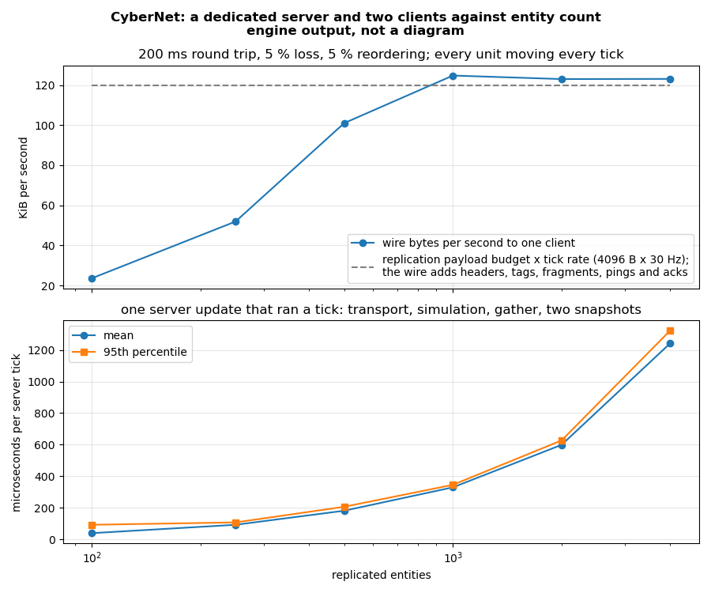

# Networking: a dedicated server and its clients

Issue #82's core: an encrypted, authenticated transport over UDP; replication from the server's
`ecs::World` into each client's; a headless dedicated-server host and a client host that run them;
and a simulated network to test them under. The contract is `networking-and-replication` in
[`openspec/specs/`](../../openspec/specs/README.md); the module is
[`src/networking/`](../../src/networking/README.md).

- [The pieces, and where they live](#the-pieces-and-where-they-live)
- [Running a dedicated server and a client](#running-a-dedicated-server-and-a-client)
- [Writing a server](#writing-a-server)
- [Writing a client](#writing-a-client)
- [Replicated components](#replicated-components)
- [Relevance, priority and the budget](#relevance-priority-and-the-budget)
- [Commands](#commands)
- [The transport](#the-transport)
- [Testing under a bad network](#testing-under-a-bad-network)
- [What it costs](#what-it-costs)
- [Pitfalls](#pitfalls)
- [What is not built](#what-is-not-built)

## The pieces, and where they live

```
 ServerHost (session.h) ── WorldReplicator (world_replication.h) ── the server's ecs::World
      │   joins, commands, the fixed tick          gather: chunk columns and change versions
      │                                            build: relevance, dirty, scheduler, snapshot
      ▼
 SecureTransport (secure_transport.h) ══ handshake, sealed packets, fragments, rate, RTT, loss ══►
      │                                                                    SecureTransport
      ▼                                                                         │
 DatagramSocket (datagram_socket.h): UdpSocket | SimulatedSocket over LocalNetwork
                                                                                ▼
                                    ClientHost (session.h) ── ReplicaWorld ── the client's ecs::World
```

| Header | What |
|---|---|
| `secure_transport.h` | `SecureTransport`, `SecureConfig`, `CredentialCheck`, `SecureCounters` |
| `datagram_socket.h` | `UdpSocket`, `SimulatedSocket`, `SocketAddress` |
| `crypto.h` | the Monocypher primitives, `system_entropy()`, `SeededEntropy` |
| `fragmentation.h`, `replay_window.h`, `congestion.h` | the transport's parts, each tested on its own |
| `world_replication.h` | `NetworkIdentity`, `schema_from_reflection()`, `WorldReplicator`, `ReplicaWorld`, `replicated_digest()` |
| `session.h` | `ServerHost`, `ClientHost`, `NetCommand`, `ServerInputLog` |
| `transport.h` | `ConnectionEvent`, `DisconnectReason`, the new `ConnectionStats` fields |

The dedicated server links `cy::networking` and nothing with a renderer, audio, interface or GPU;
Monocypher is private to the module and named by `src/crypto.cpp` alone.

## Running a dedicated server and a client

```sh
just run-net-server --units 1000 --rest-after 20
# cy_net_server: listening on UDP 27015, 1000 units at 30 Hz, budget 4096 B/tick
# cy_net_server: public key 5c0f...e1a2
# tick 30  peers 0  cpu 312 us/tick  out 0 bytes total  digest 83b4f1d2a0c95e17

just run-net-client --server 127.0.0.1:27015 --key 5c0f...e1a2 --seconds 30
# Joined       entities 1001  snapshots 29  rtt 1093 us  loss 0/1000  digest 1f0a...
```

Without `--key` the server generates its static key from the operating system's generator and prints
the public half; pass `--key <64 hex digits>` (the secret) to keep the same identity across runs. The
client steers its avatar with move commands and prints its replicated digest once a second; once the
server's world has stopped (`--rest-after`) and every snapshot has arrived it equals the server's.
Both are headless.

## Writing a server

```cpp
cy::net::UdpSocket socket(allocator);
socket.open(27015);
cy::net::SecureConfig secure;
secure.accept_connections = true;
secure.server_secret = my_static_secret;          // 32 bytes; publish public_key_for(secret)
secure.authenticate = &check_ticket;              // optional: refuse before the peer exists
cy::net::SecureTransport transport(allocator, socket, secure);

cy::net::WorldReplicator replicator(allocator, world, schemas);
replicator.initialize();                          // registers NetworkIdentity, binds schemas
replicator.replicate(entity, /*prefab=*/1, /*owner=*/cy::net::PeerId{});

cy::net::ServerHostConfig config;
config.scope = {"linux", "x86_64", build_id, schemas.identity()};
config.tick_rate_hz = 30;
config.budget.bytes_per_tick = 4096;
config.simulate = &my_simulate;                   // (user, world, tick, commands)
config.on_peer = &my_join;                        // create the player's entities, owned by the peer
cy::net::ServerHost server(allocator, transport, world, replicator, config);
for (;;) {
    server.update(now_microseconds());            // receive, admit, tick at the rate, send, flush
}
```

`ServerHost` advances the world's version before each tick, so the replicator can tell what the tick
wrote; a simulation that writes through `get_mut`, `set` or a query's `write` is seen, and one that
writes through a `const_cast` of `get` is not. Joins and leaves reach `on_peer` at the start of the
next tick, before the commands, so they are part of the same record.

## Writing a client

```cpp
cy::net::SecureConfig secure;
secure.server_public = server_public_key;
secure.credential = ticket_bytes;                 // what the server's CredentialCheck reads
cy::net::SecureTransport transport(allocator, socket, secure);
cy::net::ReplicaWorld replica(allocator, client_world, schemas);
replica.initialize();
cy::net::ClientHost client(allocator, transport, replica, {my_scope});
client.connect("203.0.113.7:27015");
for (;;) {
    client.update(now_microseconds());            // apply snapshots, acknowledge, send commands
    if (client.phase() == cy::net::ClientPhase::Joined) {
        client.submit(move_command);
    }
}
```

`phase()` goes `Connecting` → `Joining` → `Joined`, or `Refused` with `refusal()` naming why
(`Incompatible` with `SchemaSetMismatch`, say), or `Disconnected`. The client world's replicated
entities carry `NetworkIdentity`; `ReplicaWorld::entity_of(id)` finds one, and `self()` is the owner
the client's own entities carry.

## Replicated components

A component is replicated when its reflected type has a compiled schema in the session's
`SchemaSet`. Declare the fields with `Replicated(encoder, parameters, condition)`:

```cpp
struct CY_REFLECT_TYPE() Unit {
    CY_REFLECT_FIELD(Range(-2048.0, 2048.0), Replicated("quantised", "bits=20", "on-change"))
    f32 position[3];
    CY_REFLECT_FIELD(Replicated("bitfield", "bits=10", "owner-and-observers")) u16 health;
    CY_REFLECT_FIELD(Replicated("raw", "", "owner-only")) u32 orders;
    f32 phase;                                    // no Replicated: never on the wire
};
```

`schema_from_reflection(type_of<Unit>(), fields)` turns that into a `ReplicationSchema` keyed by the
fields' stable ids, so renaming a field changes nothing on the wire. Encoders: `raw`, `quantised` (a
scalar, or a vector for a three-component field; the interval is the field's own `Range`),
`quantised-vector`, `quaternion`, `bitfield`, `dictionary`. Conditions: `on-change` (the default),
`always`, `owner-only`, `except-owner`, `owner-and-observers`. `Transient` fields are never derived.
Both ends add the same schemas to their `SchemaSet`, and its `identity()` goes into the
compatibility scope, so a client with a different set is refused at the join.

Making an entity replicated adds one component, `NetworkIdentity`, and changes nothing else: a query
written without it still matches the entity.

## Relevance, priority and the budget

With no `SubjectFn` every replicated entity is relevant to every peer. Give `ReplicatorConfig` a
`SubjectFn` — it fills a `RelevanceSubject` (position, cell, team, importance) from the entity — and
call `set_interest(peer, interest, cells)` with each peer's viewpoint and interest cells; the
replicator then sends a peer only what `InterestSet` admits, and an entity that leaves a peer's
relevance is despawned on that peer. The `PriorityScheduler` orders what is dirty by ownership,
importance, recency and staleness and chooses within `BandwidthBudget::bytes_per_tick`; an update
that does not fit waits, and the scheduler's staleness bound keeps it from waiting forever. The
budget is the snapshot's own size, checked exactly as it is written: `ReplicationReport::bytes` never
exceeds it.

## Commands

A client sends intent as `NetCommand`s — the tick it was issued for, a stable command type, an
optional target network id and up to 48 payload bytes — on the reliable command channel. The server
refuses a command past `max_commands_per_tick` issued for one tick, one naming a tick earlier than the
peer's previous command, one outside `command_window_ticks`, and a malformed message, and flags the
peer (`ServerHost::peer_stats()`). What it accepts is applied at its tick, or at once when it arrived
late, in (tick, peer, arrival) order, and handed to `SimulateFn` with the target resolved to the
server's entity. Authority stays in the simulation: the demo game ignores a move whose target is not
the sender's own avatar.

`ServerInputLog` is every join, leave and applied command with the tick it was applied at. To replay
a session, build the same world and call `ServerHost::replay_step()` once per tick with that tick's
entries; the world matches the recorded one at every tick.

## The transport

The handshake is three messages and keeps no server state until the third:

| Message | Bytes | Carries |
|---|---|---|
| HELLO | 192 (padded) | protocol id, the client's ephemeral X25519 key |
| CHALLENGE | 105 | the server's ephemeral key, a cookie, a tag only the server's static key can produce |
| RESPONSE | 83 + credential | the cookie again, the credential sealed under the client-to-server key |

The server's first sealed packet accepts (`Accept`) or refuses (`Deny` with `ServerFull`,
`AuthenticationFailed`, or whatever the `CredentialCheck` returned). After it, every packet costs 29
bytes of header and tag, carries a 64-bit counter checked against the replay window before
decryption, and packs as many frames as fit the MTU (1200 by default).

| `SecureConfig` | Default | |
|---|---|---|
| `mtu` | 1200 | never below 1068, one full reliability datagram sealed |
| `handshake_timeout_ms` / `handshake_resend_ms` | 5000 / 250 | |
| `connection_timeout_ms` | 5000 | nothing authentic for this long: `Timeout` |
| `ping_interval_ms` | 100 | round trip, loss reports, keep-alive |
| `rate` | 512 KiB/s down to 16 KiB/s | the token bucket; cut by a quarter on loss over 10 % or a round trip 150 ms over its minimum |
| `unreliable_hold_ms` | 100 | an unreliable datagram the rate holds longer is discarded and counted |
| `max_message_bytes` | 259 845 | larger than a datagram is fragmented, up to 255 fragments |
| `disconnect_on_abandoned` | true | a reliable datagram out of retransmissions ends the connection |

`stats(peer)` reports the round trip, jitter, loss in each direction, the send rate, discards and
packets refused for authentication or replay; `counters()` reports what the handshake refused.
`poll_event()` reports `Connected` and `Disconnected` with the `DisconnectReason`.

## Testing under a bad network

`SimulatedSocket` puts a `SecureTransport` on a `LocalNetwork`, whose `NetworkConditions` — latency,
jitter, loss, duplication, reordering — are seeded draws, and `SeededEntropy` makes every key
reproducible, so a session replays packet for packet. `security()` then says the transport is not
fit for shipping, which is the point: a key a test can predict protects nothing. The suites:

| Suite | What |
|---|---|
| `unit.networking_core` | X25519 against RFC 7748, sealing, the replay window, fragments, the rate controller, the estimators |
| `integration.networking_session` | the secure transport under attack and under loss; replication over worlds; the hosts end to end at 200 ms, 5 % loss and reordering; determinism; refusals; the budget |
| `integration.networking_udp` | the same session on a real socket on the loopback, admitted for shipping |

`src/networking/tests/session_fixture.h` builds a server and up to four clients, each with its own
world, on one simulated network; `replicated_digest()` compares what replication can carry,
quantised fields compared quantised.

## What it costs

`just capture-net-session` runs `cy_net_session_bench` — a server and two clients at a 200 ms round
trip, 5 % loss and 5 % reordering, every unit moving every tick, 30 Hz, a 4096-byte budget — and
films `cy_net_session_trace`. Development profile, Linux x86-64:

| Entities | Wire bytes/s to one client | Snapshot bytes | Server µs per tick (mean / p95) | Converged after rest |
|---|---|---|---|---|
| 100 | 24 186 | 676 | 40 / 93 | 260 ms |
| 500 | 103 454 | 3 210 | 182 / 207 | 220 ms |
| 1000 | 127 742 | 3 998 | 330 / 346 | 525 ms |
| 4000 | 126 023 | 3 944 | 1242 / 1323 | 1555 ms |



[The video](../design/videos/net-session.mp4): the server's world and two replicas side by side, and
each client's distance from the server — about two metres behind while the units move at 12 m/s
(half a round trip), zero once they stop.

## Pitfalls

- **Advance the world's version every tick** if you drive `WorldReplicator` yourself. With one
  version for ever, every chunk looks freshly written and every entity is compared every tick —
  correct, and slower.
- **Write through `get_mut`, `set` or a query's `write`.** A write the chunk's version does not see is
  a write replication skips, because the baseline says nothing changed.
- **Do not acknowledge cumulatively.** `PeerBaseline::acknowledge()` promotes everything up to a
  snapshot; with unreliable snapshots use `acknowledge_exactly()`, as the replicator does.
- **Seeded entropy is for tests.** A `SecureTransport` over `SeededEntropy` is reported not
  encrypted for shipping; never configure one in a game.
- **A command's tick must not go backwards** for one peer: the server refuses it as forged.
- **The credential travels sealed but is the application's to verify.** The transport authenticates
  the server to the client with its key; the client to the server is whatever `CredentialCheck` does.
- **Client-side anti-cheat is out of scope.** Nothing here inspects a client's process or memory, and
  nothing should try: the server's authority over state, its validation of every command and RPC,
  and its refusal to trust a client's claims are the only real defence.

## What is not built

- Client prediction joined to reconciliation, and interpolation of remote entities: `prediction.h`'s
  parts are still separate, and a client shows the server's state as it arrives.
- The Swift API over these hosts, and declarative RPCs.
- DTLS, WebSocket and IPv6. The transport is Noise NK over Monocypher, interoperating with itself.
- A per-connection short entity id in snapshots (each record carries the 64-bit network id).
- Runs on Windows and macOS other than CI's: the Winsock and `arc4random_buf` paths are built and
  tested there, and only Linux has been run by hand.
