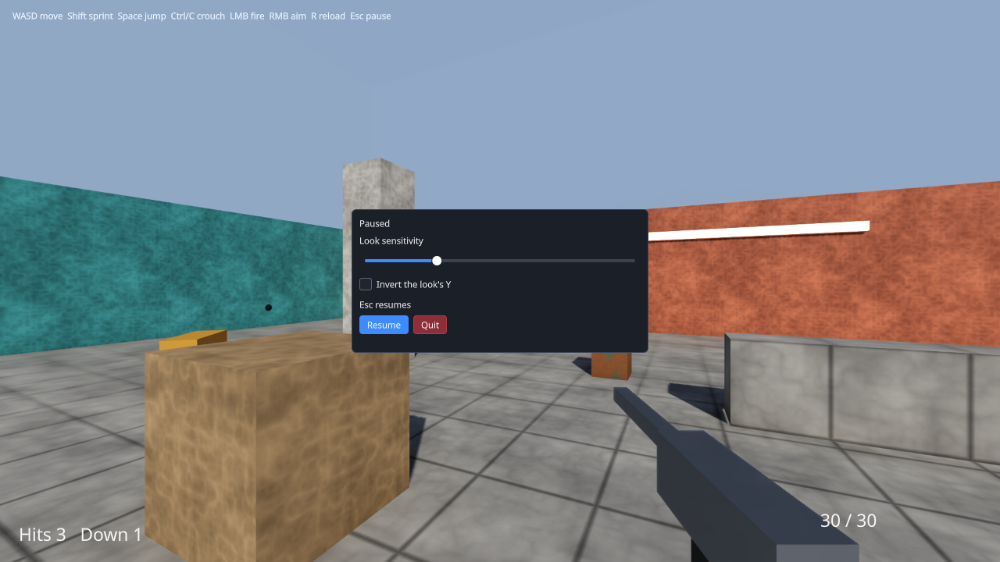

# Making a game playable

A game in this repository runs first as a scripted session — a timeline of synthetic key presses,
headless or drawn into images — because that is what a test can hold to a digest. This guide is the
other half: the same game in a window, a person at the mouse, the keyboard or a pad, through the
**desktop play host** in [`samples/play`](../../samples/play/README.md). `samples/15-first-person`
and `samples/14-third-person` are played under it (`just play-fps`, `just play-tps`); what follows
is what they did, and what a future game does.



## 1. The split

| Who | Owns |
|---|---|
| the play host (C++, `samples/play`) | the window, the platform's input into the game's input server, the real-time loop, the pause, the interface the game builds through the ABI, the swapchain |
| the game's host (C++, the sample's `host/`) | its servers and adapters, its tick and its frame, its renderer — exposed as parts, not as one `frame()` |
| the game (Swift) | every decision: what the keys mean, the look and its sensitivity, the HUD, the menu, what a shot does, when a target gets back up |

The play host decides nothing about the game, and the game's host decides nothing about play: the
loop calls it, it does not call the loop.

## 2. A host that exposes its frame's parts

A scripted host's `frame()` is already five steps; the play host needs them separately, because a
real-time frame runs zero, one or several ticks and a paused one runs none:

```cpp
class MyHost {
public:
    using Step = FrameStep;                      // seconds, interpolation, paused
    cy::Status frame() noexcept;                 // the scripted run: the five below, one tick
    cy::Status pump() noexcept;                  // the scene tree's callbacks
    cy::Status tick(cy::Nanoseconds now) noexcept;   // one fixed tick, its input stamped `now`
    cy::Status drain(cy::Nanoseconds now) noexcept;  // paused: the input resolved, no tick
    void begin_frame() noexcept;                 // InputAdapter::begin_frame
    cy::Status update(const Step& step) noexcept;    // onUpdate, presentation, the mix
    cy::input::InputServer& input() noexcept;
    CyInputPointer pointer() noexcept;
    void set_pointer_over_ui(bool over) noexcept;
    void ui_event(const CyUiEvent& event) noexcept;
};
```

`cy::play::HostedGame<MyHost, MyRenderer>` turns that into a `PlayGame`. Three rules keep the
scripted run what it was — and `integration.first_person_sample` and `third_person_sample` still
hold it byte for byte:

- **`frame()` is the parts in their old order.** One `tick` at `(tick + 1) × step`, `begin_frame`,
  `update` with a default `Step` — one step's seconds, interpolation zero, not paused.
- **A tick is counted on its own.** It was `frame + 1`; in a real-time loop it is not.
- **What presentation advances by is the frame's seconds, or nothing when paused.** Lights, effects,
  the first-person spring, the camera's smoothing and the mix all take `step.paused ? 0 : seconds`;
  the behaviours' `onUpdate` takes the seconds and reads the pause.

## 3. Drawn at the frame's own time

A frame between two ticks is drawn where things are at that moment. `CyTime::interpolation` — the
ABI has carried it since 1.3 — is how far past the last tick the frame is, and each moving thing is
carried forward from the last tick by its motion over it:

```cpp
// the host: what the frame DRAWS, not what the simulation holds
cy::Transform MyHost::drawn_prop(u32 index) const noexcept {
    const cy::Transform now = bodies_->prop(index);
    if (interpolation_ <= 0.0) {
        return now;                              // a frame on its tick: exactly the tick's
    }
    return carried_forward(before_[index], now, static_cast<f32>(interpolation_));
}
```

```swift
// the game: the first-person head, and the third-person camera's focus, the same way
let ahead = Float(now.interpolation * now.fixedDelta)
if ahead > 0 { feet = feet + state.velocity * ahead }
```

A frame that falls on its tick moves by nothing, so nothing the scripted run draws or folds into its
digest changes. Draw from the `drawn_*` accessors; fold the digest from the simulation's.

## 4. Input: the platform's, through the game's actions

The play host attaches `Sdl3InputSource` to the game's input server and assigns the keyboard, the
mouse and every pad to player one; the game's action maps resolve them. Add the played game's
bindings **after** the scripted run's, so their indices — and so the arbitration — are what they
were (`play_bindings.h`):

```cpp
cy::play::scheme_binding(*reload, cy::input::key_control(Key::R)),
cy::play::stick_binding(*move, GamepadControl::LeftStickX, GamepadControl::LeftStickY),
cy::play::scheme_binding(*fire, cy::input::gamepad_control(GamepadControl::RightTrigger)),
```

A stick is a radial dead zone, rescaled so full deflection still reads one, with an actuation just
past zero: at the default half-way threshold an eased stick loses the arbitration to idle keys.

**The mouse's look is the pointer's counts**, per frame, not an action: `Input.pointer().delta`, in
window pixels with +y down like `position`. Two things made that true here: the input adapter
converted the input layer's +y-up `MoveY` into the ABI's +y-down delta (a real mouse pushed away read
as a pull before), and it now observes the events still waiting for a tick when a frame begins (a
frame that ran no tick published no motion, and a fast display juddered). The play host holds the
mouse — relative mode, raw counts — exactly while the game runs and the window has the focus.

**Rebinding** is a text file read into the input user's profile at start:

```
player.jump       keyboard/f
weapon.fire       gamepad/rightTrigger
```

A slot is the action's own: the first binding of jump is slot 0 whatever is bound before it.

## 5. The pause and the menu

Esc, a pad's Start, or the window losing the focus pauses: no tick runs, presentation stands still,
the mouse is released, and `Time.now.isPaused` is true. The game shows its menu then — CyberdyneKit's
`PauseMenu` is one — and applies what the player sets where it applies its look, once:

```swift
menu = try? PauseMenu(for: self, title: "Paused") { [unowned self] settings in
    lookSettings.lookSensitivity = FirstPersonSettings().lookSensitivity * settings.lookSensitivity
    lookSettings.invertY = settings.invertY
    try? eye?.configure(lookSettings)            // the camera's one sensitivity
}
// onUpdate
try menu?.update(paused: Time.now.isPaused)
```

`try?`, because a scripted run has no interface and refuses it. The play host reads two widget ids
and nothing else: a click on `play-resume` resumes, on `play-quit` ends the run. Only the player
resumes; a window getting its focus back stays paused with the menu up.

The HUD is the game's too — ABI 1.6 elements under `UI.root()`: the first-person crosshair, hit
marker, magazine and score are `game/Hud.swift`.

## 6. The picture

The play host makes the Vulkan device; the game's renderer draws on it, at its own extent, and leaves
its output sampled for the presenter:

```cpp
graph.add_pass("hand off", rhi::QueueKind::Graphics)
    .read(output, rhi::Access::FragmentSampledRead)
    .side_effect();
```

The presenter scales it into the swapchain image inside a letterbox, draws the interface over it at
the window's own resolution, and presents. A resize rebuilds the swapchain and the interface
renderer, never the game's frame. (The Vulkan device's resize destroyed the swapchain and created
another under a handle it never returned; the presenter's next frame failed. It is rebuilt in place
now, and `smoke.first_person_play` resizes the window twice.)

## 7. Testing a played game

Nothing calls the game. A test writes the hands down — `play/*.input` — and the play host pushes them
through `Sdl3EventInjector` onto SDL's own queue, so they take the path a person's take:

```
10 mouse move 200 0          # counts, window pixels, +y down
20 key w down
30 focus lost
40 pad attach                # SDL's virtual joystick
41 pad axis leftStickY 1
50 mouse to 491 416          # the menu's Resume
51 mouse left down
```

`--headless` runs it under SDL's dummy video driver with no device, which is how
`integration.first_person_play` and `integration.third_person_play` run in CI; `--fixed-clock` makes
every frame one tick, so the run is reproducible frame for frame. `smoke.*_play` draw the same hands
in a window and hold the game to the headless run's, the frames to no validation error, and a 1080p
frame's work to 16.7 ms.

## 8. Pitfalls

- **Lay out what `onUpdate` wrote before flattening.** A menu shown this frame has no rect until a
  layout runs; flattened first, it is drawn at the origin for a frame (`PlayUi::settle`).
- **Close the pads before detaching a virtual joystick.** SDL frees the device on detach; a gamepad
  still open on it is then closed through freed memory.
- **A resize can land between a frame's events and its present.** The window manager resizes the
  window asynchronously, so the present finds the swapchain out of date. The presenter follows the
  window and draws the frame again into the new swapchain, once — dropping it instead lost a frame
  per resize, which `smoke.first_person_play`'s resize case caught (149 of 151 presented).
- **A real desktop changes focus under a film.** Captures and timed tests pass `--no-focus-pause`.
- **The toolkit's widgets belong under the screen's root.** Started with its own root, a document's
  anchors were a zero-sized parent's and the menu sat in the corner.

## 9. Not built yet

- Metal and D3D12 compile the present shader; the play host makes a Vulkan surface only, and it ran
  on Linux with an RTX 5060.
- No audio device: a played game mixes into the null backend.
- The menu's settings and a rebinding last as long as the run.
