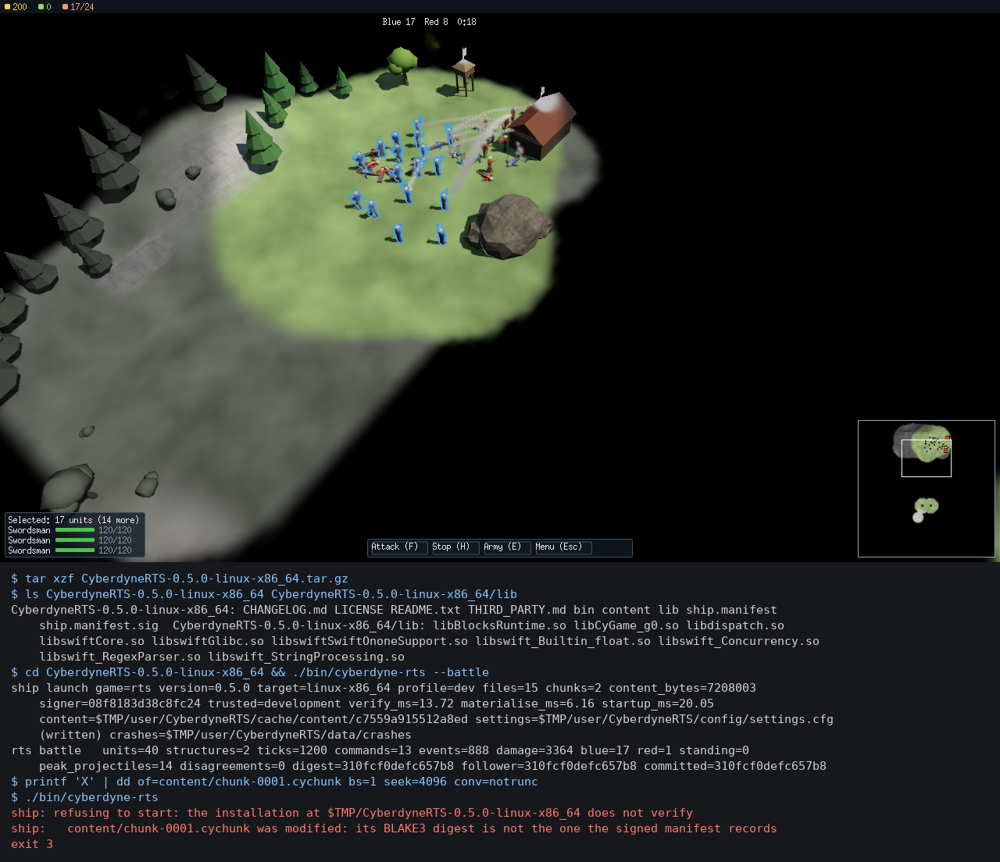

# Shipping a game

How a game that plays in a window becomes an artefact you can hand to someone: one recipe per game
and desktop target, cooked content cut into chunks, a signed manifest the game checks before it
starts, the Swift runtime carried with it, its settings and crash reports in the player's own
directories, and continuous integration uploading all of it. Issue #87, the packaging half of M11.e.

**Governed by**: [`build-and-packaging`](../../openspec/specs/build-and-packaging/spec.md) —
"Manifest integrity and content protection" — and
[`build-system-and-platforms`](../../openspec/specs/build-system-and-platforms/spec.md) —
"Distribution artefacts". The reference for every part is
[`tools/ship/README.md`](../../tools/ship/README.md); the change is
[`add-shipping-packages`](../../openspec/changes/add-shipping-packages/proposal.md).



*The RTS artefact unpacked into an empty temporary directory and played there by
`samples/13-rts-api/play/skirmish.input`, frame 1200 at 1280x720. Below, the commands run on that
directory: the scripted battle from the artefact ends in the build tree's digest (`310fcf0defc657b8`),
then one byte of the second content chunk is overwritten and the game refuses to start, naming the
chunk. `$TMP` is the temporary directory. The played session is
[`docs/design/videos/ship-rts-packaged.mp4`](../design/videos/ship-rts-packaged.mp4).*

## Packaging

```
just package rts linux                 the RTS from the release profile, dist/packages/
just package fps host --profile dev    the first-person game from the tree you already built
just package all host                  every game this tree built: rts, fps, tps and ship
just release-games                     every game, release profile only, dist/releases/<version>/games
just package-test                      smoke.ship_games: each artefact launched from a clean directory
```

`<game>` is `rts` (samples/13-rts-api), `fps` (samples/15-first-person), `tps`
(samples/14-third-person), `ship` (samples/11-ship's card) or `all`. `<target>` is `linux`,
`windows`, `macos` or `host`. **A target is packaged on its own operating system**: the binaries
come from the build tree that host made, and `just package rts macos` on Linux is refused by name
rather than writing Linux binaries into a `.app`.

What each target's artefact holds:

| Target | Artefact | Layout |
|---|---|---|
| Linux | `CyberdyneRTS-0.5.0-linux-x86_64.tar.gz` and `...-symbols.tar.gz` | `bin/` (stripped), `lib/` (the Swift module, `RUNPATH $ORIGIN`), `content/`, the manifest |
| Windows | `CyberdyneRTS-0.5.0-windows-x86_64.zip` | `bin/` with the executable and its DLLs, `content/`, the manifest |
| macOS | `CyberdyneRTS-0.5.0-macos-arm64.zip` | `CyberdyneRTS.app`, ad-hoc signed; the manifest and the chunks in `Contents/Resources/` |

Every artefact carries `README.txt` (how to run it, what it needs from the machine), `LICENSE`,
`THIRD_PARTY.md`, and a `CHANGELOG.md` written by `tools/release/release.py changelog` — the same
function `just release-changelog` runs — for the engine version in `CMakeLists.txt`.

### Linux and the Vulkan loader

The artefact carries everything the game loads except the graphics stack: the executable links SDL3
statically and finds Vulkan at run time through `volk`, which opens the system loader
(`libvulkan.so.1`, package `libvulkan1`) and, through it, the GPU driver's ICD. Neither is carried,
and neither can be: the ICD belongs to the driver. `vulkaninfo --summary` says whether a machine
has both. Without them the game says so and plays headless.

The Swift module needs the Swift runtime. **A release-profile module carries it inside**: in the
Shipping configuration on Linux, `bindings/swift/tools/cy_swift_module.py --static-stdlib` links
`libswiftCore` and the rest into `libCyGame_g0.so` (issue #81's shipping static link), so nothing
else goes in `lib/`. A development module loads the toolchain's runtime dynamically; the packager
then copies those libraries beside it and points the module at them with `patchelf --set-rpath
'$ORIGIN'`, which is why packaging a development build needs `patchelf`. A static runtime is for
shipping only — two modules each carrying a runtime cannot share one process, and hot reload loads
a generation per edit.

No AppImage is produced: `appimagetool` is not part of this toolchain, and the tarball already runs
from wherever it is unpacked.

### Windows

The Windows leg of continuous integration has no Swift toolchain (`swift-actions/setup-swift` fails
on the runner's Node runtime — the note above the `build` matrix in `.github/workflows/ci.yml`), so
on Windows only `samples/11-ship`'s card is packaged. The recipe packages a Windows game the moment
the tree has its Swift module.

### macOS, codesign and notarization

The bundle is signed **ad hoc** (`codesign --sign -`), which is enough to run on the machine that
built it and on any Mac where the user allows it from the context menu. The order matters, and it
is the reason the main executable is `sealed` in the manifest rather than hashed:

1. the Swift module in `Contents/Frameworks/` is signed first, so the bytes the manifest pins are
   the signed bytes;
2. `cy_ship pack` writes and signs the manifest in `Contents/Resources/`;
3. the bundle is signed last — which seals `Resources/`, manifest included, and rewrites the main
   executable's signature, so that one file's integrity is the bundle seal's to check, not ours;
4. `codesign --verify --deep --strict` must pass, and the bundle is zipped with `ditto`.

**Notarization needs credentials this project does not hold**: an Apple Developer ID Application
certificate and an App Store Connect API key. With them, the steps are:

```
codesign --force --options runtime --timestamp --sign "Developer ID Application: <team>" \
    CyberdyneRTS.app/Contents/Frameworks/libCyGame_g0.so
cy_ship pack ... (as package.py does)
codesign --force --options runtime --timestamp --sign "Developer ID Application: <team>" CyberdyneRTS.app
ditto -c -k --keepParent CyberdyneRTS.app CyberdyneRTS.zip
xcrun notarytool submit CyberdyneRTS.zip --key <AuthKey.p8> --key-id <id> --issuer <issuer> --wait
xcrun stapler staple CyberdyneRTS.app
```

Nothing here runs on the macOS leg yet beyond the ad-hoc path; the macOS artefacts are built in CI
and were not run on a Mac by the change that added them.

## The signed manifest

`ship.manifest` is one text file a person can read:

```
cyship 1
game rts
title CyberdyneEngine RTS
version 0.5.0
revision 28edcceb774a9829920764d53d063d23b69e8d79
target linux-x86_64
profile dev
signer 08f8183d38c8fc24
chunk-bytes 4194304
content-bytes 7208003
chunk 4194304 2a998fd5…  content/chunk-0000.cychunk
chunk 3013699 557550ab…  content/chunk-0001.cychunk
file 11228552 …          bin/cyberdyne-rts
file 5086552 …           lib/libCyGame_g0.so
...
entry 0 7207068 …        frontier.cypak
entry 7207068 935 …      module.toml
```

**The cooked content is one stream cut into chunks.** Every content file — the RTS's
`frontier.cypak`, the third-person hillside and its streamed wind, the first-person arena's
textures, the game module's manifest, samples/11-ship's whole `cy_build` installation — is
concatenated in name order and cut every 4 MiB; an `entry` names a file by its offset and size in
that stream and pins its own digest, and a `chunk` pins each slice. A modified chunk therefore
names a narrow slice of the content, and the chunk files are the unit a patch would replace.

**Every file of the artefact is listed** — chunks, binaries, libraries, documents — by size and
BLAKE3 digest, and the manifest is signed by `ship.manifest.sig`, an Ed25519 (RFC 8032) signature
over its exact bytes. The signature comes from Monocypher, an audited single-file library
(`deps/manifest.toml`); `tools/ship/src/signature.cpp` is the only translation unit that names it,
and `integration.ship_manifest` holds it to RFC 8032's own test vectors, so any Ed25519
implementation can check what it signs.

### Keys

A build trusts exactly one public key, compiled in:

| | |
|---|---|
| By default | **the development key**, whose seed is the BLAKE3 digest of a published sentence. Anyone can sign with it; it exists so a checkout packages and launches with no key handling. Every launch says `trusted=development`. |
| A release key | `cy_ship keygen --out release.key` writes a new secret (32 random bytes from the operating system) and prints its public half. Configure the build with `-D CY_SHIP_PUBLIC_KEY=<that hex>`; it then refuses content the development key signed. |
| Signing | `just package ... --key release.key`, or the secret's hex in `CY_SHIP_SIGNING_KEY` — how a CI secret reaches the packager without being written to disk. |

Keep the secret out of the repository and out of build logs; rotate it by configuring a new public
key, which makes every artefact signed by the old one refuse to start under the new build.

## What a packaged game does at startup

Every game's `main()` begins with `cy::ship::start` (`tools/ship/include/cy/ship/launch.h`). Out of
a build tree it finds no manifest beside the executable and changes nothing. From an installation:

1. **The signature, first and alone.** A manifest whose signature does not hold, or that a key this
   build does not trust signed, is not read for anything else.
2. **Every file.** Present, the size the manifest says, the digest it says — and every file present
   that the manifest does NOT list, so a library dropped beside the executable is refused rather
   than loaded. Every problem is collected and printed by name, and the game exits 3:

   ```
   ship: refusing to start: the installation at /opt/CyberdyneRTS-0.5.0-linux-x86_64 does not verify
   ship:   content/chunk-0001.cychunk was modified: its BLAKE3 digest is not the one the signed manifest records
   ship:   lib/libinjected.so is not listed: the signed manifest does not list it
   ```

3. **The content, materialised.** The games read cooked packages by path, so the entries are cut
   back out of the verified chunks into `<user cache>/content/<manifest digest>/` on the first
   launch; every later launch re-verifies those files by digest and rewrites only what does not
   match. A cached file is never trusted because it exists.
4. **Crash reports** go to `<user data>/crashes/` through the engine's crash handler
   (`cy/core/diagnostics/crash.h`), stamped with the game, version, target and revision.
5. **The settings file**, `<user config>/settings.cfg`, is read — or written with every default
   and a line saying what each does. Settings become the game's own flags ahead of the player's
   arguments, so a flag typed on the command line wins; a value the game cannot take is a warning,
   never a refusal.

   | Game | Settings |
   |---|---|
   | RTS | `vsync = on`, `width = 1920` (the height follows at 16:9), `validation = off` |
   | first- and third-person | `window = 1280x720`, `fullscreen = off`, `vsync = on` |

6. **No arguments — a double-click — plays.** The RTS and the first- and third-person games start
   with `--play`; samples/11-ship's card opens its window.

The user directories are the SDL3 platform's: `~/.local/share/CyberdyneEngine/<Game>/` on Linux,
`%APPDATA%\CyberdyneEngine\<Game>\` on Windows, `~/Library/Application Support/CyberdyneEngine/<Game>/`
on macOS, each with `config/` and `cache/` under it — or `$CY_SHIP_USER_DIR/<Game>/` when that is
set. The installation itself is never written to.

One line reports it all:

```
ship launch game=rts version=0.5.0 target=linux-x86_64 profile=dev files=15 chunks=2
    content_bytes=7208003 signer=08f8183d38c8fc24 trusted=development verify_ms=13.72
    materialise_ms=6.16 startup_ms=20.05 content=... settings=... crashes=...
```

A build configured with `-D CY_SHIP_REQUIRE_INSTALLATION=ON` refuses to start anywhere but a
verified installation.

## Shipping builds

The release profile is the default for `just package` because it is what ships: the Shipping
configuration, link-time optimisation, assertions off, no `CY_DEVELOPMENT`, no Slang compiler
(`CY_SHADER_SLANG` is off in Shipping, which `shader-system` requires), and the editor is a separate
Rust application no game links. `just release-games` refuses any other profile, and refuses an executable whose symbols show
the editor's backend (`cy::editor…`) or the Slang compiler (`slang::`) linked into it — the release
RTS and first-person game carry neither; every manifest's `profile` line says which profile an
artefact came from. Continuous integration packages the dev
profile, because it reuses the tree each leg already built rather than building a second one.

## Continuous integration

The `package` job runs `just package all host --profile dev` on linux-x86_64, macos-arm64 and
windows-x86_64 from the tree each leg's `build` job packed, and uploads `games-<label>` — the
artefacts, their SHA-256 sums and the Linux symbols — for fourteen days. `smoke.ship_games`, which
the `test` job runs, unpacks each artefact into a clean temporary directory and launches it there.

## Measured

Linux x86_64, GCC 13, RTX 5060. Sizes are the compressed artefact and, in brackets, unpacked.
`startup_ms` runs from the start of `cy::ship::start` to the moment it hands the game its arguments —
the signature, every file hashed, the content materialised, the settings read; the first launch
writes the content cache, later launches re-verify it. Medians of five later launches.

| Game | Release artefact | Release startup, first / later | Development artefact | Development startup, first / later |
|---|---|---|---|---|
| RTS | 14.1 MB (26 MB) | 20.3 / 10.7 ms | 17.2 MB | 24.7 / 16.8 ms |
| third person | 15.5 MB (28 MB) | 18.1 / 11.7 ms | 18.8 MB | 22.5 / 17.0 ms |
| first person | 8.4 MB (21 MB) | 12.3 / 7.9 ms | 11.4 MB | 13.4 / 13.5 ms |
| samples/11-ship | 1.7 MB (3.9 MB) | 2.5 / 2.2 ms | 1.6 MB | 3.0 / 2.7 ms |

Content: the RTS 7.2 MB in 2 chunks, the third-person game 7.0 MB in 2, the first-person game
0.2 MB in 1, the card 6 KB in 1. The release artefacts hold six files and the content chunks — the
Swift runtime is inside the module — where a development artefact also carries ten Swift runtime
libraries. Most of the startup is hashing every file: 26 MB for the release RTS.

## Testing

| Suite | What it proves |
|---|---|
| `integration.ship_manifest` | RFC 8032 vectors; a signature holds only for its bytes and its key; the manifest round-trips and refuses a path outside the artefact, a repeated path and chunks that do not tile the stream; every file listed; entries read back across chunk boundaries; a tampered or short chunk, a missing file, an unlisted file, an edited manifest and an untrusted key each refused by name; a cached file re-verified by digest; a launch from a build tree unchanged; a packaged launch verifying, materialising and applying its settings; a tampered or planted installation not starting; a bad setting a warning |
| `smoke.ship_games` | `--require-shipping`'s symbol check refuses `cy_shaderc`, which links Slang; each game this tree built, packaged and unpacked into a clean temporary directory: its scripted run ends in the build tree's digests; played headless it writes its settings file and takes every flag the settings become; under `strace` it opens nothing in the checkout (the first-person game also draws twenty frames, the only time it reads its textures); the archive holds exactly what the manifest lists; a flipped chunk byte, a deleted chunk and a planted library each refuse the launch by name; `--ship-crash` leaves a report naming SIGSEGV |

Both were watched going red under sixteen mutations — the signature not checked, any key accepted,
a digest or a size not compared, unlisted files not looked for, a missing file skipped, an entry
losing a byte at a chunk boundary, a path allowed to climb, a cached file trusted by its size, a
launch ignoring its verification, the settings after the player's arguments, a setting becoming a
flag the game does not take, the RTS loading its module and the first-person game its textures from
the build tree:
[`evidence/falsification.txt`](../../openspec/changes/add-shipping-packages/evidence/falsification.txt).

## Pitfalls

- **Packaging one target on another.** Refused: the binaries are the host's.
- **A development build without `patchelf`.** Its module loads the toolchain's Swift runtime, and
  the packager needs `patchelf` to point it at the copies; a release build needs neither.
- **Writing into the installation.** A game that saved anything beside its executable would fail
  its own next launch as an unlisted file. Everything a game writes goes to the user directories.
- **The development key in a release.** `trusted=development` on the launch line means anyone could
  have signed what the game loaded. Configure `CY_SHIP_PUBLIC_KEY` for a release.

## What is not built yet

- Notarization (credentials), an AppImage (`appimagetool`), and Windows games (no Swift on the
  Windows leg).
- Mach-O and PE/PDB symbol splitting: only the Linux artefact is stripped with its symbols archived.
- Encrypted content, and signature checks for content delivered after installation — downloadable
  content and patches carry their own manifests in `tools/build/` and are not signed yet.
- A run of the macOS and Windows artefacts by a person: CI builds them (`package`) and
  `smoke.ship_games` launches them headless on each leg that tests; the change that added them ran
  them by hand only on Linux.
