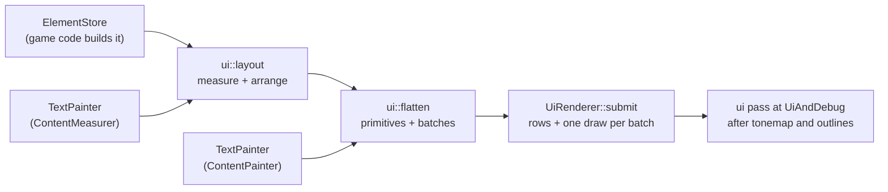
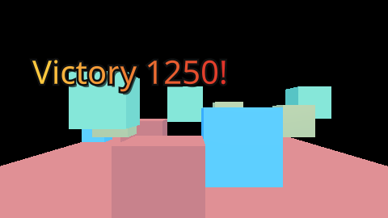
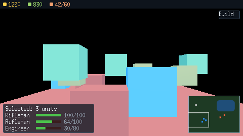
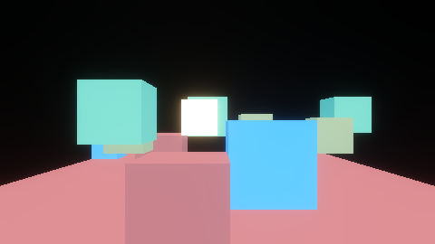

# Runtime UI in CyberEngine

How a game puts an interface on screen with CyberUI: build elements in the store, lay them out,
attach text, flatten them, and hand the stream to the interface pass. The route goes through
[`src/ui/README.md`](../../src/ui/README.md) and
[`src/ui/render/README.md`](../../src/ui/render/README.md); the contract is
[`ui-system`](../../openspec/specs/ui-system/spec.md).


*`samples/13-rts-selection`: the squad the drag box caught listed bottom-left, resources across the
top, the minimap with the camera's rectangle bottom-right, and the developer console — all one
`ElementStore`, one `flatten()` and one pass.*

## Contents

1. [The pieces](#1-the-pieces)
2. [Building an interface](#2-building-an-interface)
3. [Text](#3-text)
4. [Drawing it](#4-drawing-it)
5. [The developer console](#5-the-developer-console)
6. [A HUD from game code](#6-a-hud-from-game-code)
7. [The widget toolkit](#7-the-widget-toolkit)
8. [Documents, style sheets and hot reload](#8-documents-style-sheets-and-hot-reload)
9. [Bindings and animation](#9-bindings-and-animation)
10. [Input, focus and navigation](#10-input-focus-and-navigation)
11. [Opacity groups and the HDR composite](#11-opacity-groups-and-the-hdr-composite)
12. [The toolkit from Swift](#12-the-toolkit-from-swift)
13. [Testing](#13-testing)
14. [Not built yet](#14-not-built-yet)

---

## 1. The pieces

| Target | Directory | What it does | Names a device? |
|---|---|---|---|
| `cy::ui` | `src/ui/` | the element store, layout, `.cyss`, input routing, flattening to primitives | no |
| `cy::ui-text` | `src/ui/text/` | `TextPainter`: an element's text measured and painted as glyph primitives; the interface font (with `CY_TEXT`) and the built-in fallback font | no |
| `cy::ui-console` | `src/ui/console/` | `DevConsole`, the developer console | no |
| `cy::ui-toolkit` | `src/ui/toolkit/` | `Toolkit`: the widgets, their focus, styles, animations and bindings; `.cyui` documents and their hot reload | no |
| `cy::ui-input` | `src/ui/input/` | `UiInputBridge`: the `UI.*` input actions driving the toolkit, and gameplay suppressed while it holds the input | no |
| `cy::ui-render` | `src/ui/render/` | `UiRenderer`: the stream drawn at the frame's `UiAndDebug` stage, opacity groups offscreen, and an HDR composite before the tone curve | yes |

All six are behind `CY_UI`. Elements are not entities: `cy::ui` does not link `cy::ecs`.



## 2. Building an interface

An element is created in a parent, given a layout input and paint data, and flagged. Colours are
**premultiplied ARGB** (`0xAARRGGBB`).

```cpp
ui::ElementStore store(allocator);
auto root = store.create(ui::kNoElement, Name::intern("hud"));
store.layout_input(*root)->model = ui::LayoutModel::Absolute;   // children placed by anchors

auto panel = store.create(*root, Name::intern("panel"));
ui::LayoutInput& input = *store.layout_input(*panel);
input.anchor_min = input.anchor_max = Vec2{1.0F, 1.0F};          // bottom-right corner
input.offset_min = Vec2{-108.0F, -80.0F};
input.offset_max = Vec2{-6.0F, -6.0F};
ui::PaintData& paint = *store.paint(*panel);
paint.background = 0xFF1E3A24U;
paint.border_width = 1.0F;
paint.border_colour = 0xFF8FA3B5U;
paint.corner_radius = 3.0F;
(void)store.set_flags(*panel, ui::ElementFlags::Visible | ui::ElementFlags::ClipsChildren);
```

What the paint data means on screen:

| Field | Effect |
|---|---|
| `background` | the fill. Zero, with no border, means the element draws nothing — a layout container — and puts no primitive in the stream |
| `border_width`, `border_colour` | a border inside the bounds |
| `corner_radius` | rounds the fill, the border and an image alike |
| `opacity` | multiplies down the tree into every colour beneath |
| `material`, `atlas`, `uv` | `BuiltinMaterial::Image` samples an atlas page; `Glyph` is what text uses |
| `ElementFlags::ClipsChildren` | children are clipped to this element, intersected with every clip above |

When game state changes, write the input and mark what changed: a new colour or text of the same
size is `Dirty::Paint`; a size change is `Dirty::Measure`; a move is `Dirty::Arrange`.

## 3. Text

With the complete text backend (`CY_TEXT`, the default) CyberUI draws its text in the **interface
font** — Noto Sans, Latin, as a multi-channel distance field — through FreeType, HarfBuzz and
msdfgen (issue #86, [the text guide](text.md)):

```cpp
cy::text::CompleteTextBackend backend;          // src/backends/text-complete/; outlives the server
(void)backend.start();
cy::text::TextServer server;
(void)server.start_with(cy::text::TextServerConfig{}, backend);
ui::TextPainter text(allocator);
(void)text.start(server, cy::text::FontSource{ui::interface_font_bytes()},
                 ui::interface_font_desc(), /*first atlas page*/ 1);

auto label = store.create(*root, Name::intern("label"));
ui::TextStyle style;
style.colour = 0xFFFFD34DU;
style.size = 18.0F;                             // reference units; zero is the painter's line height
style.outline_width = 1.5F;                     // from the distance field, not eight copies
style.outline_colour = 0xFF101010U;
style.shadow_colour = 0x80000000U;
style.shadow_offset = Vec2{2.0F, 2.0F};
(void)text.set_text(*label, "Gold 1250", style);
```

A label with no preferred size is measured by the painter (pass `&text` to `ui::layout`); its glyphs
are painted after its background and before its children (pass `&text` to `ui::flatten`). A style
with no `size` draws a line exactly as tall as the built-in font's — 13 units times `pixel_scale` —
so a layout written in rows of that font keeps every row. A line in one face is one batch: the
shadow pass and the glyphs share the distance-field page and the `GlyphField` material.
`set_colours` gives ranges of a label their own colour; `gradient_colour` blends across the line.



**The built-in font stays as the fallback.** It is the X Window System's public-domain `misc-fixed`
6x13, printable ASCII, compiled in as data (`src/ui/text/src/builtin_font_data.h`, generated by
`src/ui/text/tools/make_builtin_font.py`; provenance in `deps/shipped-content.md`). It is the last
face of the interface font's chain, and with `CY_TEXT` off it is the whole of the interface's text,
started exactly as before:

```cpp
(void)server.start(cy::text::TextServerConfig{});
(void)text.start(server, ui::builtin_font(), /*atlas page*/ 1);
```

Draw it at whole-number `pixel_scale`s; it is point-sampled. The suites that pin a golden image
drawn before #86 (`render.ui` (a)–(g), `render.rts_api_hud`) start on it explicitly.

## 4. Drawing it

```cpp
ui::render::UiRenderer renderer(allocator);
(void)renderer.create(device, {width, height, output_format});
// outside a frame, after the labels are set: the text's pages (coverage, distance field, colour —
// cy/ui/render/text_atlas.h), again whenever text.atlas_revision() changes; and any image pages
(void)ui::render::upload_text_atlases(renderer, text);

// every frame, before the frame is assembled:
ui::LayoutReport laid;
(void)ui::layout(store, scale_settings, viewport, &text, laid);
ui::FlattenReport flattened;
(void)ui::flatten(store, ui::Rect{0, 0, viewport.x, viewport.y}, buffer, flattened, &text);
(void)renderer.submit(buffer, ui::resolve_scale(scale_settings, viewport));
sinks.ui = renderer.stage();          // rendering::assembly::FrameSinks
```

The pass runs after tonemapping, bloom, grading and the selection outlines, so a colour is the
output's bytes. With nothing to draw it records nothing and the frame is byte-identical to a frame
without it. `renderer.report()` says how many indirect draws it recorded — one per batch `flatten()`
made — and how many batches a clip emptied.

## 5. The developer console

```cpp
ui::DevConsole console(allocator);
ui::ConsoleStyle style;                      // anchors, rows shown, history, colours
(void)console.create(store, text, *root, style);
(void)console.add_command("spawn", &spawn, &game);
(void)console.type("spawn tank");            // from text input
(void)console.submit();                      // echoes, runs, prints the reply
(void)console.print("ready", ui::kConsoleWarning);
```

`help`, `clear` and `echo` are built in. The scrollback is a ring held by the console; the store
holds exactly `visible_rows` row elements whatever has been printed, and a print repaints them
without a relayout. `set_open(false)` collapses the panel out of layout and the stream.

## 6. A HUD from game code

`samples/13-rts-selection/hud.h` is a strategy HUD written as game code over the same calls:
`set_resources`, `set_selection` (one row per selected unit with a health bar) and `set_minimap`
(unit dots and the camera's rectangle, clipped by the minimap). The sample selects a squad with a
drag box, writes the selection into the HUD, and photographs the frame:

```
build/dev/samples/13-rts-selection/cy_sample_rts_selection --out docs/design/images
```

| The frame | With the HUD and the console |
|---|---|
|  |  |

### The same HUD from Swift

ABI 1.6 lets a scripting module build in the same store. `samples/13-rts-api/game/Hud.swift` is this
HUD rewritten in Swift with CyberdyneKit's declarative layer — panel for panel, colour for colour —
plus a Build button, and the RTS game there writes it from its own state every frame:

```swift
hud = try mountUI {
    Panel("resource-bar") {
        Label("0", colour: gold, name: "gold").id("gold")
        …
    }
    .layout(.anchored(min: Vec2(x: 0, y: 0), max: Vec2(x: 1, y: 0), offsetMax: Vec2(x: 0, y: 17))
                .flex(.row, gap: 4, align: .centre, padding: UIInsets(horizontal: 6, vertical: 2)))
    .style(UIStyle(background: panel))
    Button("Build", colour: text, name: "build-button") { _ in onBuild() }
}
try hud["gold"].setText("\(gold)", colour: gold)
```



*`render.rts_api_hud`: the HUD a Swift behaviour built through the ABI, over the pipeline suites'
scene. Without the button it is the C++ HUD's frame byte for byte.*

The host side is three calls on `cy::game_backend::UiAdapter` (`cy::game-backend-ui`), which
implements the ABI's `UiBackend` over the store, a `TextPainter` and an `Interaction` it owns:

```cpp
cy::game_backend::UiAdapter ui(allocator, store, text, root);
(void)ui.start();                              // the root transparent to hits, a HUD layer
cy::game_backend::bind(host, &ui);             // every ui_* entry now answers
// every frame, before the behaviours' frame update:
(void)ui.layout(scale_settings, viewport);
(void)ui.route_pointer(position, buttons_pressed, buttons_released);
input_adapter.set_pointer_focus(0, true, ui.pointer_over());
ui.drain_events([&](const CyUiEvent& event) noexcept { (void)runtime.ui_event(event); });
```

Deliver through `drain_events`, not a loop over `events()`: a receiver that moves focus or destroys
what it clicked queues a BLUR and a FOCUS while the batch is delivered, and `drain_events` keeps
those for the next frame instead of walking an array that is growing under it and clearing them.

A module reaches the root and its own elements only; the console beside them in the same store
answers `NOT_FOUND`. A press and a release of the left button over one button is a click, delivered
to the behaviours of the entity that owns it. The Swift side is in [the Swift guide](swift.md#the-interface-abi-16).

## 7. The widget toolkit

`cy::ui::Toolkit` is a retained widget tree on the same store: a widget is a handful of elements —
a slider is a track, a fill and a thumb — with a record saying what they are, so everything above
(layout, `.cyss`, flattening, the renderer) draws it with no new path. A widget's handle is its
root element (`WidgetId`).


*`render.ui_toolkit` (d): `src/ui/toolkit/tests/data/gallery.cyui` at 1920×1080, twice the
reference resolution, in the interface font — buttons, a toggle, checkboxes, a radio group, a
slider with the gamepad's focus ring, a progress bar, text fields, a drop-down, tabs over a
virtualised list, an image with a rich-text caption and a scroll view. Held to a golden image.*

| Kind | What it is | Events |
|---|---|---|
| `panel`, `row`, `column`, `grid`, `stack` | containers: anchors and offsets, flex, cells, layers | — |
| `scroll-view` | a clipped viewport, scrolled by the wheel, `UI.ScrollUp`/`Down` and by focus | — |
| `label`, `rich-text`, `image` | text; text in runs (`[color=#rrggbb]`, `[size=N]`, `[img=page,u,v,w,h]`); an atlas region | — |
| `button` | pressed and released over it, or Accept with focus | Clicked |
| `toggle`, `checkbox` | on or off | Changed (value 0 or 1) |
| `radio-group` | one of its `items`, each a `radio` | Changed (index) |
| `slider`, `progress-bar` | a value in a range, by a step | Changed (value) |
| `text-field` | one line: caret, selection, composition (IME), undo, clipboard, a mask, a length limit | Changed, Submitted |
| `dropdown` | one of its `items`, picked from a list over the interface | Opened, Changed, Closed |
| `list-view` | items from a `ListSource`, **virtualised**: only the rows in view exist | Changed, Submitted |
| `tabs` | a bar over its pages; each child is a page titled by its `title` | Changed |
| `dialog` | modal, over a dimmed backdrop, in a layer of its own; focus returns where it was | Opened, Closed |

```cpp
ui::Toolkit toolkit(allocator, store, text);
(void)toolkit.start();                               // a root of its own, and the overlay above it

ui::WidgetDesc desc;
desc.kind = ui::WidgetKind::Slider;
desc.id = "volume";
desc.minimum = 0.0F;
desc.maximum = 10.0F;
desc.step = 1.0F;
const ui::WidgetId volume = *toolkit.create(menu, desc);

// every frame: bindings, animations and transitions, styles, the lists' rows, layout, and what is
// placed after layout — the focus ring, the caret, an open drop-down's list, a tooltip
(void)toolkit.update(seconds, scale_settings, viewport);
for (const ui::WidgetEvent& event : toolkit.events()) {
    if (event.kind == ui::WidgetEventKind::Changed && event.widget == volume) {
        settings.volume = event.value;
    }
}
toolkit.clear_events();
```

A game's own `set_value`, `set_text` or `set_selected` raises no event: Changed means the player
did it. The lists' rows are made for the window, not the items — a list of ten thousand items and
a list of a hundred both hold the same twenty-five rows (`integration.ui_toolkit`).

**Measured** (this machine, the `dev` preset, an RTX 5060 for the device suite):

| What | Cost |
|---|---|
| A frame of the widget gallery on the CPU, nothing changed: `update`, `flatten`, `submit` | 64 µs (65 widgets, 374 primitives, 48 draws) |
| A frame of a scrolling 10 000-item list: new rows given items, laid out, styled, flattened | 69 µs mean, 77 µs worst — the 100-item list costs 51 µs |
| An opacity group | one graph pass and one transient target the size of the frame, one composite primitive (GPU time not measured) |

The gallery binds a page for almost every draw, because a label's glyphs and the panel under it
alternate between the shape and glyph pages; a frame with fewer, larger text runs batches better.

## 8. Documents, style sheets and hot reload

A `.cyui` document is the interface as text: one widget a line, children indented two spaces,
`#id` and `.class` after the kind, properties as `key=value`. Any `.cyss` property is accepted as a
property and becomes an inline style.

```text
cyui 1
stylesheet "ui/menu.cyss"
column #menu .panel anchor=[0.5, 0.5, 0.5, 0.5] offset=[-160, -120, 160, 120] gap=8
  label .heading text="Options"
  slider #volume min=0 max=10 step=1 value=5 bind="volume" bind-mode=two-way
  dropdown #quality items=["Low", "Medium", "High"] selected=1
  use "ui/stat.cyui" #health label="Health" value=0.7
  button #play .primary text="Play"
```

`use` instantiates another document with parameters (`param label="Stat"` in it, `$label` where
it is used). `DocumentInstance` makes a document's widgets; its `reload` is a **diff** — a widget
is matched by its id, or by its kind and position, and kept with its state (a slider the player
moved keeps the player's value, the focus stays where it was). `DocumentHost` reads a document
through the VFS and watches it and everything it reaches:

```cpp
ui::DocumentHost menu(allocator, toolkit, vfs);          // settles 100 ms before a reload
(void)menu.open("ui/menu.cyui", ui::kNoElement, &bindings);
// every frame:
if (Expected<bool, Error> reloaded = menu.poll(now_ns); reloaded && *reloaded) { … }
// a save that does not parse keeps the interface; menu.instance().diagnostics() says why
```

**Style sheets** cascade theme → sheet → inherited → inline. The toolkit's built-in theme
(`default_theme_source()`) styles every widget and its parts; a game's sheet is over it, and
`set_theme` replaces the theme itself. Selectors are a kind (`slider`), a part (`slider-thumb`),
an `#id`, `.class`es and a state — `:hover`, `:active`, `:focus`, `:disabled`, `:checked`,
`:selected`, `:open` — read from the owning widget, so `button:hover` recolours a button's
background and `button:hover button-label` its caption. `var(--name)` reads a theme variable.

**Cooking.** The build graph's `ui` producer turns a document into one `cyuicook 1` bundle holding it
and every sheet and document it reaches, each read through `NodeContext::discover` — saving a shared
sheet re-cooks only the documents that reach it. A shipped game reads the bundle through
`BundleResolver` and no project file ([`tools/build/README.md`](../../tools/build/README.md)).

## 9. Bindings and animation

A binding drives a widget property from a `BindingSource` and, `TwoWay`, writes the player's changes
back. While the player is editing — a text field with focus, a slider being dragged — the source
does not overwrite the field.

```cpp
class Volume final : public ui::BindingSource {
    ui::BoundValue read() noexcept override {
        ui::BoundValue value;                              // Kind::Number
        value.number = game.volume;
        return value;
    }
    bool changed() const noexcept override { return game.volume_revision != seen; }
    Status write(const ui::BoundValue& value) noexcept override { … }
};
(void)toolkit.bind(volume, ui::WidgetProperty::Value, source, ui::BindingMode::TwoWay);
```

A document names its bindings (`bind="volume"`) and a `DocumentBindings` finds the source by name.

**Transitions** are a sheet's: `transition-duration: 0.1s; transition-timing-function: ease-out`
on a rule makes a state change — a hover, a press — ease between the two styles. **Animations** are
code's, on paint properties only, so an animation never lays anything out again:

```cpp
(void)toolkit.fade(dialog, 0.0F, 1.0F, 0.2F);
(void)toolkit.slide(toast, Vec2{0.0F, -24.0F}, 0.25F);     // from 24 units above, to its place
(void)toolkit.pop(badge, 0.3F);                            // grows in with `Back` easing
ui::Animation pulse;
pulse.property = ui::AnimatedProperty::Background;
pulse.from_colour = 0xFF1E2A3AU;
pulse.to_colour = 0xFF3A5A8AU;
pulse.easing = ui::Easing::EaseInOut;
pulse.decorative = false;                                  // state feedback: plays under reduced motion
(void)toolkit.animate(button, pulse);
```

Easings: linear, ease-in, ease-out, ease-in-out, ease, spring and back. With
`settings().reduced_motion`, a decorative animation jumps to its end on its first frame; state
feedback still plays. Time is the `seconds` handed to `update`, so an animation is reproducible to
the frame.

## 10. Input, focus and navigation

The toolkit takes **semantic actions**, never device input. `cy::ui-input` declares the `UI.*`
actions (Accept, Cancel, the four directions, next and previous tab, focus next and previous,
scroll up and down, context) with default bindings for a keyboard and a gamepad, and
`UiInputBridge` delivers what fired each tick:

```cpp
ui::UiInputActions actions;
(void)ui::declare_ui_actions(registry, actions);
auto context = ui::make_ui_context(actions);                  // Enter, Space, a gamepad's south…
ui::UiInputBridge bridge(toolkit, input_server, user);
(void)bridge.start(actions, *context_handle, /*priority*/ 10);
// every tick, after the input server resolved it:
(void)bridge.pump();
```

The bridge sets the input user's focus layer to `Interface` while a dialog, an open drop-down or a
focused text field holds the input, and to `Gameplay` otherwise, so the **input system** drops a
gameplay action bound to the same key — the interface consumes before gameplay without a flag in
game code. Directional navigation picks the nearest focusable widget in the pressed direction,
skipping what a collapsed or hidden ancestor removed; Tab follows document order; `set_neighbour`
overrides either. The focus ring is drawn when focus moved by keyboard or gamepad, and not after a
click.

## 11. Opacity groups and the HDR composite


`ElementFlags::OpacityGroup` makes an element's subtree draw **offscreen** and composite once at the
element's opacity, so the overlap of two children of a fading panel is not darker than either (the
picture above, `render.ui_toolkit` (b), matches the host reference). The dialog is a group, which is
what makes its fade-in clean. `flatten` puts each group's primitives after the main stream with
batches of their own; the renderer declares one graph pass per group into a cleared transient
target, and a frame with no group declares nothing new.



**The HDR composite.** `FramePassKind::UiHdr` runs after motion blur and before bloom, on the linear
scene colour. A second `UiRenderer` made for the frame's colour format, handed to
`FrameSinks::ui_hdr`, draws a document there: a float target decodes interface colours to linear
light and `UiRendererDescription::scene_scale` multiplies them to the frame's exposure, and
`PaintData::intensity` above one makes an element emissive — the panel in the picture is bright
enough to bloom, which the same panel drawn after the tone curve is not. World-space and diegetic
documents are still to come; this is the stage they will draw at.

## 12. The toolkit from Swift

ABI 1.12 puts the toolkit behind sixteen `ui_*` entries (`cy_abi.h`, "1.12: the widget toolkit"),
and CyberdyneKit wraps them. A behaviour loads a document or builds widgets declaratively, and its
entity receives the events:

```swift
@Behaviour
final class SettingsMenu: Behaviour {
    var volume: Float = 0.5
    var quality = 1
    var menu: WidgetTree?

    override func onCreate() throws {
        menu = try mountWidgets {
            WidgetNode.column(id: "menu") {
                WidgetNode.label("Options").classes("heading")
                WidgetNode.slider(in: 0...1, step: 0.05).bind(.value(self, \.volume))
                WidgetNode.dropdown(["Low", "Medium", "High"]).bind(.selected(self, \.quality))
                WidgetNode.button("Play") { [unowned self] _ in self.start() }.appear(.pop())
            }
        }
    }

    override func onUpdate(_ delta: Double) throws {
        try menu?.refresh()          // pushes what the game changed since; only that
    }
}

// or from a document, reloaded on save:
let hud = try loadUI(path: "ui/hud.cyui")
on(.click, of: hud["build"]) { [unowned self] _ in self.build() }
try hud["gold"].setText("\(gold)")
try hud["toast"].animate(.slideY(from: -24))
_ = try UI.navigate(.navigateDown)  // a game that maps its own input
```

A binding writes the player's change back before the node's own `onChange` runs. The host side is
`UiAdapter::attach_toolkit(&toolkit, &resolver, &vfs)` and `UiAdapter::frame` in place of
`layout`; a widget the embedder made answers `NOT_FOUND` to a module, as the console does. The
Swift API is in [the Swift guide](swift.md#the-widget-toolkit-abi-112).

## 13. Testing

| Suite | What it holds |
|---|---|
| `unit.ui` | opacity down the tree, content painted in order under its clip, empty containers, the shape fields |
| `unit.ui_text` | the built-in font's glyphs, measurement, glyph placement and uv, the warmed atlas |
| `integration.ui_interface_font` | the interface font: distance-field glyphs on one page and one batch, the built-in line height, size scaling one atlas entry, outline and shadow, gradient and colour spans, glyphs made resident by `set_text`, a colour glyph as an image |
| `unit.ui_console` | a virtualised scrollback, commands, layout and what the console flattens to |
| `unit.ui_render` | the 64-byte row round-trips, the scissor rule, one draw per batch, the host reference, a distance-field glyph and its outline band |
| `unit.render_forward` | the interface stage's producer is handed the chain's last colour |
| `render.ui` | on a device: nothing to draw is byte-identical to the frame before the pass; the device matches the host reference to one step; order, nested clipping and opacity; the HUD and console against a golden image; (h) a paragraph in the interface font is one draw and matches the host to one step; (i) an outlined, shadowed title against a golden image |
| `integration.game_backend_ui` | the ABI 1.6 entries over a real store: ownership, kinds, the progress fill, visibility, clicks, hits, focus, destroy |
| `render.rts_api_hud` | the Swift-built HUD flattens to the C++ HUD's primitives and draws the same bytes on a device; with its Build button against a golden image |
| `unit.ui_toolkit` | every widget's states and events, rich text, text editing (caret, selection, composition, undo, clipboard, masks), focus order by keyboard and gamepad, transitions and animations by time, bindings, documents: parse, write, round-trip, `use`, reload as a diff |
| `unit.ui_input` | the `UI.*` actions and their default bindings, the bridge, the focus layer suppressing gameplay |
| `integration.ui_toolkit` | every container's layout and the gallery's against goldens at one DPI and two; the 10 000-item list at the cost of a hundred and inside a frame budget; a document reloaded from disk keeping its state |
| `render.ui_toolkit` | (a) a started, empty toolkit is byte-identical; (b) an opacity group matches its host reference; (c) the HDR composite blooms; (d) the gallery, closed and with its dialog, against golden images; (e) the HDR stage's place in the frame |
| `integration.game_backend_ui` | also ABI 1.12: widgets, documents by text and by path with reload, events to their owners, navigation, the embedder's widgets out of reach |
| `integration.build_content` | the `ui` producer: discovered sheets and used documents, a re-cook on a saved sheet, a missing file and a broken document named |

```sh
just test-suites render:^render.ui$
CY_RENDER_UPDATE_GOLDEN=1 build/dev/cy_test_render_ui   # rewrite references; look before committing
CY_UI_UPDATE_GOLDEN=1 build/dev/cy_test_integration_ui_toolkit   # rewrite the layout goldens
python3 src/ui/render/shaders/regenerate.py --slangc build/dev/Development/bin/slangc
just build-shaders --strict src samples
```

## 14. Not built yet

Issue #91's remaining stages: custom UI materials and blur-behind, world-space and surface-space
documents, the immediate-mode API, the inspector and the conformance suite. An editor panel that
previews a `.cyui` document beside its text is not built: a document saved while a game runs is
reloaded by the game's `DocumentHost` (or `UiAdapter`, for a module's document loaded by path).
