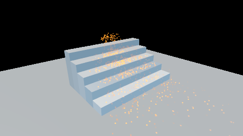
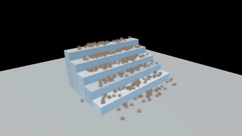

# Particle collision

Sparks that bounce down stairs, debris that lands and stays, rain that dies on the ground and splashes
where it hit. CyberVFX particles collide with analytic primitives, the scene's signed distance field
and the frame's depth buffer, on the CPU path and on the device, and the response is authored in the
effect's graph.





Films: [`vfx-collision-sparks.mp4`](../design/videos/vfx-collision-sparks.mp4) and
[`vfx-collision-debris.mp4`](../design/videos/vfx-collision-debris.mp4), written by
`just capture-vfx-collision`.

## 1. The pieces

| Piece | Where | What it does |
|---|---|---|
| `vfx.collide.plane`, `.sphere`, `.box`, `.capsule`, `.sdf`, `.depth` | `src/vfx/src/asset.cpp` (registry), `compile.cpp` (lowering) | the nodes an author places; six outputs over one contact |
| `Contact`, `Bounce`, `Resolve`, `Impact` | `include/cy/vfx/ir.h` | the IR: a query, and arithmetic over it |
| `collision_contact`, `collision_bounce`, ... | `include/cy/vfx/collision.h` | the CPU path's spelling of the four |
| the collision prelude | `src/vfx/src/emit_slang.cpp` | the device's spelling of the same four, in the same order |
| `CollisionField`, `DepthCollisionView` | `include/cy/vfx/collision.h` | what the CPU path collides with: `SimulationWorld::set_collision` |
| `GpuCollisionField`, `GpuCollisionDepth`, `VfxGpuPass::set_collision` | `src/vfx/gpu/` | what the device collides with: descriptor set 1 |
| `GpuGiScene::field_binding` | `src/rendering/gi_gpu/` | the GI clipmaps' own device buffers, for the field collider |
| `vfx.event_count`, `vfx.event_payload` | `src/vfx/src/asset.cpp` | spawning from another emitter's events, on the CPU path |

## 2. Author a collision

A collider takes the particle's `position` and `velocity` — the ones the step just integrated — and
gives back six outputs:

| Output | What it is |
|---|---|
| `position` | moved out of the collider to separation zero, if it was inside |
| `velocity` | after the response: bounce, friction, stick |
| `contact` | 1 while touching (within a millimetre), 0 otherwise |
| `began` | 1 on the step a contact starts — needs `was_in_contact`, the `contact` of the step before |
| `impact` | the closing speed on that step, 0 otherwise: what an event should carry |
| `normal` | the surface's normal at the contact |

Every other input is optional and has a default you can see in the editor's inspector:

| Input | Default | Meaning |
|---|---|---|
| `radius` | 0 | the particle's radius, so a big piece rests on its surface and not its centre |
| `restitution` | 0.5 | the share of the closing speed a bounce sends back |
| `friction` | 0 | Coulomb: the tangent loses at most `friction` times the normal impulse each contact. 0 slides forever; 0.5 stops a 4 m/s slide in 1.63 m |
| `stick` | 0 | above 0.5, a particle stops dead on contact |
| `rest_speed` | 0 | closing speeds below this do not bounce — a resting particle rests instead of chattering |
| `was_in_contact` | 0 | the particle's contact flag from the last step, for `began` and `impact` |
| shape inputs | a ground plane, a unit sphere, ... | plane `normal`, `offset`; sphere `centre`, `sphere_radius`; box `centre`, `half_extents`; capsule `start`, `end`, `capsule_radius`; sdf `step`; depth `thickness` |

The Update stage of a bouncing effect, in the canvas format the editor saves (the gravity step,
nodes 4 to 8, as in the `ground_bounce` module of `src/vfx/tests/test_vfx_modules.cpp`):

```
node 1 vfx.attribute
prop 1 attribute position
node 2 vfx.attribute
prop 2 attribute velocity
node 3 vfx.attribute
prop 3 attribute collided
node 9 vfx.collide.sdf
prop 9 restitution 0.55
prop 9 friction 0.15
prop 9 radius 0.012
link 8 out 9 position
link 6 out 9 velocity
link 3 out 9 was_in_contact
node 10 vfx.set_attribute
prop 10 attribute position
link 9 position 10 value
node 11 vfx.set_attribute
prop 11 attribute velocity
link 9 velocity 11 value
node 12 vfx.set_attribute
prop 12 attribute collided
link 9 contact 12 value
```

Note the links FROM a collider name their output pin (`link 9 position 10 value`), where every
other node's is `out`, and a numeric value is a property like any other (`prop 9 restitution
0.55`).

A collider is an ordinary node, so it goes in a reusable `.cyvfxmodule` like any other — the
`ground_bounce` module in `src/vfx/tests/test_vfx_modules.cpp` is one — and the editor's palette and
the MCP tools see the six types as soon as the engine registers them (`vfx.catalogue.get`).

### The responses the requirement lists

* **Bounce and friction**: the `velocity` output. **Sliding** is friction below the slope's grip.
* **Stick**: `stick 1`. The particle stops on the contact step; gate its integration with the contact
  flag (`velocity * (1 - collided)`) to keep it on a wall against gravity.
* **Kill**: `kill_if(contact)` — one kill root a kernel, so combine reasons with `max`.
* **An event**: `emit_event(impact)`, with the collider's `position` on the raise's `payload` input.
  It fires once a contact: never while resting, again on every bounce.
* **Spawn on contact** (CPU path): a second emitter whose Spawn writes `vfx.event_count(impact)` to
  `spawn_count` and whose Initialise reads `vfx.event_payload(impact)` — one particle an event, born
  where it happened.

## 3. Choose a collider

| Collider | Space | Accuracy | Cost | Cannot see |
|---|---|---|---|---|
| plane, sphere, box, capsule | the effect's | exact | a few flops | anything else |
| `sdf` | world | the field's voxel | 1 field sample clear, 7 touching (5 at quality 2) | walls thinner than a voxel |
| `depth` | screen | a depth texel | 5 texels on screen (3 at quality 2) | anything off screen, occluded or behind the camera |

**Use the field for anything that matters.** It is world space, so a particle falling behind a
pillar, off the edge of the screen or behind the camera still lands. **Use the depth buffer for
cheap, disposable effects** — rain, ash, splashes — and expect them to fall through what the camera
cannot see; that is the mode working as specified. A depth surface is `thickness` deep (50 cm by
default): a particle further behind it than that is behind it, not inside it.

Analytic colliders are authored in the effect's space and move with it; a host that wants a
physics body's shape to deflect particles writes the shape into the node's inputs as parameters.

## 4. Give the world something to collide with

On the CPU path, once:

```cpp
// A CollisionField is one virtual: `distance(Vec3)`. Over the GI field it is four lines —
// `GiFieldAdapter` in src/vfx/gpu/tests/test_vfx_collision_gpu.cpp.
world.set_collision(&field, &frame_depth_view);  // either may be null
```

On the device, each frame, before `declare` (the depth texture is one graph's resource):

```cpp
const gi_gpu::FieldBinding binding = gi_scene.field_binding();
GpuCollisionField field = /* the same numbers, see test_vfx_collision_gpu.cpp */;
GpuCollisionDepth depth{frame_depth_resource, view_projection, inverse_view_projection, eye, w, h};
pass.set_collision({&field, &depth, effect_origin});
pass.step(inputs);
pass.declare(graph);
```

An emitter that collides with nothing binds and generates exactly what it did before collision
existed; `VfxGpuPass::collides()` says which kind a pass is.

## 5. The budget

`BudgetLevers::collision_quality` is the controller's lever: 3 authored, 2 the cheaper normals, 1 the
analytic colliders only, 0 nothing collides. An effect's `ScalabilityPolicy::may_reduce_collision`
false keeps it at 3. Both paths read it.

## 6. What it costs

Measured on an RTX 5060, Vulkan, 65 536 particles, the update dispatch alone:

| Collider | ms |
|---|---|
| none | 0.0065 |
| plane | 0.0086 |
| scene field (GI clipmaps, two levels) | 0.0172 |
| depth buffer, 1920 x 1080 | 0.0210 |

The whole sub-step — spawn, compaction, initialise, update — is about 1.2 ms at that population, and
the compaction (one workgroup scanning the block in slot order) is nearly all of it with or without
a collider. `GpuPassDescription::timed` and `last_device_ms` / `last_update_ms` measure it in a game.

## 7. The suites

| Suite | What it holds |
|---|---|
| `integration.vfx` | rest on a plane within a tenth of a millimetre; restitution exact; one event a contact; kill, stick, friction (Coulomb's stopping distance); sphere, box, capsule; the field seeing what the depth buffer cannot; the depth buffer's thickness; sparks spawned from impacts; the budget's quality |
| `integration.vfx_compiler` | a collider-free effect's generated units and cook key byte-identical to before collision; one contact for six outputs; the collision set in the unit; the palette; event reads refused outside their stage; a reusable collision module |
| `render.vfx_collision_gpu` | the device against the CPU executor, particle for particle, for every collider, the impact events and the quality lever; refusing an event-reading emitter; the device timing |
| `render.vfx_collision` | the pictures above, asserting the sparks are in the frame and the debris is at rest |

## 8. Pitfalls

* **Liveness elides an attribute nothing reads.** If only `began` reads `collided` and nothing wires
  `began`, `collided` is written and never read — and elided. Read it (the pictures' effect lights a
  touching particle twice as bright) or don't rely on it.
* **`began` needs `was_in_contact`.** Without it every contact step is a beginning, and an event
  fires every step a particle rests.
* **A payload is a `float4`.** Read a position out of it with three `dot`s against the axes, as the
  sparks emitter in `collision_effects.cpp` does.
* **The field's normal is a finite difference.** At the edge of a step it blends the tread and the
  riser over `step` (5 cm); make `step` smaller for sharper edges at more risk of a noisy normal.

## 9. Not built yet

* **Spawn on contact on the device.** The GPU event chain is one level deep: a device emitter raises
  impact events (counted, bounded, ranked) but no device emitter consumes them, and
  `VfxGpuPass::create` refuses one that tries.
* **Oriented boxes and capsules from physics, bound automatically.** A host writes a body's shape
  into a collider's inputs; nothing does it for every body.
* **Collision against the depth buffer's previous frame.** A particle collides with the depth the
  host binds; a frame that simulates before its depth prepass must bind last frame's.
