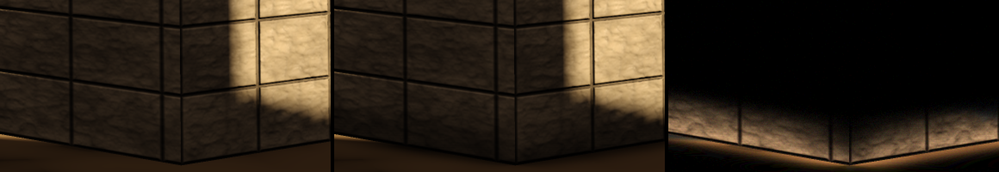
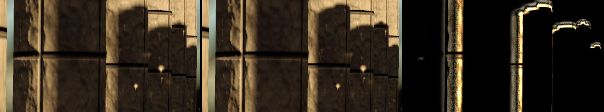
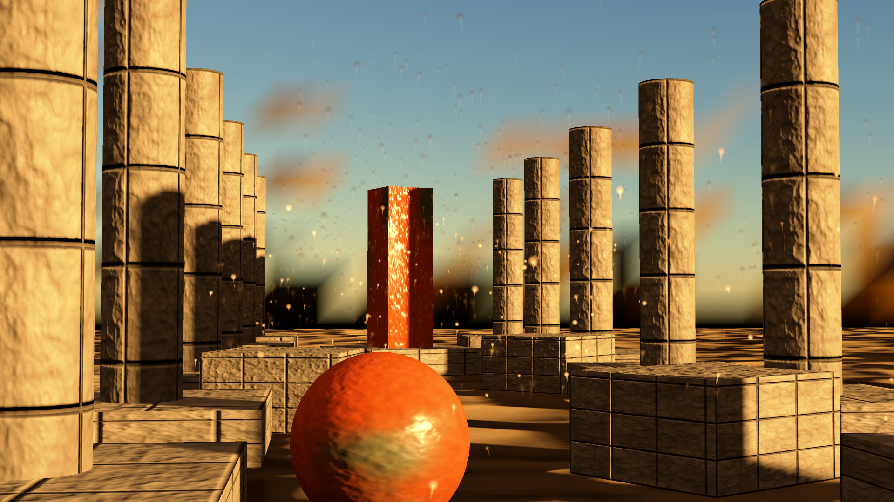
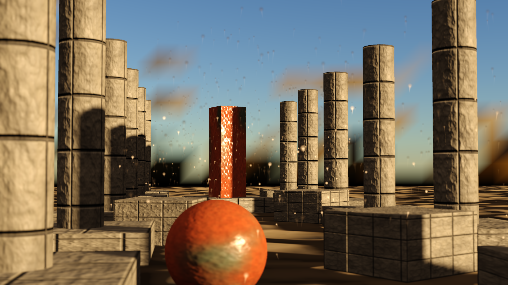
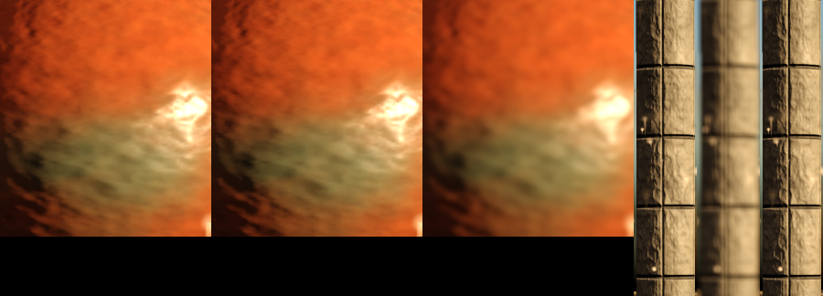
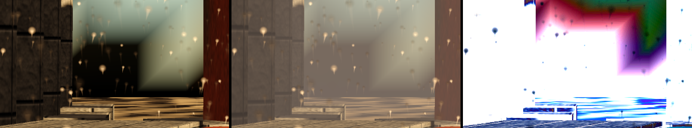
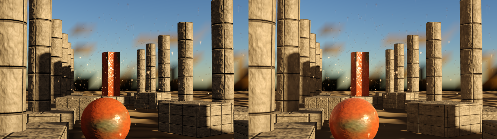
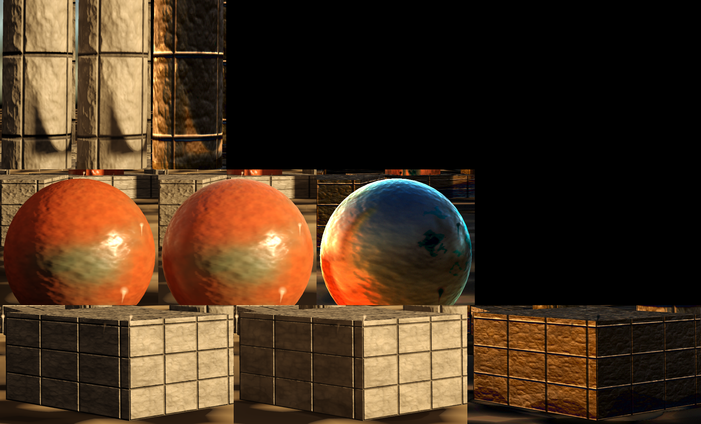
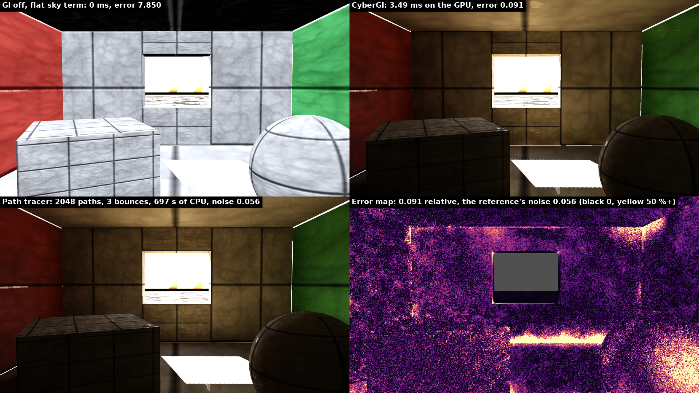

# `samples/12-beauty` — the first frame in which a material decided a pixel

> **M11.c's closing artefact.** Section 7 of `openspec/changes/implement-m11c-image/tasks.md`.
>
> ```
> just capture-beauty-shot                          # the picture, the before/after and the manifest
> just capture-beauty-shot --video                  # ... and the turntable
> just capture-beauty-shot --regenerate-textures    # ... regenerating the source images first
> just capture-ambient-occlusion                    # the shot with ambient occlusion off and on
> just measure-beauty-mip-chain                     # does the shot read its cooked mip chain?
> just capture-beauty-bloom                         # the same shot with and without bloom
> just capture-soft-shadows                         # the shot with soft and contact shadows off and on
> just capture-beauty-grading                       # the shot ungraded, warm and cool
> just capture-beauty-depth-of-field                # the shot focused on the sphere and on a column
> just capture-decals                               # the shot with its decals off and on (and the world's ground marker)
> just capture-beauty-gi                            # the shot with its flat sky term and with the engine's GI
> just capture-gi-interior                          # a sunlit room and the shot: no GI, the GI, the path tracer
> ```
>
> No CTest entry: the picture needs a graphics device, and on a machine without one the program says
> which device it did not find and writes nothing.


The provenance — what a person authored, what the renderer produced, and what this frame does not
contain — is [`docs/design/beauty-shot.md`](../../docs/design/beauty-shot.md), and the machine-readable
half is `docs/design/images/m11c-beauty-shot.manifest`, built from the frame's own `AssemblyReport`
rather than from anything this program believes.

## The sentence this artefact exists for

M11.c's ledger opens with a measurement rather than a complaint:

> There is no texture in this repository. Outside `docs/`, the tree holds exactly six image files —
> four editor identity marks and two golden references. Every material in every picture the project
> has produced is constants.

M11.c's spike then walked the path that would have to close to change that, and came back with
**four of six junctions closing and the two ends missing**: the material editor refused to open, the
importer named BC7 and delivered uncompressed RGBA8, nothing in the tree bound the material texture
table, and no assembled frame drew a compiled material program. This program is the other end of all
four.

## What it runs, in order

| | |
|---|---|
| **author** | three material graphs, placed and wired on `cy_editor_interface::specialised::graph::GraphCanvas` — THE canvas, the one `editor-architecture` forbids a sixth bespoke graph editor beside |
| **compile** | `lower_material` → `lower_graph` → `compile_material` → `assemble_translation_unit`. Twelve programs a material, one cook key each |
| **shader** | `slangc` over the generated module and `shaders/beauty.slang`, which is the fragment-stage lowering the engine does not generate — `slang_program.h` says so in as many words |
| **cook** | `cy::import::TextureImporter`: PNG in through M11.c's own DEFLATE decoder, BC7 and BC5 blocks with a nine-level mip chain out through M11.c's own encoder |
| **bind** | the blocks uploaded and bound at **(set 0, binding 1)**, which is where `cy/material.slang` declares `cyMaterialTextures[]` — imported rather than restated, so the Slang compiler checks the agreement rather than a comment |
| **assemble** | `cy::rendering::assembly::FrameAssembly`: eight passes, the post chain's three stages, the exposure the shot file commits and `cy/fullscreen.slang`'s tone curve |
| **capture** | the 8-bit output AND the linear scene colour, read back out of **one** submission, plus a manifest |

## The files

| | |
|---|---|
| `shot.h` | the committed scene's shape, and the artefact's honesty contract in its header |
| `shot.cpp` | the `.cyshot` parser and the `.cyprim` loader. Every refusal is about something the picture would have been wrong about |
| `stage.cpp` | the device: the cook, the uploads, the descriptor sets, the shadow map, the frame, and the two readbacks |
| `shaders/beauty.slang` | its entry points and the one thing it decides that the material cannot — which attributes the material sees, and what the engine's light loop does with the surface it returns. `just _beauty-programs` compiles every `[shader("...")]` entry point it declares, read off the file |
| `gi.h`, `gi.cpp` | `--gi on`: the shot's GI scene from its own meshes and instances, the caches, the device resolve, and the path-traced reference |
| `main.cpp` | the command line, the sidecar check, and the turntable. `--albedo-levels 1` is a CONTROL: level 0 of every albedo map's cooked chain and nothing beneath it |
| `make_cool_look.py` | writes `content/beauty/looks/cool.cube` from the formula in its docstring |
| `measure_mip_chain.py` | `just measure-beauty-mip-chain`'s judge: the full chain rendered twice must agree, and against albedo level 0 alone must DIFFER and be the less aliased |

## Three things in here that were found by looking at a picture

Each is commented where it is fixed, because each is the kind of defect that produces a plausible
image rather than an obvious one:

1. **A BC5 normal map has no blue channel.** Reading `.xyz` from it gives z = 0, which decodes to
   −1 and turns every normal inside out. Every upward-facing surface in the frame was black and
   nothing else said so. `texture.h` chose BC5 for exactly the reason that makes this happen — *"Z is
   reconstructed in the shader from X and Y"* — and the shader now does.
2. **A zeroed material parameter block draws a black material however the graph was authored.** The
   authored defaults live in the module's own declarations, so `cy_material author` writes them into
   the sidecar and the frame uploads them.
3. **The sky's ambient term is its mean RADIANCE, not its irradiance.** The factor of π between them
   is the difference between a picture with a sun in it and a flat one: multiplying by the irradiance
   made the ambient π times too strong, the sun invisible against it, and every shadow in the frame a
   shade of the same grey.

## Bloom, with and without

`--bloom` puts bloom into the frame's post chain at step 9 with the grade the shot file carries
(`bloom threshold-stops`, `intensity`, `scatter`, `levels`): the threshold is written in stops above
the white the exposure maps to 1.0 and converted to scene units by `bloom_threshold_for_exposure`.
Without the flag bloom is absent — no pass, no target — and the frame is the one M11.c published:
`bloom-beauty-off.png` is pixel-identical to `m11c-beauty-shot.png`.
`just capture-beauty-bloom` photographs both from one set of compiled programs:

| Without bloom | With bloom |
|---|---|
|  |  |

`docs/design/images/bloom-beauty-on.manifest` is the bloomed frame's provenance; its post-stage
list names `Bloom` at step 9, before exposure.

## What it does not claim

The full list is in the provenance, and the short version is: no anti-aliasing stage (the frame is
supersampled and the manifest says three post stages, none of them temporal), no global illumination
pass in the published frame (it is `--gi on`, at the end of this file), no ambient occlusion pass in the published frame (it is `--ambient-occlusion on`, at the end
of this file), procedural geometry, and a normal map and an occlusion channel sampled by the FRAME
because the compiled-material closure vocabulary has no term for either.

**The air is the one thing in this frame that is not content.** Three ember emitters are authored in
`embers.cpp` — node by node, on `cy::vfx`'s shipping node library and through its shipping compiler
— because there is no on-disk VFX asset format in this tree to author them into, and no VFX graph
editor to author them with. What the field proves is the runtime, not an authoring path, and the
provenance says so where the rest of this list is.

## Ambient occlusion, off and on

`--ambient-occlusion on|off` is the setting, off by default. On, the program records the frame's
own `DepthPrepass` stage from its own buffers (`record_prepass`, drawing `sceneVertex` with
`scenePrepassFragment`, which writes the geometric normal octahedrally), switches
`PostChainConfig::ambient_occlusion` on, hands the stage to `occlusion::AmbientOcclusionPass`, and
shades with `sceneFragmentOccluded` against the prepass depth — tested, not written. The term
multiplies the sky term only; `sceneFragment`, the entry point the published frame is drawn with, is
unchanged in what it computes. The radius (1.5 m) and power (1.5) are content, in `shot.cyshot`.

| Ambient occlusion off | Ambient occlusion on |
|---|---|
|  |  |



`just capture-ambient-occlusion` writes `docs/design/images/ambient-occlusion-{off,on,detail}.png`
and `ambient-occlusion-on.manifest`, and `tools/docs/compare_ambient_occlusion.py` fails it unless
the off picture is `m11c-beauty-shot.png`'s pixels exactly and no pixel got brighter.

## Soft and contact shadows, off and on

`--soft-shadows on|off` is the setting, off by default. On, the program records the depth and
normal prepass, declares the frame's `ContactShadows` stage through
`contact_shadows::ContactShadowPass`, and shades through `sceneFragmentSoft`: the sun's map
filtered by `cy/shadow.slang`'s percentage-closer soft filter — a blocker search and a kernel whose
radius is `(blocker - receiver) * tan(sun angular radius)`, so the far ends of the long shadows
soften and their feet stay sharp — and darkened further by the contact term where the trace toward
the sun found an occluder the 3.7 cm map texels and the 5 cm normal offset lose. The sun's angular
radius (0.265 degrees) and the trace's reach are content, in `shot.cyshot`. Ambient occlusion
composes with it.

| Soft shadows off | Soft shadows on |
|---|---|
|  |  |



`just capture-soft-shadows` writes `docs/design/images/soft-shadows-beauty-{off,on,detail}.png` and
`soft-shadows-beauty-on.manifest`, and `tools/docs/compare_soft_shadows.py` fails it unless the off
picture is `m11c-beauty-shot.png`'s pixels exactly.

## Colour grading, ungraded, warm and cool

`--look <file.cygrade>` grades the frame at step 12 of the post chain — after the tone curve, on
display-referred colour — through `grading::GradingRenderer`'s resolve in place of the frame's own:
the same exposure (the shot's stops), the same curve, then one lookup into a 33³ table baked from the
look. Two looks are committed in `content/beauty/looks/`: **warm** is the parametric controls alone
(white balance toward 4 600 K, gain, lift, contrast, saturation); **cool** is a slightly cool white
balance and `cool.cube`, an exported-style creative LUT in sRGB encoding written by
`make_cool_look.py`, baked together into one table. Without a look the frame is the one M11.c
published, and `just capture-beauty-grading` fails unless `grading-beauty-none.png` is
`m11c-beauty-shot.png`'s pixels exactly (`tools/docs/compare_grading.py`).

| Ungraded | Warm | Cool |
|---|---|---|
|  |  |  |


`docs/design/images/grading-beauty-{warm,cool}.manifest` are the graded frames' provenance; their
post-stage lists name `ColourGrading` at step 12, after `Tonemap`.

## Depth of field, on the sphere and on a far column

`--depth-of-field <target>` puts depth of field into the frame's post chain at step 7, before bloom,
through `depth_of_field::DepthOfFieldPass`, focused on one of the targets the shot file names:
`sphere`, the copper orb 8 m out, and `column`, the colonnade's last pillar on the right of the frame,
33 m out. The lens is the camera's own — the focal length the shot's 42-degree horizontal field of
view implies on a 36 mm full-frame sensor, cropped to this image's aspect — at the shot's f/1.4, and
the focus distance is the target's distance along the view axis. Nothing else is chosen: the blur
of every pixel is the thin-lens circle of confusion at its depth. Without the flag the stage is
absent and the frame is the one M11.c published; `just capture-beauty-depth-of-field` fails unless
`depth-of-field-beauty-off.png` is `m11c-beauty-shot.png`'s pixels exactly, and unless each focused
frame keeps its target's detail and loses the other's (`tools/docs/compare_depth_of_field.py`).

| Focused on the sphere | Focused on the far column |
|---|---|
|  |  |



`docs/design/images/depth-of-field-beauty-{sphere,column}.manifest` are the focused frames'
provenance; their post-stage lists name `DepthOfField` at step 7, before `Tonemap`. The embers are
drawn without depth, so the stage blurs each by the surface behind it.

## Volumetric fog, off and on

`--fog on|off` is the setting, off by default. On, the post chain's `volumetric_fog` stage is
switched on and declared through `fog::FogPass`: a froxel volume — 160 by 90 columns, 96 slices out
to the shot's `fog far`, four sub-steps a slice — marched through the shot's height fog, lit by the
same sun through the same shadow map and by the same sky term the surfaces are shaded with, and
every scene and sky fragment is seen through it (`throughFog` in `shaders/beauty.slang`). Where a
column stands between the sun and the air, the froxels behind it scatter no sunlight: the shafts
between the Colonnade's columns. The haze is content, in `shot.cyshot`'s `fog` lines — a
meteorological visibility, a base altitude and scale height, an albedo and a Henyey-Greenstein
`g` — and nothing else about it is tunable.




Captured with `just capture-volumetric-fog` on Vulkan: the off picture is `m11c-beauty-shot.png`
pixel for pixel; on, 2073296 of 2073600 pixels change, 261046 darker by more than one step and
1659089 brighter by more than one step, the largest by 120 of 255, with 0 validation errors.

`just capture-volumetric-fog` writes `docs/design/images/volumetric-fog-beauty-{off,on,detail}.png`
and `volumetric-fog-beauty-on.manifest`, and `tools/docs/compare_volumetric_fog.py` fails it unless
the off picture is `m11c-beauty-shot.png`'s pixels exactly.

## Motion blur, off and on

`--motion-blur <degrees>` puts `rendering-post-processing`'s motion blur into the frame at step 8,
at that shutter angle, and `--orbit-still <path> --orbit-frame <n>` photographs frame `n` of the
turntable after drawing frame `n - 1`, so the frame has the orbit's motion — one and a half degrees
of camera turn about the shot's target — and the embers have drifted one step. On, the program
records the depth and normal prepass through `scenePrepassMotionFragment`, which writes the frame's
motion vectors from this render's camera and the last one's; the scene still shades through
`sceneFragment`, the published frame's own entry point. `motion_blur::MotionBlurPass` blurs the
scene colour before exposure, so the embers and the sky are streaked with the rest of the picture —
the sky, which the prepass does not draw, as the far plane moving with the camera. Off is the frame
the turntable always drew.

`just capture-beauty-motion-blur` writes `docs/design/images/motion-blur-beauty-{off,on}.png`:
frame 20 of the 240-frame orbit, drawn after frame 19, with 0 validation errors. On, the columns'
masonry and the embers streak along the orbit's direction, most at the frame's edges.

## Temporal upscaling, in every mode

`--upscale <mode>` — `native`, `quality`, `balanced` or `performance` — renders the shot at the
mode's render extent with the temporal framework's jitter and reconstructs the output at the frame's
`Temporal` stage through `upscale::TemporalUpscalePass` (`src/rendering/upscale/`). The program adds
the depth, normal and motion prepass, removes the jitter from its motion vectors (`BeautyFrame::jitter`),
derives the reactive mask from a copy of the colour taken before the air and the embers are drawn,
and runs ambient occlusion, the contact trace, the GI, the decals' cluster grid and the air at the
render extent; depth of field, motion blur, bloom and the resolve run at the output. The still is
drawn after `--upscale-frames` (48) frames of the same view, `--sharpness` (0.3) is the sharpening,
and `--timing-frames <n>` prints the median whole-frame device time over `n` more. It refuses
`--supersample` above one. Off is the frame the program always drew.

`just capture-upscale` times every mode at 1440p and 4K with the GI on, one run at a time, and
writes `docs/design/images/upscale-beauty-{native,performance}.png` and the crop strips
`upscale-beauty-crops-{1440,2160}.png`. On an RTX 5060, the whole frame's device time and the PSNR
of the converged still against native AA:

| Output | Off (no AA) | Native AA | Quality | Balanced | Performance |
|---|---|---|---|---|---|
| 2560x1440 | 5.62 ms | 7.62 ms | 6.14 ms, 42.6 dB | 5.32 ms, 40.4 dB | 4.65 ms, 37.3 dB |
| 3840x2160 | 12.04 ms | 16.47 ms | 10.62 ms, 43.4 dB | 9.49 ms, 41.7 dB | 8.56 ms, 40.3 dB |

The aliased frame is 38.1 dB from native AA at 1440p and 39.5 dB at 4K.

## Global illumination, off and on

`--gi on` lights the shot with the engine's GI (`gi.h`, issue #35 stages 4 and 5). The GI scene is
the shot's own: `gi::append_mesh_cards` puts a card every half metre over every object and every
metre over the gravel, `gi::MeshDistanceField` builds each primitive's signed distance grid from its
triangles, and the field places them by their instances' transforms. The caches are lit by the shot's
sun and by a sky term fitted to the engine's atmosphere, run in converged mode before the first
frame — the GI specification asks it of a capture — and the frame's `ScreenSpaceGi` stage is
produced by `gi_gpu::GpuScreenResolve` through the hardware tier where the device has ray queries:
the prepass (with each material's roughness, `scenePrepassGiFragment`) unpacked, the screen probes
placed, traced, filtered in probe space and integrated (the engine's default gather;
`--gi-gather per-pixel` is the per-pixel one), accumulated over time, and published. `sceneFragmentGi` replaces
the flat sky term with the indirect diffuse on the diffuse albedo and adds the indirect specular
through the split-sum environment BRDF; the sun, its shadows, the sky dome and the post chain are the
published frame's. `--gi-tier software`, `--gi-divisor 2`, `--gi-gather per-pixel`,
`--gi-denoiser shared`, `--gi-probe-rays <n>` (32), `--gi-ray-density <f>` (the share of the screen
probes traced a frame, 1), `--gi-frames <n>`, `--gi-timing-frames <n>` (240, the frames the GI is
timed over after the still) and `--gi-converged off` are the controls.

The caches' arithmetic — the card shading and the probe gather — runs on the device
(`gi_gpu::GpuGiCaches`, installed after converged mode, which converges on the host); `--gi-caches
host` keeps it on the processor, the oracle. After the held timing, `--gi-live-frames <n>` (240)
frames run with the caches live — the GI's sun turning a tenth of a degree a frame and a 3 m block
the GI holds as a moving object (not drawn) circling the target — printed as `gi live`: the host's
update at its median, 95th percentile and worst, and the resolve, the card shading and the gather on
the device. RTX 5060, 1920x1080, hardware tier: the host's update 0.39, 0.48 and 0.38 ms at its
median in the sunlit room, the workshop hall and the Colonnade, the whole GI 3.87, 4.16 and 3.07 ms
on the device; with `--gi-caches host` the update is 24.9, 30.4 and 15.1 ms (the guide's section 7b).

A decal whose material glows (`decal-material ... emission r g b`, radiance in the frame's units)
writes the emission channel where it lands — the shot's soot and moss write none, as before — and,
with `--gi on`, the GI scene's cards inside its box and facing its way take its emission and albedo,
so the GI is lit by exactly the lamp the frame draws. Every emitter stays in the surface cache
(`EmitterOverride::CacheOnly`): a promoted one would leave the cards for `frame_lights()`, which the
frame does not read, and the pixels it lights directly would lose that light.





Captured with `just capture-beauty-gi` on the RTX 5060, Vulkan, 0 validation errors. Off is
`m11c-beauty-shot.png` pixel for pixel, and `tools/docs/compare_gi.py` fails the recipe unless it is;
on, 66.3 % of the pixels change and the open sky between the columns does not.

**Measured against the path tracer.** The run with the GI path traces 400 pixels of its own frame —
288 see a surface — with `gi::PathTracer` over `lightmap_bake::MeshSceneTracer`'s exact triangles,
256 paths of three bounces each, and compares the published indirect diffuse:

| | relative error against the path tracer |
|---|---|
| the engine's GI, the screen probes (the default) | **0.048** |
| the engine's GI, the per-pixel gather | 0.127 |
| the flat sky term it replaces | 0.384 |

Measured at `--supersample 1`, after the shadow fix below: the frame these pixels are traced from
shades the sun with the shadows the GI's caches are lit by. (Before it, through the per-pixel
gather and the mirrored shadows, the engine's GI was 0.126.)

**What it costs** at 1920x1080 (`--supersample 1`), every stage of the GI from timestamps, the
fastest of 240 frames after the still at full clocks (below): 2.73 ms through ray queries (of which
the probes' rays are 0.90 and the probe-space denoiser 0.53), 1.73 ms on the half-resolution grid
(`--gi-divisor 2`), 5.68 ms through the software field; the per-pixel gather 12.3 ms through ray
queries. It was 4.49 ms as #124 measured it, 4.09 ms at full clocks. The caches are updated on
the host here, about 19 ms of processor time a frame
over 12 782 cards, and converged mode spends 32 frames — 11 s — before the first; the device card
shading and probe gather of stages 2 and 3 are the installation that moves them off the processor.

## The GI beside the path tracer: a sunlit room, a workshop hall and the Colonnade

`just capture-gi-interior` photographs three shots three ways each — without the GI, with it, and with
the GI's indirect diffuse replaced by the path tracer's — and maps where the GI and the path tracer
differ. `--gi-reference-step 4` path traces every fourth pixel each way of the last frame
(`BeautyGi::reference_image`: `gi::PathTracer` over the exact triangles, two independent halves of
each pixel's paths so the reference's own noise is measured too, a tracer a thread) and upsamples it
against the frame's depths and normals; `--gi-reference-still` draws the frame once more with that
bound where `sceneFragmentGi` reads the GI's diffuse target — the sun, the shadows, the GI's specular
and the post chain unchanged — and `--gi-error-map` writes |GI - path tracer| over the path tracer.
`--gi-gather per-pixel` and `--gi-denoiser shared` select the GI's other paths.
`tools/docs/compose_gi_comparison.py` lays the four out with the run's figures in their labels.

The second shot is `content/beauty/interior.cyshot`, **The Sunlit Room**: the Colonnade's own
weathered-stone graph and maps on every wall, coloured per material by the shot's new
`material <key> base-color r g b`, six half-metre slabs built round one window, the sun through it,
and `air none` — the embers are the Colonnade's, authored at its camera.



CyberGI 0.091 relative to the path tracer over 125 024 traced pixels (its own noise, 2048 paths:
0.056), 3.49 ms on the GPU — where it was 0.193 and 6.63 ms, the surfaces the sun's patch lights a
third too dark because a card was shadow-tested at its centre (the guide's section 7b).

The third shot is `content/beauty/hall.cyshot`, **The Workshop Hall**: a game's interior, two
windows, a blue and an ochre wall, columns, crates, and a bench under a lamp whose underside glows
(`--decals on`).


CyberGI 0.148 relative over 129 600 traced pixels (the reference's noise 0.088), 3.78 ms on the
GPU. `just capture-gi-hall-video` films it under a camera swinging 30 degrees and back
(`--frames <dir> --frames-count 120 --orbit-degrees 30`):
[docs/design/videos/gi-hall-orbit.mp4](../../docs/design/videos/gi-hall-orbit.mp4).


CyberGI 0.023 relative over 86 427 traced pixels (the reference's noise 0.014), 2.73 ms on the GPU.

Only the still is read back (`Stage::set_gi_readback_frames`). The caption's GPU time is the
fastest of `--gi-timing-frames` (240) frames drawn after the still and the reference with the GI's
host cache held (`Stage::set_gi_hold_cache`): this sample's frames are light, and over the frames
before the still the driver left the GPU at half its memory clock in some runs and not others — the
sunlit room timed 4.81 or 3.49 ms with the same binary. Issued back to back, every run timed at
full clocks, as a game's frames keep the device.

**The room found a defect in this sample's shadows.** `beauty.slang` read the sun's map with its
rows the wrong way up — `v = ndc.y / 2 + 1/2`, where the RHI rasterises the light's +Y into row 0,
which `cy/frame.slang` reads as `1/2 - ndc.y / 2` — so every lookup took the texel mirrored across the
map's centre line. In the Colonnade it hid: the pillars cast no shadow on the gravel, and a sunny
courtyard looks plausible without them. In the room the side wall under the ceiling was lit by the
sun. `sunMapUv` reads it the right way up for both the hard and the soft filter, the fog's march
takes the same rows, and `tools/docs/check_sun_patch.py` fails `just capture-gi-interior` unless the
room's sunlit patch is where its window and its sun put it (proved red on the mirrored lookup, with
device-free tests of its own). Every still in this file was captured again with the fix.

