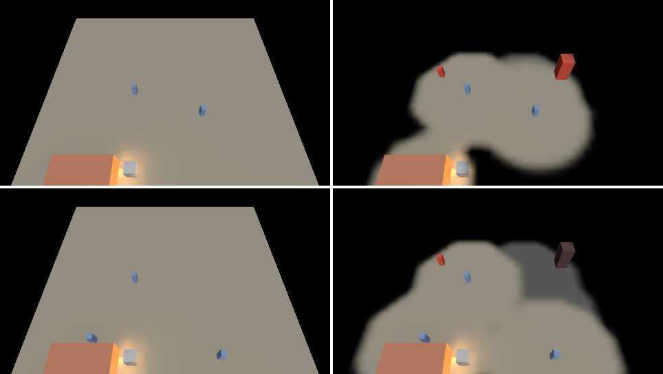
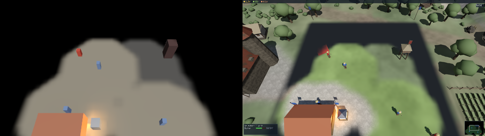
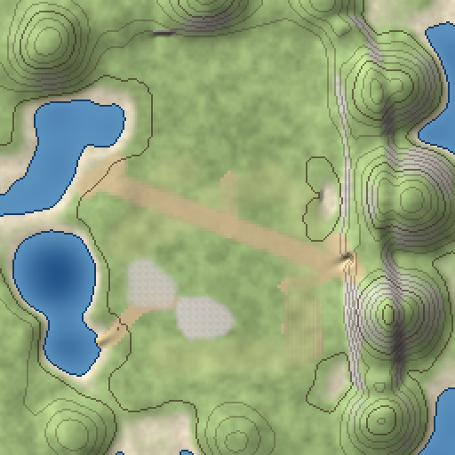

# samples/13-rts-api — an RTS unit, written in Swift, through ABI 1.3, 1.5, 1.6, 1.7, 1.8 and 1.16

The end-to-end proof of `add-swift-game-api`. A Swift behaviour runs a small RTS: a camera the
keyboard and the screen edges pan, a unit picked under the pointer, sent to a clicked ground point,
heard arriving, and a new unit built with a key. **Every one of those decisions is Swift calling the
engine.** The C++ host binds six adapters and loads content; it does not carry a single value
between the game and a server.

```
just run-sample rts-api                    420 frames of scripted play, headless, then the report
just run-sample rts-api --no-behaviours    the negative control: the same host with no game
just run-sample rts-api --no-systems       the scheduler's control: Swift systems never installed
just run-sample rts-api --no-ui            the interface's control: no interface, so no HUD
ctest -R rts_api_sample                    the test: the claims below, the controls, and two runs
```

ABI 1.5 (`add-swift-m12-gaps`) adds four things the game does, each through the engine rather
than the host: the commander and a scout are behaviours on level NODES, so the scene tree's pump
drives their `onEnterTree` and `onReady` and resolves their `@Node` paths; `trainUnits` is a Swift
`@System` the engine's scheduler runs every fixed tick, ordered against a native system reading the
same column; the scout walks a hero with a character controller and jumps once; and it kicks a
crate with an impulse.

ABI 1.6 (`add-swift-ui-bindings`) adds the HUD. The commander mounts, in CyberUI's store, the
resource bar, selection panel with health bars and minimap of `samples/13-rts-selection` — written in
Swift (`game/Hud.swift`), element for element — plus a Build button. Every frame it writes the HUD
from the game: gold less what was spent, food against the cap, the selected unit's health, a dot per
unit and the camera's frame on the minimap. A click on Build reaches the commander through the
engine's `ui_event`, and the next fixed step builds a worker; a left click over the HUD is the HUD's,
not a selection, because the commander asks `UI.hitTest` first.

ABI 1.7 (`add-swift-animation-api`, issue #76 stage 4) makes the units ANIMATE from Swift: every
unit the commander enlists gets an animator over the host's `worker` rig, walks while its agent
follows a path, stands idle when it stops, cheers on arrival, and is stood down to idle by the
cheer's own `cheer_done` event. The host cooks that rig — eight joints, an idle, a walk with
footstep events and a held cheer, and a program with no transitions because the game picks the
state — into a memory mount, loads it back by asset id through the asset system and
`AnimationLibrary`, and installs the engine's `AnimationSystem` in its schedule
(`host/worker_rig.*`).

ABI 1.8 (`add-deterministic-math` stage 8) gives the commander a LOCKSTEP COMPANY: sixteen units
in two groups on a field of their own, which the host runs as a fixed-point lockstep session — an
issuer, and a follower driven by the issuer's command log alone. The commander enlists them in
`onCreate` and, every 90 ticks, orders each group to the next waypoint of a patrol, a point it
computes entirely in fixed point: the waypoint's angle is integer arithmetic on a binary `Angle`, its
cosine and sine are the engine's (`Detmath.cos`, `Detmath.sin`), and the point is CyberdyneKit's
`Fixed` `*` and `+` (`game/Company.swift`). `host/company.h` states the same scenario in C++, and
`determinism.cross_leg` runs that C++ twin on all four CI legs, publishing `detmath-company-digest`
for `cross-leg-compare`; the sample's test holds the digest the SWIFT-driven session ends in to the
same committed `company::kCompanyDigest`. So the orders a Swift game computes are bits, and the
session they drive is the same on x86-64 and arm64, Linux, macOS and Windows. The commander also
writes the lead unit's authoritative x into a `Fixed` field of `RtsReport` (`component_set_fixed`).

ABI 1.9 (issue #35, the live half) gives the commander the BASE'S LIGHT: the host hands its level to
the engine's global illumination (`host/illumination.*` — the 32 m ground, the barracks, a glowing
beacon beside it and the crate, the crate moved every frame from its body) and binds the ABI 1.9
adapter, and the game decides the rest (`game/Lighting.swift`): a GI volume over its base at Epic
quality and twice the update rate, placed in `onCreate`; the beacon put out by its glass's material
name at frame 151 and lit again at 251; and the light on a guard's chest facing it read before,
between and after. With `--render <dir>` the host draws the session every frame on a device, lit by
the engine's device GI over that same system (`gi_gpu::GpuGiFrame`, `host/render.*`): the frame is
the pipeline suites' scene shaped into the level, seen from the game's camera.

```
just run-sample rts-api --render <dir>            the session drawn with the device GI: four stills
just run-sample rts-api --render <dir> --gi off   the control: the same frames without the GI
ctest -R rts_api_gi                               the picture and its cost (smoke)
```


Measured on the RTX 5060 (`smoke.rts_api_gi`, 480x270): a frame 4.65 ms together — the game's
0.56 ms with the GI's host update 0.37 ms of it, and the GI 0.64 ms on the device (6.3, 1.1 and
1.0 ms before the GI's host decisions were bounded and its card shade widened); the frame round the beacon's foot falls from 169 to 148 when the game puts it out and
returns to 170 when it lights it again, and without the GI reads 197 throughout. The GI runs from
the ground point the camera looks at, with probe and card ladders sized to the level
(`host/illumination.cpp`); headless, with the caches on the processor, a run of 420 frames takes
under two seconds.

ABI 1.10 gives the game FOG OF WAR. The host keeps the grid — `cy::game_backend::FogAdapter` over
the level's 32 x 32 metres, or over the RTS test map's whole terrain on a run with `--map`
(`host/fog_grid.h`), updated after every fixed step from where each entity with a vision stands
(`host/fog.*`) — and places an enemy camp in the level: `/Level/RaiderNear`,
`/Level/RaiderFar` and `/Level/Watchtower`. Everything else is the game's (`game/Fog.swift`): in
`onReady` it gives its workers blue's sight (7 m) and its barracks a ghost-leaving vision, and the
camp it resolved by `@Node` red's; every worker it builds gets blue's sight in the fixed step that
enlists it; in `onUpdate` it reads which of the camp blue sees, shows a raider's minimap dot only
while blue sees it and the watchtower's as a ghost, puts the fog's overlay page on the minimap, and
is refused once when it tries to give sight from a frame. By frame 420 blue sees both raiders — the
far one came into sight when the ordered worker arrived — and remembers the tower it walked away
from at frame 90.

```
just run-sample rts-api --render <dir> --fog       blue's fog in the frame, the camp by blue's sight
ctest -R rts_api_fog                               the picture and its cost (smoke)
```



Measured on the RTX 5060 (`smoke.rts_api_fog`, 480x270): the fog stage takes about 0.011 ms of
device time a frame, the host's half a few microseconds, and a frame with the fog and the GI 4.84 ms
against 4.68 ms without the fog.

## The RTS test map

`--map <package>` draws the same session on **The Frontier** (`content/rts/frontier.cymap`), a map
that looks like a game rather than a test: hills and a lake round the level, a forest the engine's
foliage placement grew, a village, a keep, farms, gold, stone and timber, and the enemy camp — and
the game's units as the skinned worker, walking, cheering and standing as the Swift game plays them.

```
just build-engine                                          cooks build/<p>/samples/13-rts-api/frontier.cypak
cy_sample_rts-api --render <dir> --map frontier.cypak      the session drawn on the map, 1920x1080
    --width <n> --height <n>   --view overview   --video <dir> [--video-every <n>]
    --gi off   --no-fog   --no-hud   --no-ao   --no-shadows   --no-validation
just capture-rts-map                                       the images and the video below
ctest -R 'rts_map|rts_api_map'                             the cook, the load, the run, the golden, the budget
```





[The video](../../docs/design/videos/rts-map.mp4): the orbit over the level and the company's field
under blue's fog — the ground blue's workers see, the ground they saw greyed, and the rest of the
map, the company's field included, black. `--no-fog` draws the map as it is.

**Where it comes from.** The build cooks the source (`map/map_cook.h`, `cy_rts_map_cook`): the
terrain is the engine's modifier stack evaluated by `terrain::evaluate_region`, the call the editor's
terrain tools preview with — noise, hills, the carved lake, the flattened level and company field,
roads, and brush strokes that raise, smooth and paint — its painted layers baked with the slope's
rock and the shore's sand into one 2048-texel albedo; the forest is `foliage::generate_region` over
a `TerrainQuery` of the cooked tiles, with the source's species, rules and exclusion zones; every
building, resource and plant, and the skinned worker on the worker rig's eight joints, is built from
primitives at cook time (`map/map_meshes.cpp`). The package is ten assets in the cooked-asset
envelope under fixed ids (`map/map_format.h`), and the host reads it back BY ID through
`AssetSystem` (`map/map_load.h`), each payload checked against its header's kind and content hash.
`content/rts/README.md` is the source's reference.

**How it is drawn** (`host/map_render.h`): the engine's frame — `FrameAssembly` and `FrameRecorder`
with the standard material, its base colour texture table (the albedo and `content/beauty`'s
stone, gravel and copper), the sun's 2048-texel shadow map with the percentage-closer soft filter,
`occlusion::AmbientOcclusionPass`, the device GI over the level's `IlluminationSystem` the game tunes
(the map's buildings and resources are boxes it holds besides its own), blue's fog over the whole
map — the host's grid is sized from the cooked map's bounds (`map::map_bounds`), so ground blue
never saw is black wherever it lies, and the company's second group is drawn only where blue sees
it — with the minimap's overlay page from the same field, the
HUD the game built through `UiRenderer`, and every unit skinned on the device by
`skinning::SkinnedScene`: the workers posed by the engine's animation system the game drives, the
company's sixteen and the camp's raiders by the rig's clips sampled for the session's state. The
forest is merged into one mesh a 32 m square, species and tint, so it is a few hundred draws rather
than a draw a plant.

**The map does not touch the game.** `smoke.rts_api_map` holds every line of the gameplay report
to the run with no picture — the lockstep company's digest `a61e5414c179f54a` included — save the GI's
light readings, which the map's buildings are part of.

Measured on the RTX 5060 at 1920x1080, Development, no validation layer (`smoke.rts_api_map`'s
third run): **a frame 12.1 ms on average** — recorded, submitted and waited for, so the processor's
half and the device's in series — against a budget of 16.7 ms (sixty frames a second), the worst
frame 15.2 ms. The device's half is 8.3 ms, of which the GI 3.7 ms and the fog 0.075 ms; the game's
own frame before it 1.7 ms. 437 draws (624 of them from the skinning pass over the frame's three
geometry passes), 195 instances, 100 000 triangles, 684 plants. The cook takes about a second; the
package is 7.2 MB on disk and 25 MB loaded, read in about 85 ms.

**One cost found on the way**, fixed at its root: assembling a frame integrated the sky's
irradiance — 32 directions through the atmosphere — every frame although nothing it depends on had
moved, 4.6 ms of the 5.5 ms the assembly took. `FrameAssembly` now reuses it while the atmosphere,
the eye's height and the sun are exactly what they were (`integration.render_assembly`'s 'the
sky's irradiance is reused while the atmosphere, the eye and the sun hold'); every frame of every
caller pays it once, and the frame it shades with is the one it would have integrated, bit for bit.

## The battle (ABI 1.16)

`--battle` fights a battle on the company's field instead of patrolling it: blue's ten swordsmen,
ten archers and four catapults against red's eight swordsmen and eight archers, before red's
watchtower and barracks. The host places `/Level/Battlefield`, by which the game knows to fight, and
everything else is the game's (`game/Battle.swift`): it spawns a soldier for every unit — the node
blue's fog of war places its vision by — enlists and arms it (`Lockstep.arm`), places red's buildings
(`Lockstep.fortify`), and gives the plan's thirteen orders from a fixed step: both armies attack-move
at each other on tick 0; on tick 540 blue's soldiers push on while its catapults turn on the
watchtower; on tick 720 the soldiers join them; on tick 960 all of blue goes for the barracks. Every
number is a `Fixed` or an integer, and the session decides the battle (`lockstep_combat.h`).

Every frame the game reads what the ticks did (`Lockstep.events(from:)`, a cursor kept) and, where
blue's fog lets blue see the place, plays it: launch puffs and a bowstring or a catapult's thump,
sparks and a clash for a blow, sparks that bounce off the ground for an arrow, an explosion with a
short-lived light, smoke and a boom for a catapult shot or a falling building, a fall for a death; a
trail on every projectile's arc, and smoke over a damaged building. The host registers the five
effects (`host/battle_effects.*`), a pool of lights and five generated cues (`host/battle_host.*`),
and after every tick stands each soldier's node where its unit stands.

```
just run-sample rts-api --battle                                 1200 frames, headless, then the report
cy_sample_rts-api --battle --render <dir> --map frontier.cypak   drawn on the RTS test map
    --minimap-upload                                             the minimap's page re-made with
                                                                 upload_atlas each time (the control)
just capture-rts-battle                                          the images and the video below
ctest -R 'game_backend_lockstep|rts_api_sample|rts_map|rts_api_map|cross_leg'
```


[The video](../../docs/design/videos/rts-battle.mp4) is the battle from the player's camera.

**The battle is the C++ twin's, bit for bit.** `host/battle.h` states the same battle and
`run_battle()` runs it; `determinism.cross_leg` publishes its digest as `detmath-battle-digest` on all
four CI legs, and `integration.rts_api_sample` holds the Swift-driven battle to the committed
`310fcf0defc657b8` and to the twin's damage (3 364 points), survivors (17 blue, 1 red) and events
(888), with both of red's buildings fallen.

**The map draws it** (`host/map_render.*`): a figure for every unit, striking while it is engaged,
facing what it strikes, falling and lying where it fell; red's buildings from the map's kit,
darkening as they are damaged and sunk and charred once they fall; the effects' particles; the
blasts' lights beside the sun. **The HUD's minimap becomes topographic** — the whole map baked from
its heights, painted colours, roads and lake with a contour every metre (`map/map_minimap.*`,
`cy::rendering-minimap`), blue's fog over it, the battle's units and buildings as icons — redrawn
where the fog moved every sixth frame and staged into the HUD's page inside the frame
(`UiRenderer::stage_atlas`). `--minimap-upload` re-makes the page with `upload_atlas` instead, the
path that once lost the device (`fix-ui-atlas-upload-frame`); both draw the same pictures.




Measured on the RTX 5060 at 1920x1080, Development, no validation layer (`smoke.rts_api_map`'s
battle case): **a frame 11.95 ms on average** against 16.7 ms, the worst 18.1 ms; the device's half
8.6 ms, the GI 4.2 ms of it; the game's frame 3.9 ms; up to 1 280 particles and fourteen projectiles;
the minimap's bake 2.6 ms once and a composition 0.4 to 1 ms every sixth frame.
[The guide](../../docs/guides/rts-combat.md) has the rest.

## What is here

| | |
|---|---|
| `game/` | **The game.** `Commander.swift` (the squad, the selection, the orders, the build key and button, the HUD's model, its tree callbacks), `Hud.swift` (the HUD, and `HudShowcase` for `render.rts_api_hud`), `Scout.swift` (a character-controlled hero and a kicked crate), `RtsCamera.swift` (panning), `Contract.swift` (content names, collision layers, the report components and `Veterancy`), `Game.swift` (the module's entry points and the `trainUnits` system). |
| `host/rts_host.*` | Servers, the adapters bound on the ABI host, the scene bridge, the schedule with the script systems in it, the Swift module, the interface (store, text, `UiAdapter`), and the frame loop. |
| `host/level.*` | Content built in code: the ground, a navigation tile, the worker prefab, the arrival click, the input actions, and the `/Level` nodes with the crate. |
| `host/worker_rig.*` | ABI 1.7: the worker's rig authored, cooked into the records a build would write, and loaded back by asset id. |
| `host/company.h` | ABI 1.8: the lockstep company's field, spawn layout and waypoints, and `run_company()`, its C++ twin, which `determinism.cross_leg` runs on every leg. |
| `game/Company.swift` | ABI 1.8: the commander's company — enlisting, fixed-point waypoints, orders through `Lockstep.order`. |
| `host/units.*` | Plumbing for navigation agents (an agent's position is its scene node, and it has a kinematic capsule on collision layer 1), the one entity-to-body map, and the native `Veterancy` reader. |
| `host/script.*` | The scripted player: synthetic key and mouse events, aimed with the camera projection. |
| `host/illumination.*` | ABI 1.9: the level as the GI sees it (`field_boxes`), the `IlluminationSystem` and the adapter the game tunes it through, updated once a frame from the camera. |
| `host/render.*` | `--render`: the session drawn on a device, lit by `gi_gpu::GpuGiFrame` over the level's GI; the stills and the cost line `smoke.rts_api_gi` reads. |
| `game/Lighting.swift` | ABI 1.9: the base's volume, the beacon out and on, the light read. |
| `host/fog.*` | ABI 1.10: the fog grid over the level, the enemy camp's places, and the placer that tells the grid where every entity with a vision stands. |
| `game/Fog.swift` | ABI 1.10: the squad's, the barracks' and the camp's visions; what blue sees of the camp, for the minimap and the report. |
| `game/Battle.swift` | ABI 1.16: the battle — its squads, arms, buildings and plan as `host/battle.h` states them; enlisting, arming and fortifying; the orders; the events read and drawn where blue sees; the trails and smoke. |
| `host/battle.h` | ABI 1.16: the battle and `run_battle()`, its C++ twin, which `determinism.cross_leg` runs on every leg. |
| `host/battle_host.*` | ABI 1.16: the battlefield node, the soldier prefab, the soldiers' nodes after every tick, the lights, the cues, and the battle's report. |
| `host/battle_effects.*` | ABI 1.16: the five effects the game plays, authored with `StageBuilder`, and their simulation world. |
| `map/map_minimap.*` | ABI 1.16: the map as the topographic minimap reads it — heights, painted colours, roads, water. |
| `map/` | The RTS test map: `map_source.*` (the `.cymap` reader), `map_cook.*` (the cook) and `cook_main.cpp` (`cy_rts_map_cook`), `map_meshes.*` (the kit, built from primitives), `map_format.*` (the package's assets and their payloads), `map_load.*` (the package read back by id through the asset system). |
| `host/map_render.*` | `--map`: the session drawn on the cooked map with the engine's frame, its shadows, ambient occlusion, GI and fog, the units skinned, and the HUD. |
| `tests/test_rts_map.cpp` | `integration.rts_map`: two cooks byte-identical, the package loaded back by id to the content cooked, the map's terrain, layers, buildings and forest, and damaged, mistyped, newer and truncated assets and malformed sources refused. |
| `tests/test_rts_api_map.cpp` | `smoke.rts_api_map`: the session on the map against the headless run's gameplay, its golden still (`tests/references/rts_map_420.png`), and its frame at 1080p within 16.7 ms. |
| `tests/test_rts_api_fog.cpp` | `smoke.rts_api_fog`: the session drawn with blue's fog and without, the camp by blue's sight, and what the stage costs. |
| `tests/test_rts_api_gi.cpp` | `smoke.rts_api_gi`: the session drawn with the GI and without, the game's calls seen in the frame, and what a frame costs. |
| `tests/test_rts_api_sample.cpp` | `integration.rts_api_sample`, declared from this directory's `CMakeLists.txt`; with the battle's digest, damage and events against its C++ twin. |
| `tests/test_rts_api_hud_device.cpp` | `render.rts_api_hud`: the Swift HUD against `samples/13-rts-selection`'s C++ HUD, as a primitive stream and on a device, and with its button against `tests/references/rts_api_hud.png`. |

## What the game calls, and in which phase

| The game does | Through | Phase |
|---|---|---|
| resolves `units/worker` and `unit.arrived`, spawns two workers, makes them agents | `spawn_resolve`, `spawn_instantiate_many`, `audio_find_cue`, `nav_agent_configure` | none (`onCreate`) |
| pans the camera with WASD and with the pointer at a screen edge | `input_action_state_by_name`, `input_pointer`, `camera_active`, `camera_view`, `camera_set_target` | frame (`onUpdate`) |
| left click: selects the unit under the pointer | `camera_screen_to_ray`, `physics_raycast` with the unit layer's mask | frame |
| right click: records the ground point under the pointer | `camera_screen_to_ray`, `physics_raycast` with the ground layer's mask | frame |
| sends the selected unit to the recorded point | `nav_agent_move_to` | fixed (`onFixedUpdate`) |
| plays the arrival cue where a unit stops | `nav_agent_state` (the one-tick ARRIVED event), `audio_play` | fixed |
| builds a worker when B goes down | `input_action_state_by_name`, `spawn_instantiate`, `nav_agent_configure` | fixed |
| counts the tree reaching it, finds `../Barracks` and `../Crate` | the vtable's `enter_tree` and `ready`, `node_find` | none (the pump) |
| trains every unit one tick | `register_system`, then the engine's scheduler over `world_chunks` | fixed (Simulation stage) |
| walks the hero, jumps once | `character_create`, `character_move`, `character_state` | none, then fixed |
| kicks the crate | `physics_apply_impulse`, `physics_get_velocity` | fixed |
| mounts the HUD | `ui_root`, `ui_create`, `ui_set_layout`, `ui_set_style`, `ui_set_text`, `ui_set_progress`, `ui_set_visibility` | none (`onCreate`) |
| writes the HUD from the game | `ui_set_text`, `ui_set_progress`, `ui_set_visibility`, `ui_set_layout`, `ui_set_style` — only what changed | frame |
| keeps a click on the HUD from selecting | `ui_hit_test` | frame |
| hears the Build click, builds | the vtable's `ui_event`, then `spawn_instantiate` | frame, then fixed |
| gives every unit an animator over the `worker` rig | `animation_attach` | none (`onCreate`) or fixed (the build key) |
| plays walk while a unit's agent follows a path, idle when it stands, the cheer on arrival | `animation_play` | fixed |
| reads the footfalls and the cheer finishing, and stands the unit down on the next tick | `animation_events`, then `animation_play` | frame, then fixed |
| enlists the lockstep company | `lockstep_enlist` | none (`onCreate`) |
| computes each waypoint in fixed point and orders the company every 90 ticks | `detmath_cos`, `detmath_sin`, `lockstep_status`, `lockstep_order` | fixed |
| hears arrivals and reports the lead unit's x as a `Fixed` field | `lockstep_unit`, `component_set_fixed` | fixed |
| gives the squad, the barracks and the camp their sight | `fog_set_vision`, `fog_get_vision` | none (`onReady`), and fixed for a built worker |
| reads what blue sees of the camp for the minimap and the report | `fog_sight`, `fog_status` | frame |
| finds the battlefield, spawns, enlists and arms the soldiers, places red's buildings | `node_find`, `spawn_instantiate`, `lockstep_enlist`, `lockstep_arm`, `fog_set_vision`, `lockstep_fortify` | none (`onCreate`) |
| gives the battle's orders, takes the fallen off the field | `lockstep_status`, `lockstep_order` (attack-move, attack), `lockstep_combatant`, `spawn_destroy` | fixed |
| reads what the battle did and draws it where blue sees | `lockstep_events`, `lockstep_projectiles`, `lockstep_structure`, `fog_cell`, `effect_play`, `light_spawn`, `audio_play` | frame |

The pointer and the camera are refused in a fixed step and spawning is refused in a frame, so a
click is recorded in `onUpdate` and acted on in the next `onFixedUpdate`. That is the pattern
`openspec/changes/add-swift-game-api/design.md` gives for an RTS; a lockstep game would put a command
stream between the two.

## What the test checks

`integration.rts_api_sample` runs the host as a separate process, so each run loads the module into a
fresh image, and reads the report it prints:

* the keyboard pan moved the camera about +6 m and the edge pan about -6 m;
* the entity the scripted player clicked is the one the game selected;
* the game issued one order, the unit arrived within its arrival distance of the clicked point, and
  the unit that was not clicked did not move;
* the game saw one arrival, the audio adapter accepted the cue, and the audio server had a voice;
* the build key made a third worker: three `Worker` nodes, three agents, three bodies;
* with `--no-behaviours` none of that happens;
* two runs print the same report;
* ABI 1.5: `onEnterTree` and `onReady` reached the commander exactly once and both `@Node` paths
  resolved; `trainUnits` ran on all 420 fixed ticks, the native reader saw three units the first of
  which had served 419, and the scheduler ordered the two by their declarations; the hero walked
  about 4 m, was airborne once and stands on the ground; the crate left at 5 m/s and slid;
* with `--no-systems` the system never runs and nothing else changes, and with `--no-behaviours`
  no tree callback, hero or kick happens;
* ABI 1.6: the commander mounted 41 elements; after 420 frames the store shows gold 1150, food 4/10,
  "Selected: 1 unit" with the hurt worker's 64/100 and a 32-pixel fill of a 50-pixel bar, and one
  minimap dot per unit; the scripted click on Build was routed as one click, heard by the
  commander's `onUIEvent`, and built the fourth worker; the unit selected at frame 81 is still
  selected, because the click was the HUD's;
* with `--no-ui` there is no HUD, the same click on the same pixel builds nothing and lands on the
  world (dropping the selection), and nothing else changes.
* ABI 1.7: all four units carry an animator; the ordered unit walked while its agent followed the
  path, cheered on arrival and was back in idle after the cheer's event; the other three never left
  idle; the pose moved; the game read the footfalls and the one cheer finishing, each once; with
  `--no-behaviours` nothing is animated, no pose moves and no event is read, and with `--no-ui` the
  worker the HUD did not build is one animator fewer.

It was proven red by breaking `physics_raycast` (the hit is never written back: selection, order,
arrival and cue fail) and `audio_play` (every play dropped: the cue and voice checks fail), each
restored and md5-verified. The ABI 1.5 half was proven red by a scheduled body that never runs
(`most` stays 0); the rest of its mutations are in
`openspec/changes/add-swift-m12-gaps/evidence/falsification.md`. The ABI 1.7 animation half was proven red by
a game that always plays idle (`walked` and `footsteps` fail) and one that ignores the cheer's event
(`idle_after` fails), recorded in `openspec/changes/add-swift-animation-api/evidence/falsification.md`.

## Known limits

* The navigation funnel returns a staircase rather than a taut line off a cell row
  (`design.md`, "Risks"). Units still arrive; the test checks the arrival, not the path.
* A prefab here is a `SceneDescription`. Spawning a cooked `EntityTemplate` through the ABI is a
  follow-up recorded in the change's tasks.
* Single-player. The click-to-order hand-off is in-process; `gameplay_submit_command` is the append
  a lockstep RTS needs.
