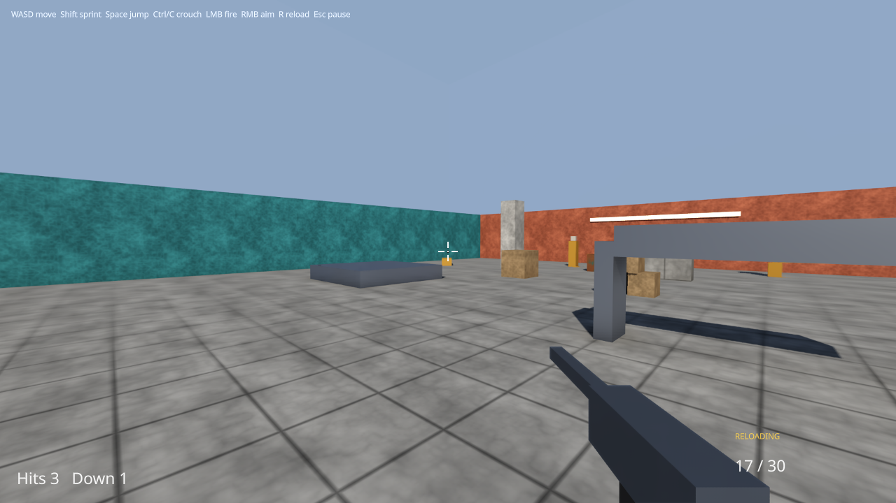
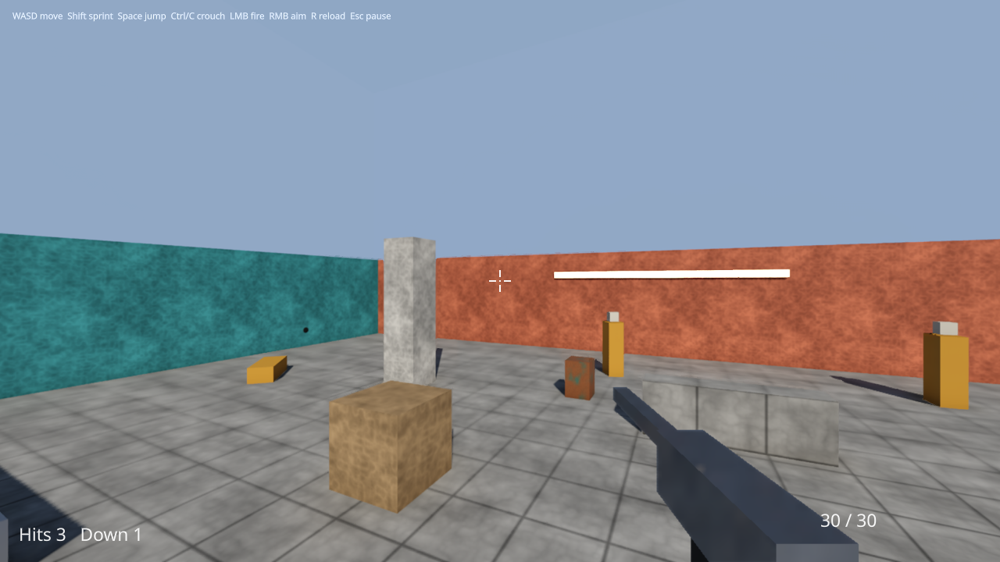

# samples/15-first-person — a first-person shooter, written in Swift, drawn with the engine's frame


A small arena and a game in it. The **player is a Swift game module**: a character that walks,
sprints, jumps and crouches, a first-person camera that looks, kicks and raises the sights, and a
weapon whose every shot is a physics raycast — an impulse on a crate, damage on a target — and what
the shot leaves behind: a muzzle flash, a burst at the barrel, sparks off what it struck that bounce
on the floor, a scorch mark and the sounds. **The targets are the engine's AI.** The C++ host builds
the arena, binds the ABI's adapters and decides nothing about the player.

```
just play-fps                                   PLAY IT: the arena in a window (below)
just run-sample first-person                    720 frames of scripted play, headless, then the report
just run-sample first-person --no-behaviours    the negative control: the same host with no game
cy_sample_first-person --render <dir>           the session drawn every frame at 1080p
just capture-first-person                       the video and the stills in docs/design/
just capture-play-fps                           the played film and its stills in docs/design/
ctest -R first_person                           the suites below
```

## Playing it

`just play-fps` opens the arena in a window through the desktop play host
([`samples/play`](../play/README.md)): the mouse looks, the keys walk, the trigger is yours. The
picture needs the Vulkan renderer (`-D CY_RENDERER_VULKAN=ON`); `--window 1920x1080`,
`--fullscreen`, `--no-vsync` and `--bindings <file>` are the play host's.

| | Keyboard and mouse | Pad |
|---|---|---|
| move | W A S D | left stick |
| look | the mouse (raw counts, relative mode) | right stick |
| sprint | left Shift | left stick pressed |
| jump | Space | south (A, Cross) |
| crouch | C or left Ctrl | east (B, Circle) |
| fire | left button | right trigger |
| aim down the sights | right button | left trigger |
| reload | R | west (X, Square) |
| pause | Esc | Start |

Thirty rounds a magazine; an empty one clicks and reloads itself. The HUD is the Swift game's
(`game/Hud.swift`): the crosshair where every shot goes, a hit marker that reddens on the shot that
puts a target down, the magazine, and what has been hit. A target shot down lies ten seconds and
gets back up — the game gives it its health back and the engine's AI stands it up. Esc, or the
window losing the focus, pauses: the menu sets the look's sensitivity and inverts its Y — applied
once, in the first-person camera's own sensitivity — and resumes or quits.

[Video: the arena played](../../docs/design/videos/first-person-play.mp4), its hands a script pushed
through the platform (`play/capture.input`).

| Reloading | A jump | The pause menu |
|---|---|---|
|  |  |  |

[Video: the whole session](../../docs/design/videos/first-person-demo.mp4) — twelve seconds at 1280x720.

| A crate a shot threw | The floor struck: a mark, and sparks bouncing | Down the sights on a target |
|---|---|---|
|  |  |  |

## What the game does, and through what

Every decision below is Swift calling the engine (`game/Player.swift`):

| | Through |
|---|---|
| walk 4 m/s, sprint 7, crouched 2, jump at 5 | `CharacterController.move(velocity:jump:)` in `onFixedUpdate` (ABI 1.5), its paces in the look's frame |
| crouch | the character **rebuilt shorter** with its feet where they were (`CharacterController.destroy`, `create`); taller again only when `Physics.overlap` of a standing capsule there is empty, so letting go of the crouch under the beam is refused until the player is clear |
| look, recoil, sights | `FirstPersonCamera.feed(look:speed:aiming:airborne:)` with the mouse's counts, `kick(pitch:yaw:)` a shot, `WeaponView(layers:)` for the arms and the weapon (ABI 1.13) |
| shoot | `Physics.raycast` along the aim the last frame drew — the eye and the weapon's aim, recoil included, recorded in `onUpdate` because a fixed step may not ask the camera — in `onFixedUpdate`, where it replays |
| push a crate, hurt a target | `RigidBody.applyImpulse(_:at:)` at the hit point; the target's `Health` component the game added at `onReady` |
| the flash | `Light.spawn(.point(...lifetime: 0.06))` (ABI 1.11) |
| the burst and the sparks | `Effect.named(_:).play(at:parameters:)` (ABI 1.15): the barrel's direction; the struck surface's normal and the floor's height in the effect's own space, which the sparks bounce on |
| the mark | `Decal.spawn(.mark(_:at:normal:radius:))` (ABI 1.15), on the arena only — a mark on a crate would stay behind when it flies |
| the sounds | `Audio.play(_:at:)`: the shot, the impact, a hit, a kill |

A shot's flash, burst, sparks, mark and sounds are presentation, refused in a fixed step, so the
step queues them and the next `onUpdate` plays them. The game asks for one effect and one mark from a
fixed step on its first tick and is refused twice — the report's `refused=2`.

## What the engine does

`host/targets.h`: four agents of `cy::ai` — one batched `PerceptionScheduler` update a tick whose
visibility batch is traced through the physics world, a behaviour tree compiled by
`cy::graph::behaviour` (`down → fall`, `hit → flinch`, `contact → engage`, `patrol`), and the game's
`Health` read once a tick as what the target felt (`SenseKind::Damage`, at the shot's source). A
target patrols, sees the player and turns to face and strafe, staggers when hit and topples when its
health is gone, its body leaving every layer a shot or a character uses.

`host/fps_host.h` runs the frame — the fixed tick (input, the game, the targets, the Jolt step),
then the frame (the light pool aged, the game's `onUpdate`, the first-person camera advanced and the
eye placed at the head the game set, the effects' world stepped, the GI from the eye, the mix) — and
captures each shot the moment the game's step returns, casting its own ray along the same line
through the same world.

`host/render.h` draws it with `FrameAssembly` and `FrameRecorder` and nothing of its own: the arena
baked in world space with content/beauty's textures, the sun's soft shadows, ambient occlusion, the
device GI over the arena's `IlluminationSystem` (`host/illumination.h`), the marks from the frame's
decal table, the bursts and sparks from `cy::vfx` through the particle renderer, the flashes as
lights, the weapon through its own lens, and the temporal upscaler at Quality.

## The frame at 1080p

RTX 5060, Vulkan, `--no-validation`, the mean over 703 timed frames of the session (the stills and the
first ten frames are not timed):

| | game ms | frame ms | total ms | device ms | GI device ms |
|---|---|---|---|---|---|
| Quality (1286x724 → 1920x1080), the default | 0.46 | 5.73 | **6.19** | 4.63 | 2.32 |
| no upscaler (1920x1080, temporal anti-aliasing) | 1.05 | 12.25 | 13.31 | 9.31 | 5.13 |
| Quality, no GI | 0.22 | 4.60 | 4.82 | 2.48 | — |

*Total* is the game's frame and the drawn frame — recorded, submitted and waited for — and the budget
`smoke.first_person_render` holds it to is **16.7 ms**: sixty frames a second. *Device* is the
device's time from the frame's first pass to its post-process, by timestamps.

## The tests

`integration.first_person_sample` (headless):

- **the scripted run is one run**: two runs end in one digest — the player, the targets and the props,
  quantised and folded every frame — and in byte-identical reports; the run with no game ends in
  another and shoots, flashes, plays and marks nothing;
- **the controller's**: the walking, sprinting and crouched paces are the game's; one jump leaves the
  ground for more than twenty ticks and over a metre; the crouch passes under the beam, the stand is
  refused there and the player stands once clear;
- **a shot hits what the raycast says**: every shot the game fired, re-cast by the host along the same
  ray at the same moment, hits the same entity at the same point, and by kind they are five target
  hits, a crate and two arena hits;
- **what a hit does**: T1, hit three times by 40, is down and lies; T0, hit twice, is at 20, flinched
  and engages; the crate the shot struck flew;
- **what a shot leaves**: a flash, a burst and a kick a shot, sparks a hit, a mark a hit on the arena —
  each counted by the game and by the engine's pool it went into — and the sounds;
- **the targets see**: perception traced rays through the physics world and saw the player.

`smoke.first_person_render` (Vulkan, serial): the drawn run's game report is the headless run's; the
frame drew the weapon view's five parts, two marks, the sparks and the flash with no validation error;
every texel the decals change lies within a few pixels of where a mark's centre — the shot's raycast
hit — projects, and every mark changed some; the sparks change texels at the wall shot's hit point;
frame 450 at 480x270 equals `tests/references/fps_450.png`; and at 1080p the total is under 16.7 ms.

Each of their key cases was proved red by a mutation:
`openspec/changes/add-first-person-demo/evidence/falsification.txt`.

`integration.first_person_play` (headless: SDL's dummy video driver, no device) plays the game with
hands written down in `play/*.input` and pushed through the platform, never into the game: a mouse
count turns the camera by the camera's 0.0022 radians, W walks four metres a second the way it
faces, the trigger hits a target the host's own raycast confirms, a lost focus pauses until Esc, the
menu's Resume fires nothing and its Quit ends the run, a pad walks, turns and fires through SDL's
own virtual joystick, a rebinding moves jump to F, thirty rounds and a click empty the magazine, and
a target shot down gets back up. `smoke.first_person_play` draws it in a window: every frame
presented without a validation error, the game the headless play run's, a window resized twice still
presenting, and a 1080p frame's work under 16.7 ms
(`openspec/changes/add-playable-fps-tps/evidence/falsification.txt`).

## What is not here

- **Particle collision is the floor, authored in the effect.** The sparks bounce on a plane whose
  height the game passes; they do not collide with the walls, the crates or the depth buffer. The VFX
  system's own collision (`vfx-system` — "Collision") is not in this tree yet.
- **Boxes.** The arena, the props, the targets and the weapon are boxes; the targets have no rig and
  fall as a body, not as a ragdoll.
- **Drawn on Vulkan only.** `--render` asks for a Vulkan device, as samples/13-rts-api's does, and is
  declared only with the Vulkan renderer. The sample adds no shader: the frame's Metal and D3D12 builds
  are what they were. It has been drawn on an RTX 5060.
- **No HUD in the scripted session.** The HUD and the menu are the interface the play host gives
  the game; the scripted session has none, and the stills above are drawn without them.
- **No sound device when played.** The game's sounds are mixed into the null backend, as the
  scripted session's are; the play host opens no audio device yet.
