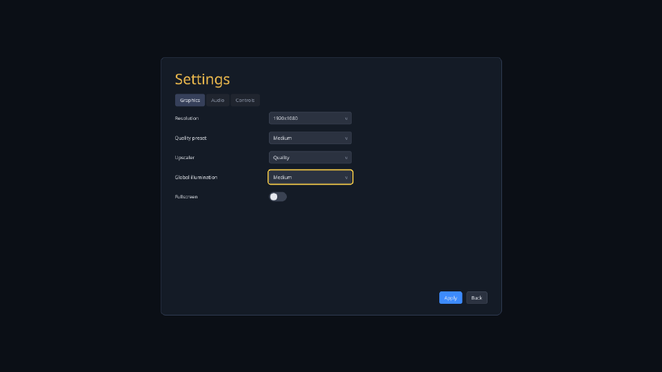
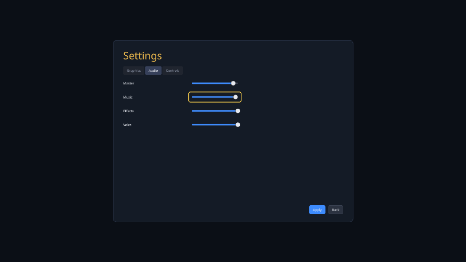
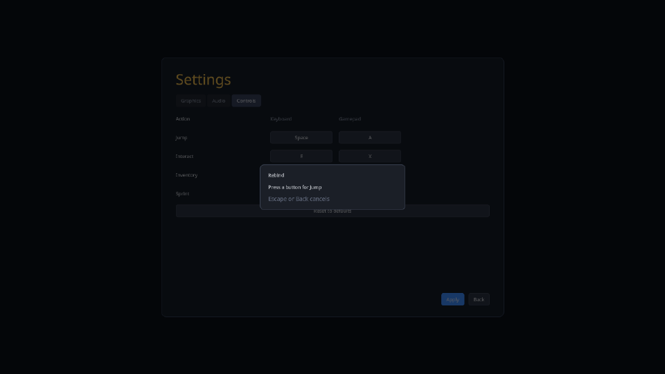
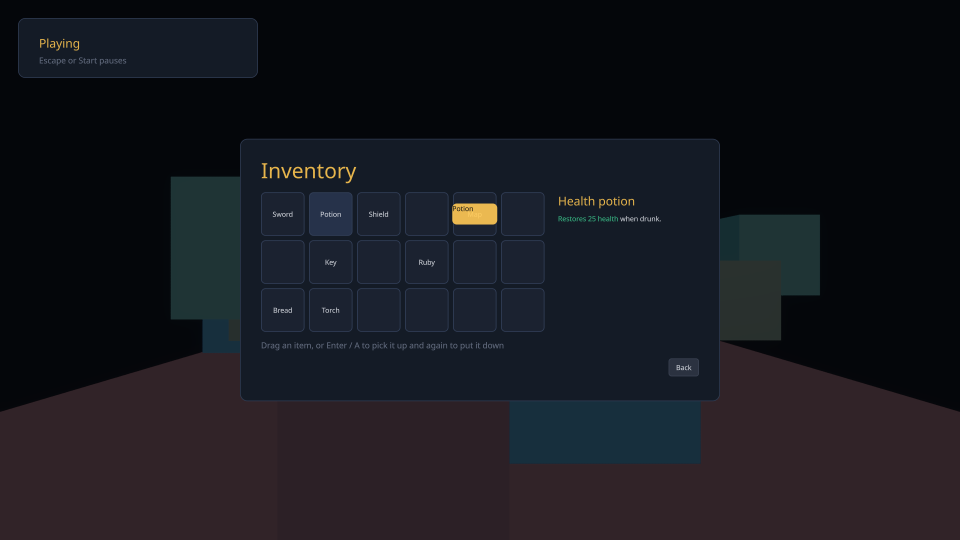
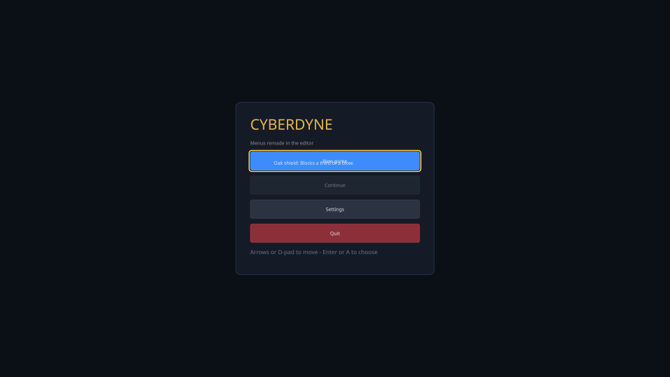

# samples/16-menus — a game's menus, in Swift, over documents made in the editor

A main menu, a settings screen, a pause menu and an inventory, written in Swift (`game/`) over
`.cyui` documents the UI layout editor wrote (`project/ui/`). Every screen works with a keyboard,
a gamepad or the pointer. Every setting goes to the engine, not to a value the game keeps:

| Setting | Where it goes |
|---|---|
| Resolution, quality preset, upscaler, fullscreen | `Video.apply` (ABI 1.17), the host's `VideoSettingsAdapter`; the renderer rebuilds its frame at the new output and renders at the upscaler's internal extent |
| Global illumination quality | `Illumination.apply` (ABI 1.9), the CyberGI system the host runs |
| Master, Music, Effects, Voice | the settings document's sliders, bound `bind=volume.master` two-way to the host's audio buses: a slider moved is the bus moved, with no Apply and no game code |
| Controls | `InputAction.rebind` (ABI 1.17): the input system's `RebindOperation` listens for the next control on that scheme, swaps a conflict onto the other action, and the profile is saved with `UserData` |



```
just run-sample menus --script samples/16-menus/tests/navigate.script     headless, with a report
cy_sample_menus --script <file> --render <dir> [--shot-size 480x270]      on a Vulkan device
cy_sample_menus ... --render <dir> --record                               every frame, for a video
ctest -R menus                                                            the two tests below
```

## The pieces

```
game/            the Swift module: Menus (the screens), Settings, Controls, Inventory, Contract
project/ui/      the documents, the sheet and two themes — the editor's output, committed
tools/session.py the editor session that authors them (one MCP call a line, project/ui/session.jsonl)
host/            the C++ host: servers, adapters, the scripted player, the renderer
tests/           navigate.script, persist.script, the two suites, and four golden frames
```

The documents are not written by hand. `tools/session.py` writes 253 `ui.*` tool calls, and
`cy-editor-mcp`'s `the_menus_sample_is_authored_by_the_ui_layout_tools` replays them over MCP into a
fresh project, holds every file it produces to the committed one, then undoes them all.

## What the host does

`host/menus_host.cpp` brings up the input server (a keyboard, a mouse and a gamepad, the `UI.*`
actions and a `Game` context), an audio server on the null backend with four buses, the widget
toolkit over a virtual file system mounted on `project/` (so a document saved while the game runs
is reloaded in it), the video adapter, a user-data directory (`--user-data`, default
`menus-user-data/`) and the RTS sample's CyberGI. It loads the Swift module and attaches `Menus` to
one node. It carries no value between the game and a server.

The scripted player (`host/script.h`) presses controls, moves and clicks the pointer, writes frames
and reports, and edits a project file the way the editor's save does (`edit <path> <find>
<replace>`, written to a temporary and renamed over the file).

## What the tests hold

`integration.menus_sample` runs the host twice over a copy of the project:

| Run | What it checks, read from the engine |
|---|---|
| `navigate.script`, a gamepad | Continue disabled on a first start and skipped by the d-pad; every graphics drop-down changed and nothing applied until Apply; two slider steps heard at once on the Master bus; Jump rebound to the gamepad's north button (the Inventory's, swapped) and to E (Interact's, swapped); a rebind cancelled by Escape changing nothing and leaving Settings open; Apply putting 1920x1080, Medium, Quality upscaling (rendered at 1286x724) and Medium GI into the engine; Start pausing; an item picked up and put down with A, a held one put back with B, one dragged with the pointer; B and Escape going back one screen; the subtitle changing under the running game when the document is saved over |
| `persist.script`, a keyboard | the settings and bindings loaded back; Continue enabled and reached; the gamepad's north button and E firing Jump, and South opening the inventory |

`smoke.menus_frames` runs `navigate.script` on a Vulkan device and holds four frames against
`tests/references/` (480x270, averaged down from the output): the graphics tab at 1280x720, the
rebind dialog, a drag in progress at 1920x1080 over the scene, and the main menu after the save. It
also checks the extents the renderer drew at, no validation message, and the frame cost.
`CY_RENDER_UPDATE_GOLDEN=1` rewrites the references.

Measured on this machine (GeForce RTX 5060, Development build): a frame (game, interface and device) costs
6.4 ms on average over 756 timed frames, and the interface's flatten and submit 0.035 ms of it. The
headless run of both scripts takes 2.5 s.

|  |  |
|---|---|
|  |  |

*The audio tab after two steps on Master and one on Music; the rebind dialog listening for Jump; a
potion dragged by the pointer at 1920x1080; and the main menu after `edit` saved "remade" over its
subtitle while the game ran.*

[A video](../../docs/design/videos/menus-gamepad.mp4) of `navigate.script`, recorded with
`--record` and encoded with ffmpeg.

## Not here

The frame is the pipeline suites' scene (`pipeline_test::FrameScene`), not a level: the GI quality
the settings set goes to the CyberGI system the host runs, which this frame does not sample. The
null audio backend mixes nothing audible. Fullscreen and v-sync are recorded by the adapter; with no
window, nothing presents them.
