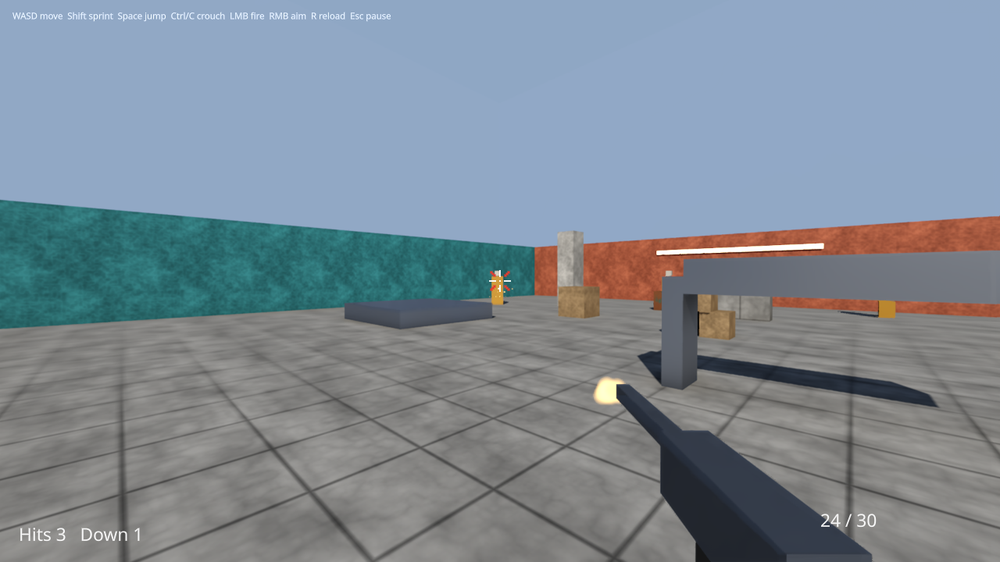

# samples/play — the desktop play host

What turns a game that runs scripted into one a person plays: a window, a mouse, a keyboard and a
pad. `samples/15-first-person` and `samples/14-third-person` are played under it with `--play`
(`just play-fps`, `just play-tps`), and a future game gets the same window, input, loop, pause and
presentation by implementing one interface.



```
just play-fps                                  the arena in a 1280x720 window
just play-tps --window 1920x1080               the hillside, larger
just play-fps --fullscreen --no-vsync          borderless at the desktop's size, uncapped
just play-fps --bindings my-keys.txt           a player's rebinding (below)
cy_sample_first-person --play --headless ...   SDL's dummy video driver: no display, no device
just capture-play-fps / capture-play-tps       the films and stills in docs/design/
```

## What it owns, and what it does not

| | Owned here | The game's |
|---|---|---|
| the window | `Sdl3DisplayServer`: resizable, v-sync, full screen; focus and resize events | its title |
| input | `Sdl3InputSource` feeding the **game's** input server; the keyboard, the mouse and each pad assigned to player one; the mouse held (relative mode) while the game runs | its actions and bindings — the engine's action maps, rebindable |
| the loop | `run_host_loop`, the engine's one frame `while`; fixed sixty-hertz ticks, a frame's interpolation (play_clock.h) | what a tick and a frame do |
| the pause | Esc, a pad's Start, the window losing the focus (pause.h); the simulation stops, the mouse is released | what the paused game shows — its menu |
| the interface | CyberUI's store, text and toolkit, and the ABI's `UiAdapter` the game binds (play_ui.h) | every element and widget in it: HUD and menu are Swift |
| the picture | a Vulkan device, the window's swapchain, the game's picture scaled into it, the interface over it (presenter.h) | the picture: the game's own renderer draws it, on this device |

It decides **nothing** about the game. `PlayGame` (play_host.h) is five calls — `input()`,
`tick(now)`, `drain(now)`, `frame(clock)`, `draw()` — and `HostedGame` (hosted_game.h) is them for
any host that exposes a scripted frame's parts, which both samples' hosts do.

## One frame

```
the input script's events for this frame, onto SDL's queue    (input_script.h)
pump the platform           SDL's queue drained: the input source's watch feeds the input server
window events               close → exit, resize → the swapchain, focus lost → pause
Esc or Start pressed        → the pause toggled
the interface's requests    a click on `play-resume` resumes, on `play-quit` quits
the mouse                   held exactly while the game runs and the window has the focus
the clock                   the frame's ticks and its interpolation
paused:   game.drain(now)   the input resolved at the last tick: the menu's cursor moves, and
                            nothing pressed meanwhile reaches the next tick as an edge
running:  game.tick(now) × ticks
game.frame(clock)           the interface's frame, the behaviours' onUpdate, presentation
game.draw() → present       the picture, letterboxed; the interface over it at the window's size
```

**Interpolated presentation.** A frame between two ticks is drawn at its own time:
`CyTime::interpolation` is how far past the last tick it is, and each moving thing is carried
forward from the last tick by its motion over it — the props, the targets and the hero by their
hosts, the first-person head and the third-person camera's focus by the Swift game. A frame that
falls on its tick — every frame of a scripted run — moves by nothing, so the scripted runs and their
digests are byte for byte what they were.

**The pause.** The game reads it in `Time.now.isPaused`, and CyberdyneKit's `PauseMenu` shows itself
while it is true. Only the player resumes: a window getting its focus back stays paused with its
menu up, so a click back into the window does not land in the game.

**The two names.** The whole contract between a game's menu and the host is two widget ids: a click
on `play-resume` resumes, one on `play-quit` ends the run. Every event still goes to its owner first.

## Controls, and rebinding them

The keys, the mouse and the pad are each sample's action maps (`host/content.cpp`,
`host/level.cpp`); the pad's sticks are radial dead zones (play_bindings.h). A player's file of
overrides is read into the input user's profile at start (bindings_file.h):

```
# action          control              slot (optional)
player.jump       keyboard/f
weapon.fire       mouse/right
player.crouch     gamepad/north
```

A line naming an action the game did not declare, or a control the input layer has no path for,
refuses the whole file and names the line.

## The tests

| Suite | What |
|---|---|
| `unit.play_host` | the clock (a fast display, a hitch, a pause, a fixed clock), the pause and the focus, the rebinding file, the input script |
| `integration.sdl3_injector` | a key, the mouse and a virtual pad pushed through SDL's queue arrive as a person's would |
| `integration.first_person_play`, `integration.third_person_play` | each sample played headless with scripted hands through the platform: the look per mouse count, the walk, the shot that hits, the pause on focus loss, the menu's Resume and Quit, the pad, the rebinding, the magazine, the respawn |
| `smoke.first_person_play`, `smoke.third_person_play` | drawn on a device: every frame presented without a validation error, the game the headless run's, a resized window still presenting, and a 1080p frame's work under 16.7 ms |

## What is not here

- **Vulkan only.** Metal and D3D12 compile the present shader (`just build-shaders --strict`); this
  host makes a Vulkan surface only, and its presentation was run on Linux with an RTX 5060.
- **No sound device.** The samples mix into the null audio backend, as their scripted runs do.
- **The menu's settings live as long as the run.** Nothing saves a sensitivity or a rebinding.
