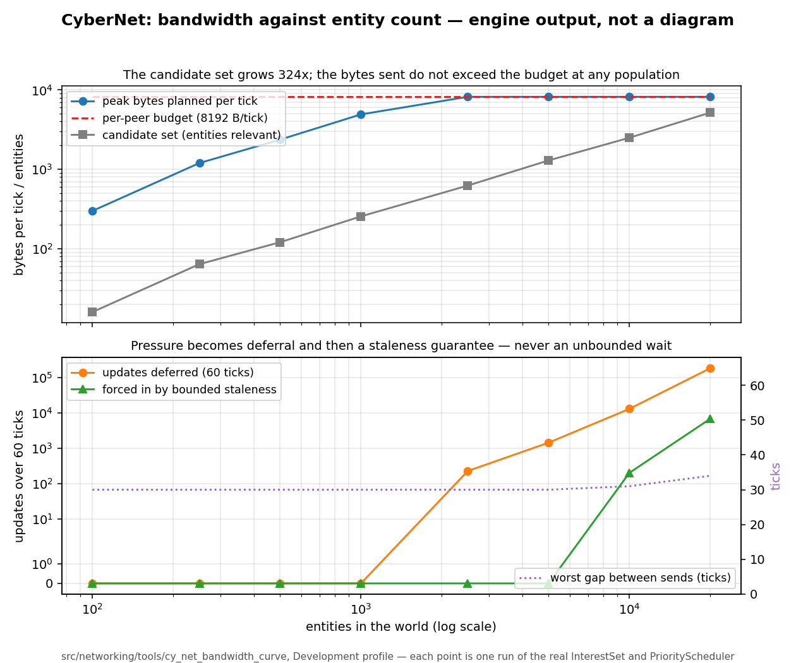
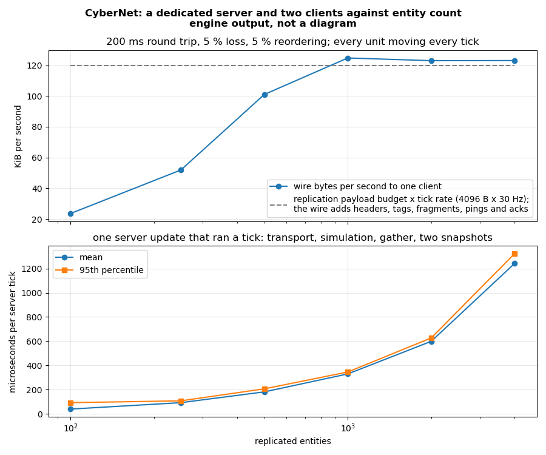
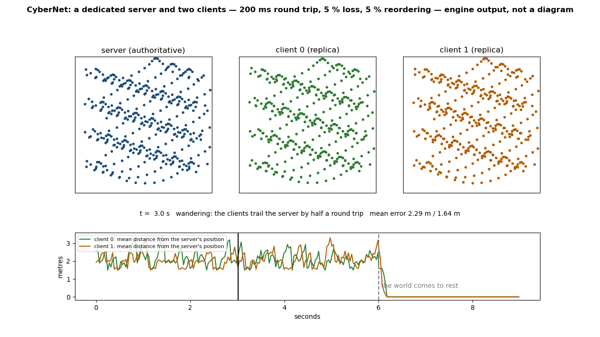

# `src/networking/` — CyberNet

**M9 section 4.** Three network modes and their prerequisites, the authority model and its handover,
the transports and the one reliability layer they share, compiled replication schemas, baselines and
deltas, spawning and RPCs, interest management, the priority scheduler and its bandwidth budget,
prediction and reconciliation, lag compensation, and the dedicated server.

**Issue #82** put those parts to work: an encrypted, authenticated transport over UDP, replication
from an `ecs::World` into client worlds, and a headless dedicated-server host and a client host
driving both — see [the secure transport, replication over a world, and the hosts](#issue-82-the-secure-transport-replication-over-a-world-and-the-hosts)
below and the [networking guide](../../docs/guides/networking.md).

Layer `scene` (4) — the rung `gameplay/`, `world/`, `graph/`, `camera/` and `replay/` chose.
Behind **`CY_NETWORKING`**, which until this milestone gated nothing.

---

## `CY_NETWORKING` stops gating nothing

`CY_NETWORKING` has been declared in `cmake/features.cmake` since M0. Before M9 there was **no
`if(CY_NETWORKING)` and no `#if defined(CY_NETWORKING)` anywhere in the tree**, so the option and its
absence produced byte-identical output — which is exactly the shape M8.b's closing gate found in
`CY_UI`, and which M8.c's gate wrote into this change as a delta requirement so that M9 would start
from it rather than discover it.

What changed:

| | Before M9 | Now |
|---|---|---|
| Default | `OFF` | `ON` — `delivery-roadmap` fails a capability at Working whose `CY_*` option defaults off |
| `if(CY_NETWORKING)` | nowhere | `src/CMakeLists.txt`, around `add_subdirectory(networking)` |
| `#if defined(CY_NETWORKING)` | nowhere | `include/cy/networking/networking.h` — one `#error`, for the out-of-tree consumer the CMake gate cannot reach |
| What it gates | nothing | `src/networking/` — the module, its tool and its three suites |
| What it fetches | nothing | Monocypher 4.0.2, already fetched for every build by the shipping manifest's signatures (issue #87). The reliability layer is the engine's own and the sockets are the platform's |
| Built with it off | never | yes, and the full suite run in both directions |

**It removes the transport, not the record.** `src/replay/`'s `ReplicationInputCursor` is
deliberately outside this option: `replay-and-rollback` forbids a second representation of
participant intent, and a replication layer that could not see the session's record would grow one.

---

## The dependency list is the dedicated server requirement

```
cy::core-base  cy::core-determinism  cy::core-memory  cy::core-reflect  cy::ecs  cy::gameplay
cy::replay     (private) cy::dep::monocypher
```

No renderer, no audio, no interface, no GPU. Monocypher is one C file of cryptography, named by one
translation unit (`src/crypto.cpp`), and private: nothing above this module sees a `crypto_` symbol. `networking-and-replication` requires a dedicated
server build to "exclude: the renderer, VFX, UI, client audio, and the editor" **at build time rather
than at runtime**, and that is what this list makes true: none of them is reachable, so the exclusion
is a property of the link graph rather than a promise. `tests/test_server.cpp` asserts the same thing
from the source side with five `__has_include` guards — adding any of those dependencies stops that
translation unit compiling.

---

## What is here, file by file

| Header | What it owns |
|---|---|
| `mode.h` | `NetworkMode`, the prerequisites `verify_mode()` checks, `CompatibilityScope` and `join_verdict()` |
| `authority.h` | `NetworkId` and its minter, `Topology`, `AuthorityRegistry` and the two-phase handover |
| `transport.h` | The `Transport` interface, `DeliveryMode`, `TransportSecurity`/`admissible_for()`, `NetworkConditions` |
| `reliability.h` | `DatagramHeader`, `ReliabilityChannel`, `ReliableEndpoint` — sequencing, acknowledgement, retransmission, the replay window, ordered delivery |
| `local_transport.h` | `LocalNetwork` (the seeded condition simulator) and `LocalTransport` |
| `udp_transport.h` | `UdpTransport` over POSIX sockets, and what it does not provide |
| `schema.h` | `FieldEncoder`, `CompiledSchema`, `SchemaSet`, `BitWriter`/`BitReader`, the change mask |
| `replication.h` | `PeerBaseline`, `SnapshotWriter`/`SnapshotReader`, spawns and despawns, `ReferenceResolver` |
| `rpc.h` | `RpcRegistry`, the direction/authority/bounds/rate-limit validation, the intent boundary |
| `interest.h` | `InterestSet` — relevance producing candidates, incrementally, over world-partition cells |
| `scheduler.h` | `PriorityScheduler`, the network LOD bands, the bandwidth budget and the degradation order |
| `prediction.h` | `InputBuffer`, `PredictionLedger`, `CorrectionSmoother`, `ProxyHistory` |
| `server.h` | `DedicatedServer`, `CookExclusions`/`apply_cook_profile()` |
| `profiler.h` | The three causal questions, and the aggregate counters beside them |
| `crypto.h` | **#82.** X25519, XChaCha20-Poly1305 and BLAKE2b from Monocypher, typed; the operating system's entropy and a seeded one for tests |
| `datagram_socket.h` | **#82.** `DatagramSocket`: `UdpSocket` (POSIX and Winsock, IPv4) and `SimulatedSocket` (one host on `LocalNetwork`) |
| `replay_window.h` | **#82.** The 64-bit packet-counter window checked before decryption |
| `congestion.h` | **#82.** The token bucket and its loss and delay response, RFC 6298 round-trip smoothing, loss from authenticated counters |
| `fragmentation.h` | **#82.** Messages larger than a datagram: fragments, and the reassembler that never hands up part of one |
| `secure_transport.h` | **#82.** `SecureTransport`: the NK handshake with a stateless challenge, sealed packets, fragmentation, rate limiting, timeouts and named disconnect reasons |
| `world_replication.h` | **#82.** `NetworkIdentity`, schemas from reflection, `WorldReplicator` over an `ecs::World` and `ReplicaWorld` into another, `replicated_digest()` |
| `session.h` | **#82.** `ServerHost` and `ClientHost`, the join and its compatibility scope, the command stream and `ServerInputLog` |

---

## Four decisions a later phase should not relitigate

### 1. Lockstep asks the determinism registry for `SamePlatform`, not for `Lockstep`

This is the milestone's brief — *"lockstep is only as true as the spike says it is"* — as a line of
code, and it is deliberate rather than an oversight.

`determinism::guarantees_of(DeterminismProfile::Lockstep)` carries `cross_platform_reproducible`, and
`DeterminismConfiguration::require()` refuses that obligation in this tree: there is no deterministic
math module, so every `CrossPlatform` or `Lockstep` session is rejected with
`DeterministicMathMissing`. `networking-and-replication` does not ask for that guarantee either —
**"Cross-platform lockstep SHALL NOT be supported"** — and asks instead for a declared compatibility
scope that every participant must match.

So the two halves of lockstep's contract go to the two things that can answer them:

* **`SamePlatform`** — the same binary on the same architecture reproduces state bit-exactly — is
  asked of the determinism registry, and it is exactly what M9's spike measured (design.md §1.1).
* **"From commands alone"** is `replicates_state(Lockstep) == false`, here.
* **"Every participant matches"** is `join_verdict()`, which refuses a peer differing in platform,
  architecture or build identity.

`tests/test_mode.cpp`'s last case asserts both halves, and mutation 5 below shows what goes red if
someone makes the engine claim the guarantee nobody has measured.

### 2. The reliability layer is shared, not the UDP backend's

`networking-and-replication` asks for "a UDP transport with its own reliability layer" and, four
requirements later, for replay protection and sequence validation from **every** transport. Written
inside the UDP backend, the second would have to be written again for the local transport — and the
first thing to diverge between two copies of window arithmetic is the replay window, which is the
half that is a security property. So `reliability.h` is one implementation over an unreliable
datagram substrate and both backends compose it. That is also what makes the in-process test a real
test of retransmission and duplicate rejection rather than a test of a simplification.

**M10 correction — the replay window is not the ordered channel's record.** M9 closed with
`m9:reliable-channel-stalls-under-loss`: a reliable-ordered channel stopped delivering under 25 %
loss and nothing noticed. It was two defects. The first was here. `already_received()` calls
anything more than 32 sequences behind the newest arrival a replay, which is right for an unreliable
datagram and wrong for one that is retransmitted for 7.5 s — about 470 sequences at 60 Hz. So a
retransmission of the hole was refused and `next_ordered_` froze for the rest of the session. The
ordered channel now answers from its own frontier (`already_taken_ordered()`), which is exact rather
than conservative, and acknowledges by NAME — a bare datagram whose `ack` field is the sequence —
what `ack_bits` cannot reach back to. Nothing on the wire changed. `ReliableUnordered` still uses
the window and still has no frontier to be exact against; nothing in this tree sends on it.

The second defect was that `ReliableEndpoint::set_policy()` had no route through any backend, so a
session could not say that its round trip was 120 ms and its match 5 s long. Both transports now
carry `set_retransmit_policy()`, and `ConnectionStats::reliable_abandoned` gives `abandoned()` the
reader it never had — sampled before anything in `flush()` that can leave early, because an
abandoned channel collects nothing and a reader written after the collection goes quiet exactly when
it has something to say.

### 3. A delta is against what the peer **acknowledged**, never against the last send

Deltaing against the last send is one array instead of two and is wrong the first time a packet is
lost: the client decodes against a baseline it never received and every field it touches is silently
garbage, with no error anywhere. `PeerBaseline` therefore holds two copies per (entity, component) —
acknowledged, and sent-since — and an acknowledgement promotes. Mutation 3 below is that exact
shortcut, and it goes red.

**#82 correction — and the acknowledgement must be exact.** `acknowledge(S)` promotes everything sent
at or before `S`, which is right only when acknowledgements are cumulative. Snapshots are unreliable:
a client that acknowledges 12 may never have received 11, and promoting 11's contents on that word
makes the next delta omit a change the client never saw — after which nothing sends it again.
`acknowledge_exactly(S)` promotes only what `S` carried, and `WorldReplicator` calls it once per
snapshot the client names (the newest and a 32-bit mask before it). Mutation 8 below is the
cumulative call, and `replication: a change in a lost snapshot is sent again, because acks are
exact` goes red.

### 4. Interest management is a scheduler, not a predicate

`InterestSet` produces candidates and never looks at a budget; `PriorityScheduler` decides what is
sent. Two objects, because the failure of one is that a bandwidth budget quietly becomes a visibility
rule and a player stops seeing an enemy because the network was busy.

---

## The bandwidth curve — measured, not asserted at one population

The exit criterion is *"Bandwidth stays within budget as entity count scales; interest management is
**measured**, not assumed"*, and tasks.md repeats the word. `tools/cy_net_bandwidth_curve` runs the
real `InterestSet` and the real `PriorityScheduler` at eight populations for sixty ticks each, over a
world that gets **denser** rather than bigger — the peer's sixteen cells of sixty-four, its budget,
its relevance distance and its band table are the constants.

```
$ build/networking/src/networking/tools/cy_net_bandwidth_curve
population,candidates,examined,peak_selected,selected_total,deferred_total,frequency_reduced_total,precision_reduced_total,forced_by_staleness_total,peak_bytes,bytes_budget,worst_gap_ticks
100,16,16,16,104,0,0,0,0,300,8192,30
250,64,64,64,416,0,0,0,0,1200,8192,30
500,121,121,121,908,0,0,0,0,2370,8192,30
1000,256,256,256,1808,0,0,0,0,4920,8192,30
2500,625,625,395,4436,230,230,0,0,8190,8192,30
5000,1296,1296,489,9054,1446,1446,0,0,8190,8192,30
10000,2500,2500,413,17118,13016,13016,0,204,8190,8192,31
20000,5184,5184,431,18376,182527,181764,0,6842,8190,8192,34
```

Read across: **the candidate set grows 324-fold and the peak bytes per tick never exceed the
budget** — 8190 of 8192 at every population from 2 500 up. The pressure becomes deferral
(`frequency_reduced`, step one of the degradation order) and then a staleness guarantee
(`forced_by_staleness`, from 10 000 up), and the **worst observed gap between two sends of the same
entity stays at 30–34 ticks** across a two-hundred-fold change in population. That last number is
what "bounded staleness" means when it is measured rather than claimed.



***`docs/design/images/m9-bandwidth-curve.png` is ENGINE OUTPUT, not a diagram***, and it says so on
its own face. `tools/curve.py` draws it from the CSV above and from nothing else.

The tool **exits non-zero if any tick exceeded the budget**, so it reports a gap rather than printing
a curve that looks fine. `tests/test_scheduler.cpp` asserts the same property over four populations,
which is what the integration tier can afford.

---

## Every check here was shown to fail

Five one-line mutations, each applied to the tree, built, run, and reverted. The pastes are in the
phase's report; the summary:

| Mutation | What goes red |
|---|---|
| 1. `select()` stops consulting the budget | three scheduler cases, including `bytes_planned <= budget` at every tick of every population |
| 2. `condition_stream()` ignores the session seed | `the condition simulator is seeded, so a failure is reproducible` — the different-seed half |
| 3. `record_sent()` promotes immediately, so a delta is against the last **send** | `a delta is against what the peer acknowledged, not the last send` |
| 4. `begin_handover()` moves authority optimistically | `a handover has exactly one authority at every step`, and the expiry case |
| 5. `profile_required_by(Lockstep)` returns `DeterminismProfile::Lockstep` | `a lockstep session whose subsystems can meet it is accepted` — the engine would be claiming cross-architecture convergence nobody has measured |

Issue #82 added fifteen more, numbered on from these; the pastes are in
`openspec/changes/add-secure-transport-replication/evidence/falsification.txt`:

| Mutation | What goes red |
|---|---|
| 6. the replay window refuses nothing | `secure transport: a replayed packet is rejected before it is decrypted` |
| 7. a packet whose tag fails is accepted | `secure transport: a tampered packet is rejected and delivers nothing` |
| 8. `acknowledge()` instead of `acknowledge_exactly()` | `replication: a change in a lost snapshot is sent again, because acks are exact` |
| 9. the world's change versions are never consulted | `replication: an unchanged world sends nothing and compares nothing` |
| 10. a connect before the first advance is timed from zero | `secure transport: a connect before the first advance is timed from that advance` |
| 11. the client does not check the challenge's tag | `secure transport: a client given the wrong server key never connects` |
| 12. the cookie is not checked | `secure transport: a response replayed from another address admits nothing` |
| 13. the send rate is not limited | `secure transport: the send rate stays under its limit and excess is discarded` |
| 14. a message is handed up before its last fragment | both fragmentation cases |
| 15. commands issued for one tick are not counted | `session: a client sending commands faster than the tick rate is clamped and flagged` |
| 16. a stale snapshot is applied over a newer one | `replication: an older snapshot arriving late is not applied over a newer one`, and the 200 ms convergence case |
| 17. the replication budget is not enforced at write | `replication: despawns and updates share one budget` |
| 18. a despawn is never confirmed | `replication: a spawn and a despawn repeat until a snapshot carrying them is acked` |
| 19. the dead stay in the relevance index | `replication: an entity that dies before any peer saw it leaves the relevance index` |
| 20. the handshake's RESPONSE is not counted as received | `secure transport: a clean link reports no loss in either direction` |

Two more checks were shown to fail the same way, both of them preprocessor rather than runtime:

* The five `__has_include` guards in `tests/test_server.cpp`: a probe translation unit compiled
  **with** the renderer, audio, UI, VFX and RHI include paths added fires all five `static_assert`s,
  and without them fires none.
* The `#error` in `include/cy/networking/networking.h`: compiled against the **`CY_NETWORKING=OFF`
  build's own generated `cy_features.h`** it fires, and against the `ON` build's it compiles.

## Both directions, run

| | `CY_NETWORKING=ON` | `CY_NETWORKING=OFF` |
|---|---|---|
| CTest entries in the `unit` tier | 73 | 72 |
| CTest entries through the `integration` tier | 143 | 141 |
| Networking targets in the build graph | `cy_networking`, three suites, one tool | none |
| `just test-all` | green | green |

The difference is exactly this module's three suites. `-D CY_NETWORKING=OFF` removes the directory
and nothing else changes.

## Four profiles, and one thing they agree about

| Profile | Configuration | `networking_core` | `networking_session` | `networking_udp` | curve |
|---|---|---|---|---|---|
| `debug` | Debug, `-O0`, `CY_UNOPTIMISED` | 40/40 | 31/31 | 5/5 | exit 0 |
| `dev` | Development, `-O2` | 40/40 | 31/31 | 5/5 | exit 0 |
| `profile` | Profile, `-O2 -g` | 40/40 | 31/31 | 5/5 | exit 0 |
| `release` | Shipping, `-O3` + IPO | 40/40 | 31/31 | 5/5 | exit 0 |

**The bandwidth curve is byte-identical in all four**, down to the last column. That is not a
coincidence and it is worth stating: every term of the priority score, every distance comparison and
every budget arithmetic in `scheduler.h` is integer, for the reason `interest.h` gives about
relevance — a decision made in floating point is a decision two builds can make differently, and a
lockstep session compares the result of what was sent. The four profiles are where that stops being
an argument.

The `unit` tier's one-millisecond-per-case CPU budget is enforced inside the binary by
`cy::test::BudgetGuard`, so `networking_core` passing in **Debug** is the statement that matters:
`-O0` is where a case that belonged in `integration` shows up.

---

## Issue #82: the secure transport, replication over a world, and the hosts

```
 ServerHost ── WorldReplicator ── ecs::World (the server's)           ClientHost ── ReplicaWorld ── ecs::World
     │            gather: chunks, columns, change versions                │             spawns, despawns, fields
     │            build: relevance -> dirty -> scheduler -> snapshot      │             acknowledge each applied
     └──────────── SecureTransport ═══════ NK handshake, sealed packets ══ SecureTransport ──┘
                       │  fragments, rate limit, RTT and loss, timeouts       │
                       └── DatagramSocket: UdpSocket (POSIX, Winsock) | SimulatedSocket (LocalNetwork)
```

### The transport

`SecureTransport` is a `Transport` over any `DatagramSocket`. Its handshake is Noise's NK pattern
spelled with Monocypher: HELLO carries the client's ephemeral X25519 key and is padded to 192 bytes;
CHALLENGE (105 bytes, so a spoofed HELLO cannot amplify) carries the server's ephemeral key and a
cookie, tagged under a key only the holder of the server's static secret can derive; RESPONSE carries
the cookie back and the application's credential sealed under the new client-to-server key. The
server keeps **no state until RESPONSE** — the cookie is a keyed BLAKE2b tag over the client's
address, its ephemeral key and the second it was issued, and the server's ephemeral secret is derived
from the same inputs. Session keys are BLAKE2b over both Diffie-Hellman results and every public key,
one per direction.

After the handshake every packet is `[type][connection id][counter][ciphertext][tag]`,
XChaCha20-Poly1305 with the first thirteen bytes as associated data and the 64-bit counter as the
nonce. `ReplayWindow` refuses a seen or too-old counter **before** decryption and marks it only after
the tag holds. Inside, reliability datagrams, pings and the session's control frames are packed up to
the MTU. `security()` reports encrypted and authenticated, so `admissible_for(..., Shipping)` admits
it — unless the entropy source is seeded, in which case it stops claiming either.

| Piece | Behaviour | Case |
|---|---|---|
| Handshake | a client given the wrong server key never connects, and says `HandshakeTimeout` | `secure transport: a client given the wrong server key never connects` |
| Tampering | a flipped ciphertext or header bit is refused, nothing is delivered, the session survives | `secure transport: a tampered packet is rejected and delivers nothing` |
| Replay | the same bytes three times: refused before decryption, delivered once | `secure transport: a replayed packet is rejected before it is decrypted` |
| Fragmentation | 50 000 bytes reliable through 5 % loss and reordering; an unreliable message whole or not at all | `... is reassembled under loss`, `... arrives whole or not at all` |
| Rate | 200 KB/s offered to a 64 KiB/s limit: 65 721 B/s sent, the excess discarded and counted | `secure transport: the send rate stays under its limit and excess is discarded` |
| Measurement | 200 ms round trip measured as 200 000 µs; 10 % loss as 100–125 per mille in each direction | `secure transport: round trip and loss are measured in each direction` |
| Disconnects | a goodbye arrives as `PeerRequest`; a silent peer as `Timeout`; refusals as `ServerFull` and `AuthenticationFailed` | `... a silent peer times out ...`, `... refuse by name` |
| A real socket | a dedicated server and a client on the loopback, keys from the operating system, admitted for shipping, converged | `integration.networking_udp`: `secure transport over UDP: ...` |

### Replication over a world

`WorldReplicator::gather()` walks every chunk holding `NetworkIdentity` once per tick: its entities,
its identity column, each schema's column and that column's change version. `build()` then decides,
per peer: relevance (everything, or `InterestSet` over a `SubjectFn`'s positions and cells), what is
dirty against that peer's acknowledged baselines, what the `PriorityScheduler` selects within the
budget, and the snapshot. **A chunk whose replicated columns are all older than the world version
of the peer's acknowledged baseline is skipped without comparing a byte**; a written chunk is compared
entity by entity, and only the fields that differ are sent. Spawns and despawns repeat in every
snapshot until one carrying them is acknowledged, so they need no reliable channel.
`ReplicaWorld` decodes into a client world bound by reflected type, so the client may register its
components in any order. `schema_from_reflection()` derives a schema from `Replicated(...)` attributes
on stable field ids — `cy::demo::Health`'s generated descriptor is one of the cases.

| Measured (`integration.networking_session`) | Bytes |
|---|---|
| A full baseline of 1000 entities, four replicated fields, owner's field included | 43 263 |
| The same 1000 entities with nothing written since the acknowledged baseline | 13 (header and terminator), 0 entities compared |
| One field of one entity changed | 24, with 291 entities compared — one chunk, not 1000 |
| 2000 entities all moving, a 2000-byte budget | peak 1975 per tick, every entity delivered, converged after the world stops |

### The hosts

`ServerHost` is the dedicated server's loop: receive, admit joins through `DedicatedServer` and the
compatibility scope (a client with another schema set is refused, by name, before any state), queue
validated commands, run every tick due at the fixed rate — `world.advance_version()`, the
application's `SimulateFn` with the commands due, gather, one snapshot per peer — and flush.
`ClientHost` connects, joins, applies snapshots, acknowledges each, and sends submitted commands.
Commands are refused past `max_commands_per_tick` issued for one tick, out of order, or outside the
command window, and the peer is flagged. Every join, leave and applied command goes into
`ServerInputLog`; `replay_step()` feeds it to a server over a fresh world with no network, and **the
replayed world equals the networked one at every tick**
(`session: the server is deterministic under the same command input`).

`tools/` has the executables: `cy_net_server` (headless; prints its public key), `cy_net_client`,
`cy_net_session_bench` and `cy_net_session_trace`. `just run-net-server`, `just run-net-client` and
`just capture-net-session` run them.

### The numbers

`cy_net_session_bench`, a dedicated server and two clients on the simulated network at a 200 ms round
trip, 20 ms jitter, 5 % loss and 5 % reordering, every unit moving every tick, 30 Hz, a 4096-byte
replication budget. Development profile (`-O2`), Linux x86-64, one core:

```
entities,wire_bytes_per_s,snapshot_bytes,budget,tick_rate,server_us_mean,server_us_p95,converged_ms
100,24186,676,4096,30,40,93,260
250,53157,1626,4096,30,93,108,160
500,103454,3210,4096,30,182,207,220
1000,127742,3998,4096,30,330,346,525
2000,125942,3941,4096,30,599,627,555
4000,126023,3944,4096,30,1242,1323,1555
```

Read across: **what one client receives levels off at the budget** — about 123 KiB/s on the wire for
120 KiB/s of snapshot payload, the rest headers, tags, fragments, pings and acknowledgements — from
1000 entities up, while the world quadruples; the scheduler defers instead. **A server tick costs
about 0.3 µs per entity** for transport, simulation, gather and two snapshots, 1.2 ms at 4000. And
once the world stops, both clients' replicated digests equal the server's within 0.2 to 1.6 s.





[The video](../../docs/design/videos/net-session.mp4) is `cy_net_session_trace`: the server's world
and both replicas side by side for nine seconds, and each client's mean distance from the server.

## What is not here, said rather than implied

* **No WebSocket transport.** `networking-and-replication` names one for browser targets. This tree
  has no browser target and nothing that could exercise one, so writing it would be writing code no
  test can run — which is how previous milestones acquired the defects their gates found. It is a
  declared gap.
* **Not DTLS.** The secure transport answers "encryption and authentication" with Noise's NK pattern
  over audited primitives, not with DTLS, and interoperates with nothing but itself. The client is
  authenticated by the application's credential, not by a key: a game that needs more issues a signed
  ticket and checks it in `CredentialCheck`. The plain `UdpTransport` is unchanged and still refused
  for shipping.
* **No client prediction joined to reconciliation, and no interpolation.** `prediction.h`'s parts are
  still separate; `ClientHost` shows the server's state as it arrives. That, and the Swift API, are the
  next steps of #82.
* **Snapshots address entities by their 64-bit network id**, and a spawn carries 162 bits. A
  per-connection short id would roughly halve an update's overhead; nothing here does that yet.
* **No IPv6.** A second socket path with no test on this host would be a second thing nobody has run.
* **Linux is where it ran.** `UdpSocket` has a Winsock path beside the POSIX one and `crypto.cpp` uses
  `BCryptGenRandom` and `arc4random_buf` there; the CI legs build and run the suites on Windows and
  macOS, and only Linux/x86-64 has been run by hand.
