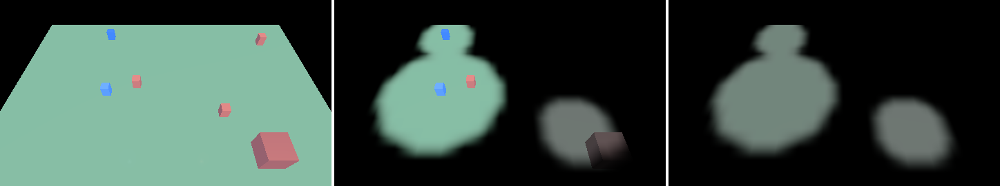

# src/rendering/fog_of_war/ — fog of war, drawn

`cy::rendering-fog-of-war`. One team's fog of war in the frame and on the minimap. The grid is
`cy::gameplay::fog::FogOfWar`'s (src/gameplay/fog/), kept in integers in the fixed step; this module
takes it as one state byte a cell (`FogOfWar::write_states`) and never writes it, and links no
gameplay code, so nothing here can make two lockstep peers disagree.



| File | What it is |
|---|---|
| `visibility_field.h` | `VisibilityField`: the grid's states faded on the frame's clock (`FogFadeSettings`: reveal and hide times) and packed `Rgba8Unorm`, a texel a cell — red how visible, green how explored. `sample_visibility` and `shade_fog`: the host twins of the shader, in its order |
| `fog_of_war_pass.h` | `FogOfWarPass`: the stage. An upload of this frame's texels into the visibility texture and one compute dispatch that shades every surface the depth reaches; readbacks for a test, timestamps for a report |
| `minimap.h` | `compose_minimap_fog`: the same field as the minimap's overlay image, premultiplied RGBA8, which `ui::render::UiRenderer::upload_atlas` takes as a page |
| `shaders/fog_of_war.slang` | the dispatch; `regenerate.py` writes `src/fog_of_war_spirv.h` and `src/fog_of_war_msl.h` |

## Where it sits in the frame

At `FramePassKind::FogOfWar` (`FrameFeatures::fog_of_war`, `AssemblyDescription::fog_of_war`,
`FrameSinks::fog_of_war`): on linear HDR after the temporal stage and before depth of field, motion
blur, bloom and exposure. The fog is a property of the surfaces: a lens blurs it like the ground it
lies on, and bloom sees a fogged light as the dimmer light it is. The frame creates
`FrameResources::fog_of_war` and the chain continues from it. Off, nothing is declared and the frame
is the frame before this module, byte for byte.

## How a pixel is fogged

1. Its world position from the depth (reversed Z) through the inverse of `projection × rotation`,
   plus the eye — the frame's rows are camera-relative. The cleared sky is written as read.
2. The visibility texture at that point: four bilinear taps half a cell apart, averaged — a tent
   two cells wide, which rounds the cells' staircase — each channel eased by a smoothstep.
3. The colour: `explored = lerp(luma, colour, saturation) × brightness`,
   `hidden = lerp(unexplored colour, explored, explored level)`,
   `result = lerp(hidden, colour, visible level)`. A fully visible pixel is written as read, bit
   for bit.

Units of other teams are not this pass's decision: a unit the team does not see is left out of the
draw list, and a remembered structure is drawn where it was last seen
(`FogOfWar::sight` and `FogOfWar::ghost`), where the pass then greys it like the ground it is on.

## What a caller does

```cpp
pass.create(allocator, device, {width, height, grid_width, grid_height});
// each frame, after the fixed step:
fog.write_states(team, states);                 // read only
field.set_states(states);
field.advance(frame_seconds);                   // or snap() on the first frame and after a cut
pass.set_frame({view, placement, style, &field});
sinks.fog_of_war = pass.stage();                // with AssemblyDescription::fog_of_war
```

## Measured

On the RTX 5060 at 480x270 (`smoke.rts_api_fog`, samples/13-rts-api): the stage's device time is
about 0.011 ms a frame (worst 0.07 ms); the host's half — the 32 x 32 grid read, faded and packed,
and the camp placed — is a few microseconds.

## Tests

* `unit.render_fog_of_war` — the field against the gameplay grid cell for cell, the fade, the
  smoothing's continuity and slope, the shading, the minimap overlay, the constants' reconstruction
  of a world position. No device.
* `render.fog_of_war` (Vulkan) — `pipeline_test::FrameScene` as a strategy field: (a) the device
  texture is the grid; (b) every ground pixel is the host twin's, and a visible one the colour it
  read; (c) explored darker and greyer, unexplored black; (d) smooth edges; (e) enemy units by the
  simulation's sight; (f) off against `references/fog_of_war_off.png`, and everything visible equal
  to off; (g) the fade.
* `unit.render_forward` — the stage's place and its refusals.

Only Vulkan ran it. The dispatch compiles for every target `just build-shaders --strict` emits; the
pass refuses a device whose native format is neither SPIR-V nor MSL, as the other produced stages do.
