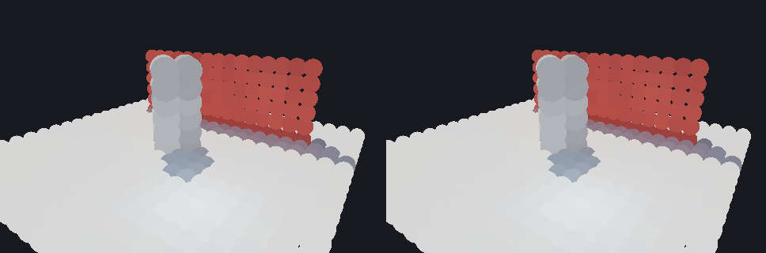

# `src/rendering/gi_gpu/` — layer 4

CyberGI on the device: the GI scene's distance-field clipmaps and surface cards uploaded
incrementally (issue #35, stage 1), the surface cache's card lighting in compute (stage 2), the
radiance cache's gather and query with the screen, software and hardware tracing tiers (stage 3),
the final gather — screen probes by default, or per pixel — and its denoiser producing the forward
frame's `ScreenSpaceGi` stage, which
`cy/frame.slang` composites where the irradiance volume's ambient sits (stage 4), and the device
cost into the GI budget, its levers onto the resolve and the budget into the renderer's arbiter
(stage 5). A frame that attaches none of it is the frame it was, byte for byte.

**Governed by**: `rendering-global-illumination` — "Surface cache", "Distance field
representation", "Incremental invalidation", "Radiance cache", "Probe update scheduling",
"Screen-space tracing", "Tracing tiers and selection", "Ray-traced effects", "Dynamic diffuse
global illumination", "GI budget and importance". Changes:
`openspec/changes/add-gpu-gi-surface-cache/` (stages 1 and 2),
`openspec/changes/add-gpu-gi-radiance-tracing/` (stage 3),
`openspec/changes/add-gpu-gi-frame-resolve/` (stages 4 and 5) and
`openspec/changes/add-gi-screen-probes/` (the screen-probe gather, the default).

`render.gi_gpu`'s last case writes the lit cards of its courtyard — a floor, a pillar casting the
sun's shadow through a shadow map, a red wall, a blue lamp — after four frames of the update,
splatted as discs: the host surface cache on the left, the device one on the right. The published
copy is `docs/design/images/gi-gpu-surface-cache.png` (RTX 5060, Vulkan; 0 of 153 600 texels differ
by more than two steps, and the PNG is byte-identical from run to run).



`render.gi_gpu_tracing`'s last case resolves the floor of `test_fallback.cpp`'s room through
`IlluminationSystem::indirect_diffuse` after twelve converged frames, with the radiance cache
gathered on the host (left), on the device through the software tier (middle) and on the device
through the hardware tier with ray queries (right): the red wall's bleed on the left of each, the
blue wall's on the right. Host and device software tier: 0 of 65 536 texels differ by more than two
steps. `docs/design/images/gi-gpu-radiance-cache.png`.


## The files

| File | What it holds |
|---|---|
| `gpu_scene.h` | `GpuGiScene`: the page table, the brick pool, the cards, the card state, the lookup grid, the lights, the shadow map, the three pipelines, and a trace batch against the uploaded field |
| `gpu_surface_cache.h` | `GpuSurfaceShading`: a `gi::SurfaceShadingBackend` that shades the selected pages in compute |
| `shaders/gi_gpu_common.slang` | the one descriptor set, the constant words, and every host function the dispatches transcribe |
| `shaders/gi_trace.slang` | `cyGiTraceRays`: `DistanceField::sphere_trace` over the uploaded field |
| `shaders/gi_cards.slang` | `cyGiShadeCards` and `cyGiCommitCards`: the card update, in two dispatches |
| `gpu_radiance_cache.h` | `GpuRadianceCache`: a `gi::ProbeGatherBackend` that gathers the selected probes on the device and answers `RadianceCache::sample` there; `GpuTierTracer`: the screen, software and hardware tiers and `TieredTracer`'s escalation, on a batch of rays |
| `shaders/gi_probe_common.slang` | the probe set, the three encodings, the gather, the query, the screen march with its nearest-depth pyramid, the world tiers' radiance and the escalation — each a transcription that names its host function |
| `shaders/gi_radiance.slang` | `cyGiGatherProbes`, `cyGiSampleProbes`, `cyGiBuildScreenHzb`, `cyGiTraceScreen`, `cyGiTraceSoftware`, `cyGiTraceTiered` — every entry point a device without ray queries has |
| `shaders/gi_hardware.slang` | the hardware tier: `cyGiGatherProbesHardware`, `cyGiTraceHardware`, `cyGiTraceTieredHardware`, over a ray query of the structures `cy::rendering-raytracing-gpu` built |
| `gpu_resolve.h` | `GpuScreenResolve`: the final gather the settings' `gi::GiGather` names — the screen probes' place, trace, probe-space filter and integrate passes, or the per-pixel resolve — and the denoiser the probes' `ScreenProbeDenoiser` names (one temporal pass, or the shared denoiser's four), the `ScreenSpaceGi` stage's producer, its two published targets, timestamps per stage; `write_gi_control` and `gi_admission`, the frame's words |
| `gpu_budget.h` | `GpuGiBudget` (the device cost into `GiBudget`, the budget into the arbiter), `apply_levers`, `tracing_divisor` / `tracing_density`, `arbiter_position` |
| `shaders/gi_surfaces.slang` | `cyGiUnpackSurfaces`: the `DepthNormal` prepass as the resolve's surfaces and the upsample's guidance |
| `shaders/gi_resolve_common.slang` | `resolve_screen_pixel` transcribed: `sample_traced`, the final-gather ray and its stand-in, the far sky, the rough specular |
| `shaders/gi_resolve.slang`, `shaders/gi_resolve_hardware.slang` | `cyGiResolve` through the software tier, and through ray queries |
| `shaders/gi_screen_probes_common.slang` | `gi::ScreenProbeGather` transcribed: placement, the probe's ray origin, the guided mixture, the harmonics, the best-matching history and blend, the probe-space filter, the per-pixel integration |
| `shaders/gi_screen_probes.slang`, `shaders/gi_screen_probes_hardware.slang` | `cyGiProbePlace`, `cyGiProbeTrace`, `cyGiProbeFilter`, `cyGiProbeIntegrate` through the software tier; `cyGiProbeTraceHardware`, `cyGiProbeIntegrateHardware` through ray queries |
| `shaders/gi_hardware_tier.slang` | the hardware world tier both the gather and the resolve trace through |
| `shaders/gi_denoise.slang` | `cyGiReproject` (`screen_history`), `cyGiDenoiseAccumulate`, `cyGiDenoiseVariance`, `cyGiDenoiseFilter` (`Denoiser`) |
| `shaders/gi_temporal.slang` | `cyGiDenoiseTemporal`: `Denoiser::accumulate` with no cascade, both signals a pixel, and on the full grid the publish |
| `shaders/gi_publish.slang` | `cyGiPublish`: `screen_upsample` into the two targets the frame samples |
| `shaders/regenerate.py` | recompiles every entry point and rewrites `src/gi_gpu_spirv.h` and `src/gi_gpu_msl.h` |

Both headers are committed, generated by `regenerate.py` (never edited by hand), so the module and
its suite are configured in every build. `CMakeLists.txt` still returns before `cy_add_module` if
either is missing, so a tree that deletes them skips the module rather than stopping on an include.

## Three modules, one seam each

| Module | Owns | Knows nothing of |
|---|---|---|
| `cy::rendering-gi` | the field, the cards, the probes, both schedulers, the lookup, and the host oracle in `card_lighting.h` | a device |
| `cy::rendering-raytracing` / `-raytracing-gpu` | the structures' decisions / the structures on the device | GI |
| **this module** | the device copy and the dispatches | how a brick is solved, where a probe goes, which page or probe to update |
| `cy::rendering-forward` / `-pipeline` | the frame, and the composite in `cy/frame.slang` | this module: the frame declares a `FrameStageDeclaration` and samples two texture slots |

The choice between host and device is one call per cache: `IlluminationSystem::set_surface_shading`
(or `SurfaceCache::set_shading_backend`) and `IlluminationSystem::set_probe_gather` (or
`RadianceCache::set_gather_backend`). Each cache keeps every decision — allocation and placement,
the clipmap scroll, invalidation, the prioritised budgeted selection (`SurfaceCache::select`,
`RadianceCache::select`), the lookup and the query — and the backend does the arithmetic on what
the cache chose.

## What a caller does

```cpp
GpuGiScene scene;
scene.create(allocator, device, {});
GpuSurfaceShading shading;
shading.bind(scene, system.field(), system.surfaces().lookup_radius());
shading.set_shadow_map(&sun_shadow);           // optional; a gi::ShadowMap
shading.set_gather({rays, max_distance, sky});
system.set_surface_shading(&shading);
// per frame:
system.update(context);                        // selects, and submits: uploads what moved
shading.declare(graph);                        // shade, commit, copy back
// ... execute, wait for the fence; the next update() retires the results ...
```

And the radiance cache, with the hardware tier where the device has ray queries:

```cpp
rt_gpu::DeviceStructures structures;           // refuses with Unsupported without ray queries
if (structures.create(allocator, device, {})) {
    system.acceleration().set_mirror(&structures);
}
GpuRadianceCache radiance;
radiance.create(allocator, device, scene, {});
radiance.bind_field(system.field());
radiance.bind_hardware(&system.acceleration(), structures.created() ? &structures : nullptr);
system.set_probe_gather(&radiance);
// per frame:
system.update(context);                        // places, scrolls, selects; the gather is submitted
structures.declare(graph);                     // what the service built, refit or moved
radiance.declare(graph);                       // the gather, through radiance.world_tier()
// ... execute; the next update() applies the gathered probes ...
```

`GpuTierTracer tiers(radiance)` traces a batch through the tiers on their own: `set_view` (depth and
last frame's colour), `set_rays`, `declare(graph, GpuTierMode::Tiered)`, `read_back`.

## Incremental, and how that is checked

The field keeps a change journal: `DistanceField::generation()` counts scrolls and `last_changes()`
lists the bricks the last scroll solved — re-solved because an invalidation cause reached them, or
exposed by the scroll. A device copy one generation behind applies that list; anything else rebuilds
its page table from `visit_bricks` and reports `full`. Cards carry `SurfacePage::revision`, bumped by
allocation, release and invalidation, and a card is written when its revision moved. A still frame
uploads nothing: `render.gi_gpu`'s `a moved object re-uploads only the bricks it touched` checks
all three.

## How close the device is to the host

Measured on the RTX 5060 (driver 580.95.05), `render.gi_gpu`, Vulkan, identical in the Development
and Debug builds. The suite prints each row; the bounds it asserts are in parentheses.

| | measured |
|---|---|
| sphere trace, 1 024 rays in the room | 0 hit/miss disagreements, 0 hits beyond 1 mm, worst \|dt\| 9.5e-7 m, worst 1 - n.n 1.8e-7 (≤ 1 %, ≤ 1 %, < 0.02) |
| door moved | 224 of 1 024 bricks re-solved and uploaded, 208 with samples, 54 144 bytes; a still frame uploads 0 (exactly the host's re-solved set) |
| room, six converged frames, direct | mean relative 3.6e-8, worst 2.0e-7, 0 pages beyond 1e-3 |
| room, six converged frames, accumulated | mean relative 3.7e-8, worst 2.4e-7, 0 pages beyond 1e-2 |
| courtyard under the shadow-mapped sun, direct | mean relative 1.3e-8, worst 1.6e-7, 0 pages beyond 1e-3; 47 floor cards in the pillar's shadow |
| courtyard, accumulated | mean relative 2.0e-8, worst 2.2e-7, 0 pages beyond 1e-2 |
| room with a promoted lamp and a cache-only sign, direct | mean relative 2.4e-6, worst 1.5e-4, 0 pages beyond 1e-3; the lamp's share of the floor under it equal to `direct_radiance` within 1e-3 |
| the same, accumulated | mean relative 9.9e-8 at frame six, 0 pages beyond 1e-2 |
| budget 48 over the room's 402 pages | exactly the host selection each frame; every page valid after 9 = ceil(402 / 48) frames |

Every case has been proven red by a mutation, applied and restored with an md5 check:
`openspec/changes/add-gpu-gi-surface-cache/evidence/falsification.txt`.

**Two ties the first run found, and what was done about them.** Both scenes are dyadic — cards on a
half- or one-metre lattice, a quarter-metre voxel — and the first run disagreed on a fifth to a third
of the bounce terms. Neither was the transcription:

- *The gather hit the surface it left.* `CardGather` started each ray at the card, at `t_min` = two
  voxels, and with 8 rays the sequence's last direction is at cos 0.25 — at `t_min`, exactly the
  half-voxel hit threshold above the card's own surface. The host counted the floor as a hit, the
  device did not. The gather now lifts its origin one voxel off the card, on both sides, and
  `integration.render_gi_pipeline`'s `a gather ray is never answered by the surface it leaves` is
  the regression.
- *A hit on a lookup sphere.* At the default half-metre lookup radius over a hundred of the room's
  gather hits land at squared distance exactly 0.25 from a card (0.25000003 on the host,
  0.24999997 on the device). That is a property of the scene and the radius, not of either side, so
  the suite's pair uses a 0.6 m radius, off the lattice.

Looking for them also found a bug on the host that predates this module: a hit exactly on two
coincident cards scored zero against both and was answered by whichever the spatial index visited
first. `card_lookup_prefers` (surface_cache.h) now breaks the tie by alignment, then by handle, in
the cache, the snapshot and the shader alike.

## Stage 3: the radiance cache and the tiers, measured

RTX 5060 (driver 580.95.05), Vulkan, `render.gi_gpu_tracing`. Every case runs the host function a
dispatch transcribes over the same inputs and compares; each row is printed by the suite, with the
bound it asserts in parentheses.

| | measured |
|---|---|
| gather, software tier, 1 022 probes, six frames, SH L1 / octahedral / SG | mean relative 5.7e-8 / 6.9e-8 / 6.0e-8, worst 1.5e-7, 0 probes beyond 1e-3 (mean < 1e-3, at most 2 % beyond); worst axis distance 3.8e-6 m (< 1e-2) |
| gather, hardware tier (ray queries), SH L1 | mean relative 5.4e-8, worst 1.2e-7, 0 beyond — the host side traced `AccelerationService::trace` |
| query, 900 points over floor, ceiling and both faces of the divider | mean relative 1.2e-7, worst 4.5e-7 (< 1e-5, < 1e-3); 0 confidence mismatches |
| structures: build, still, moved instance, pose, added instance, eviction | 1 024 ray queries after each: 0 disagreements with the service, worst \|dt\| 1.9e-6 m; the device recorded 2 builds, nothing, a top-level update, a bottom- and a top-level update, a top-level build, an eviction |
| hardware vs software tier, both on the device, resolved over `test_fallback.cpp`'s 80 points | mean relative 0.0209 (test_fallback's 0.10) — the host's own figure, because the device matches the host to 5.2e-8; it was 0.0751 before stage 4 gave every brick its far corner (see `gi/README.md`) |
| ray queries switched off by the profile, one frame later | an ordinary frame moves the image 0.142; the switch alone 0.074 (at most an ordinary frame); the switching frame 0.189 (at most 1.5x, test_fallback's) |
| a device created without ray queries vs one whose profile disabled them | 0 of 80 points differ, bit for bit |
| screen tier, 9 216 gather rays in the room / 6 784 over open ground | 0 disagreements with `ScreenTracer::trace`; the nearest-depth pyramid changes 0 answers and reads 1.03x / 2.18x fewer texels |
| software / hardware world tier, 9 216 rays | 0 disagreements with `SoftwareTracer` / `HardwareTracer`, confidence included |
| escalation, either world tier | 0 disagreements with `TieredTracer`; screen rays, escalations and world rays equal the host's; a budget of a third refuses exactly as many as the host refuses |

**What it costs**, timestamps around the dispatch alone, best of three, identical to the
microsecond over three runs of the suite on a quiet machine:

| | software tier | hardware tier |
|---|---|---|
| gather at the GI budget's default rate: 64 probes x 32 rays | 0.078 ms | 0.043 ms |
| escalation at 1920x1080, one gather ray per pixel, closed room (2 073 600 rays, 89 % escalated) | 3.35 ms | 2.13 ms |
| escalation at 1920x1080, one ray per pixel, open ground (1 528 320 rays) | 1.19 ms | 0.74 ms |
| screen tier alone at 1920x1080, closed room: plain / pyramid | 0.90 / 1.00 ms | |
| screen tier alone at 1920x1080, open ground: plain / pyramid | 0.99 / 0.49 ms | |

A full-resolution ray per pixel is the upper bound, not the plan: the resolve of stage 4 gathers
from the probes and traces at a fraction of the pixels. The pyramid pays where a ray crosses open
screen (half the time over open ground) and costs a little where a gather ray meets a wall within a
few steps; both answers are the same answer.

**Two defects running it found, both fixed.**

- *The toroidal wrap was not a modulo.* `giWrap` was `((value % modulus) + modulus) % modulus`, and
  the RTX 5060 answers the signed remainder of a negative dividend by a run-time divisor as the
  UNSIGNED remainder of its bits (`-4 % 9` gave 0). For a power-of-two window that is the modulo by
  accident, which is why every 16-brick field of stage 1 traced correctly; the radiance cache's
  nine-cell window found no probe at any negative cell. It is unsigned arithmetic now, and
  `render.gi_gpu`'s "a window whose brick count is not a power of two addresses the same bricks" is
  the regression, red on the old wrap with the device query beside it.
- *The device scene lived in system memory.* Every host-written buffer was `MemoryUse::Upload`, so a
  march read its page table, bricks and depth across the bus per step: a 1080p screen-tier batch
  took 44 ms. They are `HostVisibleDeviceLocal` now (resizable BAR on this device; the RHI falls back
  where there is none), and the same batch takes about a millisecond.

## Stages 4 and 5: the frame's GI, measured

`render.gi_gpu_resolve` runs the room of `integration.render_gi_screen` (the host oracle's suite) on
the device beside the host, frame for frame, and compares every buffer; `render.gi_gpu_frame` runs
the forward frame of the pipeline suites with the stage attached. RTX 5060, Vulkan.

| | measured |
|---|---|
| noisy diffuse / specular, every frame, software tier, 40 frames | mean relative 4.0e-8 / 7.3e-8, worst 9.9e-7 / 3.9e-5 |
| denoised and published, last frame, software / hardware tier | mean relative 1.1e-7, worst 4.5e-7 (diffuse), 2.5e-6 (specular) |
| half-resolution grid (divisor 2), published at every frame pixel | mean relative 1.1e-7, worst 2.5e-6 |
| the history (reprojection) | exact: every pixel's source and confidence |
| the frame, stage attached with its words at none | 0 pixels differ from the frame without it |
| the frame under `Baked`, which admits no dynamic bounce | 0 pixels differ; under `Dynamic`, 60 672 of 129 600 do |
| the prepass unpacked | every pixel on its box, at the depth of the ray through its centre |

**What a frame costs at 1920x1080**, timestamps around each stage:

| | reproject | resolve | accumulate | variance | filter | publish | total |
|---|---|---|---|---|---|---|---|
| room, hardware tier, authored | 0.35 | 3.96 | 1.06 | 0.52 | 5.41 | 0.26 | 11.56 ms |
| room, software tier, authored | 0.36 | 7.50 | 1.06 | 0.54 | 5.42 | 0.30 | 15.17 ms |
| room, hardware, `TracingResolution` 0.71 (the half grid) | 0.09 | 1.08 | 0.26 | 0.13 | 1.37 | 0.24 | 3.15 ms |
| room, hardware, 0.5 and `DenoiserQuality` 2 | 0.10 | 1.03 | 0.26 | 0.14 | 0.50 | 0.22 | 2.24 ms |
| beauty shot (`samples/12-beauty --gi on`), hardware | 0.31 | 8.08 | 0.96 | 0.54 | 4.32 | 0.24 | 14.75 ms (+0.30 unpack) |
| beauty shot, hardware, half grid | 0.15 | 2.42 | 0.45 | 0.27 | 1.59 | 0.38 | 5.59 ms (+0.33 unpack) |
| beauty shot, software | 0.31 | 22.98 | 0.96 | 0.54 | 4.32 | 0.24 | 29.65 ms (+0.30 unpack) |

The resolve's cost is the cache's probes traced through the field (`sample_traced`), not the rays,
which is why the half grid is the first step `TracingResolution` takes and why the beauty shot —
three probe levels over a 33 m colonnade — costs twice the room. Stage 5 holds a 960x540 frame of the
room through the screen probes to its allocation by dropping from 0.98 ms at authored quality to
0.52 ms with every lever at its floor, in the declared order, and relaxes one step only when the
arbiter grants it. Under the probes `TracingResolution`'s second step traces half the probes a
frame rather than half of each probe's rays: a probe's trace is mostly what it does once — its
history, its stand-in, its guide — and at 960x540 half its rays cost 0.92 of all of them, where half
the probes cost half (`gi::screen_probe_traces`; a probe that does not trace keeps the one it
stands for, and one with no history always traces).

**Three defects running it found, each fixed with a regression.**

- *The probe mirror never uploaded a probe the host gathered again.* Its upload keyed on a probe's
  revision, which a host gather does not move; the device query kept the first payload forever.
  `render.gi_gpu_tracing`'s "a probe the host gathers again reaches the device at the next upload".
- *The final-gather ray was weighted by what it met* — see `gi/README.md`; the transcription follows
  the host.
- *The resolve's surface buffer was not device-local.* `HostVisibleDeviceLocal` fell back to system
  memory for 72 bytes a 1080p pixel, and frames spiked to tens of milliseconds; the buffer is
  device-local, written through an upload copy the graph orders.

## The screen-probe gather, measured

`GpuScreenResolve` runs `gi::ScreenProbeGather` as passes in place of the per-pixel resolve:
PLACE (a thread a tile and a half-tile cell; the adaptive slots taken with an atomic and every probe
addressed by its cell), TRACE (one workgroup a probe, a lane a ray, summed by lane 0 in ray order,
the host's order), FILTER (a thread a probe: `ScreenProbeGather::filter`, the probe-space denoiser —
each probe's harmonics with its uniform neighbours' on its own surface, into the coefficients the
pixels read), INTEGRATE (a thread a grid cell). Under `gi::ScreenProbeDenoiser::ProbeSpace`, the
default, the pixels then take one pass, `cyGiDenoiseTemporal` (gi_temporal.slang): the shared
denoiser's accumulation for both signals of a pixel — `Denoiser::accumulate` with no cascade after
it, its history cut where the signal leaves it (`SignalConfig::history_rejection`) — and, on the
full grid, the publish into the frame's two targets; its history has a layout of its own, one
float4 a pixel a signal, without the moments only a cascade reads. `ScreenProbeDenoiser::Shared`
keeps the previous path: no filter, and the shared denoiser's accumulation, variance, one a-trous
pass and publish. `render.gi_gpu_resolve` holds both to the host over 64x40 views of the GI test
room — thirty-six frames under the probe-space denoiser, past the pixels' history of 32: every
probe placed alike, the coefficients and the filtered coefficients about 1.6e-7 mean relative, the
integrated, denoised and published signals about 1e-7, both tiers and the half grid.
`render.gi_gpu_frame`'s (d) and (e): attached at none, either gather is the frame without it byte
for byte; bound, each lights 60 672 of 129 600 pixels and the two frames differ.

`smoke.gi_gpu_probe_quality` measures the guide's axes on the frame each gather publishes at
1920x1080, read back, through both tiers (RTX 5060, Vulkan, the GI test room and its 10 cm wall):

| | per-pixel gather | probes 16 px | probes 16 px, shared denoiser | probes 8 px |
|---|---|---|---|---|
| against the path tracer, 220 points: software / hardware | 0.078 / 0.065 | 0.071 / 0.064 | 0.076 / 0.066 | 0.072 / 0.064 |
| the sealed room behind 10 cm, mean / worst pixel: software | 2.5e-5 / 4.1e-2 | 0 / 0 | 0 / 0 | 0 / 0 |
| the same, hardware | 1.2e-7 / 2.9e-3 | 0 / 0 | 0 / 0 | 0 / 0 |
| frames to within 10 % after a light moves 4.9 m: software / hardware | 9 / 11 | 9 / 10 | 14 / 13 | 9 / 10 |
| a converged still view, per frame: software / hardware | 0.0023 / 0.0017 | 0.0016 / 0.0011 | 0.0019 / 0.0017 | 0.0016 / 0.0011 |

**What it costs**, the fastest of five frames, timestamps around each stage (ms); "temporal" is the
probe-space denoiser's one pass, where the shared denoiser has its accumulation, variance, filter
and publish:

| | reproject | place | trace | filter (probes) | integrate | accumulate / temporal | variance | filter | publish | total |
|---|---|---|---|---|---|---|---|---|---|---|
| 1080p, per-pixel gather, hardware | 0.35 | | | | 4.03 | 1.06 | 0.54 | 5.51 | 0.29 | 11.79 |
| 1080p, per-pixel gather, software | 0.35 | | | | 7.60 | 1.06 | 0.53 | 5.50 | 0.26 | 15.29 |
| 1080p, probes 16 px, hardware | 0.36 | 0.02 | 1.12 | 0.01 | 0.66 | 0.58 | | | | 2.75 |
| 1080p, probes 16 px, software | 0.36 | 0.02 | 2.05 | 0.01 | 0.61 | 0.58 | | | | 3.63 |
| 1080p, probes 16 px, shared denoiser, hardware | 0.36 | 0.02 | 1.12 | | 0.66 | 1.06 | 0.54 | 1.52 | 0.23 | 5.50 |
| 1080p, probes 16 px, shared denoiser, software | 0.35 | 0.02 | 2.05 | | 0.61 | 1.06 | 0.54 | 1.52 | 0.23 | 6.38 |
| 1080p, probes 8 px, hardware | 0.36 | 0.06 | 4.21 | 0.07 | 0.64 | 0.58 | | | | 5.93 |
| 1080p, probes 8 px, software | 0.36 | 0.06 | 7.68 | 0.07 | 0.63 | 0.58 | | | | 9.38 |
| 1080p, probes 16 px, hardware, `TracingResolution` 0.71 (half grid) | 0.10 | 0.02 | 1.12 | 0.01 | 0.17 | 0.17 | | | 0.23 | 1.82 |
| 1080p, probes 16 px, software, half grid | 0.09 | 0.02 | 2.07 | 0.01 | 0.17 | 0.17 | | | 0.23 | 2.77 |
| 2560x1440 (a 4K output, the upscaler's quality mode), per-pixel, hardware | 0.63 | | | | 7.02 | 1.89 | 0.96 | 9.84 | 0.51 | 20.86 |
| 2560x1440, probes 16 px, hardware / software | 0.64 / 0.63 | 0.03 | 1.91 / 3.49 | 0.03 | 1.16 / 1.06 | 1.03 | | | | 4.80 / 6.26 |
| 3840x2160, per-pixel, hardware | 1.46 | | | | 15.58 | 4.27 | 2.17 | 22.30 | 1.12 | 46.90 |
| 3840x2160, probes 16 px, hardware / software | 1.42 / 1.43 | 0.06 | 4.21 / 7.69 | 0.07 | 2.63 / 2.38 | 2.32 | | | | 10.72 / 13.95 |
| 3840x2160, probes 8 px, hardware | 1.44 | 0.23 | 16.39 | 0.39 | 2.56 | 2.34 | | | | 23.36 |

The probes' own passes are 1.8 ms at 1080p through the hardware tier and 2.7 ms through the
software tier, against the per-pixel resolve's 4.0 and 7.6. The shared denoiser at full resolution
was 3.1 ms more — four passes over two million pixels and two signals, bound by memory — and the
probe-space denoiser in its place is 0.6 ms, which brings the default to 2.75 / 3.63 ms at full
resolution, within the ~4 ms the issue aims at on both tiers. `DenoiserQuality` has nothing left to
remove from the probes' path: it shortens a cascade the probe-space denoiser does not run. Every 8
pixels is four times the probes and their trace, and buys no measurable error here. A 4K output
through the temporal upscaler renders its GI at the internal resolution: 1080p in its performance
mode, 1440p in its quality mode.

**One defect running it found.** The temporal pass binds the two targets whatever the grid, and
on the half grid first declared them only on the publish after it: a descriptor naming an image in
a layout no barrier had put it in, which the validation layer reported as a write-after-write
hazard. It declares them on every grid now; `render.gi_gpu_resolve`'s half-grid screen-probe case
holds it to no validation error.

## The probes' trace in a furnished room

In the GI test room the probes' trace was 1.1 ms; in the sunlit room of the guide's section 7b,
with five times the cards, it was 3.9 ms of a 6.6 ms frame. Taken apart by removing one thing at a
time and timing the trace pass at 1920x1080 through ray queries, the trace was the CARD LOOKUP each
hit resolves through (2.4 ms of it), not the rays, nor the stand-in lane 0 gathers from the radiance
cache, which the rays' latency hides. Halving the rays saved 13 %: a wave finishes with its slowest
lane. Two changes, neither of which moves a number the host computes:

- **The lookup reads one cell** (`gi::CardNeighbourGrid`). The device grid had been `CardGrid`'s:
  a hash of cells one lookup radius across, each listing the cards whose CENTRE is in it, so a
  lookup visited the 27 cells about the hit — 27 bucket reads and as many short scattered lists.
  Now each cell lists every card within the radius of any point of it, a list entry carries the
  card's position beside its handle, and a lookup reads the one cell holding the hit; the cards it
  scores are a superset of those within the radius, the comparison (`card_lookup_prefers`) does not
  depend on their order, so it names the card `CardSnapshot::find` names
  (`integration.render_gi_pipeline`'s "one cell of the neighbour grid finds the card the snapshot
  finds", red when a card is listed only in its own cell). A card is listed in about 21 cells; a
  handle travels as a float's value, exact below `kMaxCards` (2^24).
- **A probe of at most 32 rays is traced by a 32-lane workgroup** (`cyGiProbeTraceNarrow`,
  `cyGiProbeTraceHardwareNarrow`): the same per-lane code, where the 64-lane group's second wave had
  no ray to trace and only waited at the barriers. Probes of more rays keep the 64-lane group.

Timed the same way at full clocks (the beauty sample's `gi fastest`), the sunlit room's trace went
from 3.83 to 1.48 ms and its integration (whose smooth-surface rays look cards up too) from 1.15 to
0.74 ms; every stage of the GI from 6.24 to 3.49 ms, and through the software tier from 9.28 to
4.61 ms. The device cards are
also shaded over their squares now (`giShadedCardDirect`, the transcription of
`gi::shaded_card_direct`): `render.gi_gpu`'s courtyard case holds the cards a pillar's shadow edge
crosses to the share of their square the shadow map lights, host and device alike.

## Promoted emitters

A light record is four `float4`s and the fourth was always zero; it now carries a promoted emissive
card's normal and area (`GiLight::emitter_area`), and `giDirectRadiance` integrates such a light
with `giEmitterFormFactor`, the transcription of `gi::emitter_form_factor`. Every other light still
uploads zeros there, so a scene with no promoted emitter writes the same bytes as before.

What it costs, measured with timestamps around the update's passes on the RTX 5060 (`render.gi_gpu`,
`what a promoted emitter costs the device card update`, median of nine): the room's 403 cards with
8 gather rays each take 0.348 ms with the point light alone and 0.363 ms with a lamp promoted
beside it — 0.015 ms for one promoted light's form factor and shadow ray over every card.

## What is not here

- **The card gather through the radiance cache.** The card gather traces the field and reads the
  cards directly — the surface-cache radiosity of stage 2 — rather than the device radiance cache
  stage 3 added beside it; joining the two is the composite's work, with the resolve.
- **Frames in flight for the caches.** The resolve's constants are a ring of
  `rhi::kMaxFramesInFlight` and its descriptor sets are per frame, but the scene's, the cards' and
  the probes' buffers are written in place, which is right for a frame that drains before the next
  update — the beauty shot's and every suite's — and not yet for a pipelined one.
- **The frame's shadow cascade.** The shadow map is a `gi::ShadowMap` depth array the host provides
  (captured from the field, or assigned from a renderer's pass); binding the cascade is stage 4.
- **Measured card and gather costs in the budget.** `GpuGiCost` carries them, but the resolve is the
  only part the beauty shot and the suites feed it; `GpuRadianceCache::last_time()` times the
  gather and a caller may add it, but nothing observes it on its own yet.
- **D3D12, and ray queries off Vulkan.** SPIR-V and MSL are committed and `just build-shaders
  --strict` compiles every entry point — the ray query ones included — for DXIL too, but there is no
  D3D12 bundle in the module yet, and the D3D12 and Metal backends build no acceleration structure
  (they refuse, and the software tier answers).
