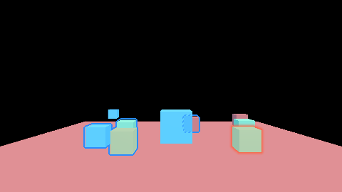
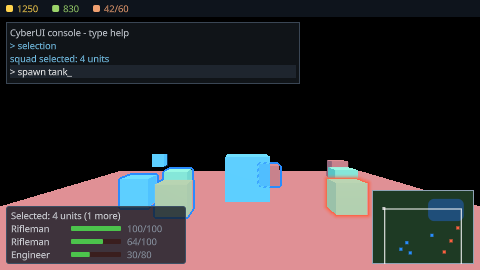

# `src/ui/render/` — layer 4

CyberUI on the device: the flattened primitive stream drawn over the frame at its interface stage.

**Governed by**: `ui-system` — "Rendering", "GPU-driven rendering". Change:
`openspec/changes/add-runtime-ui-rendering/` (issue #91, stage 1) and
`openspec/changes/add-ui-toolkit/` (stage 2: opacity groups and the HDR composite). Behind `CY_UI` with the rest of
`src/ui/`.

## The files

| File | What it holds |
|---|---|
| `encode.h` | The device-free half: `GpuUiPrimitive` (the 64-byte row the shader reads), `scissor_for`, `build_draws` (one `UiDraw` per batch), and `shade_reference` / `shade_glyph_field` / `draw_reference` — the shader transcribed for the suites |
| `text_atlas.h` | `upload_text_atlases`: a `TextPainter`'s coverage, distance-field and colour pages, each in the format the shader samples it as (issue #86) |
| `ui_renderer.h` | `UiRenderer`: the pipeline, the atlas pages, the per-frame rows and indirect arguments, and the pass declared through `FrameStageDeclaration` |
| `shaders/ui.slang` | `cyUiVertex` and `cyUiFragment`, one shader with material-indexed behaviour: a shape, an image, a coverage glyph, and a distance-field glyph with an outline band |
| `shaders/regenerate.py` | recompiles it and rewrites `src/ui_spirv.h` and `src/ui_msl.h` |

## The frame

```
post-process ─► output ─► selection outlines ─► ui ─► present
                                                 ▲
         flatten() ─► rows + indirect arguments ─┘   (host-visible, one set per frame in flight)
```

`FrameSinks::ui = renderer.stage()` hands the `UiAndDebug` stage to this module, which declares one
pass that loads and stores the colour the chain ended in. Without a producer the stage is the single
pass it always was. With one attached and nothing to draw, the pass records nothing and the frame is
the frame from before the pass existed, byte for byte (`render.ui`, case (a)).

**Opacity groups.** An element flagged `ElementFlags::OpacityGroup` has its subtree flattened after
the main stream, with batches of its own (`PrimitiveBuffer::groups()`). The renderer declares one
graph pass per group, drawing it into a cleared transient target the size of the frame
(`group_format`), and the interface pass samples it once through a composite primitive at the
group's opacity — atlas `kFirstGroupAtlas + n` — so overlapping children of a faded panel do not
darken their overlap. At most `kMaxOpacityGroups` (16) a frame; a frame with none declares nothing
new (`render.ui_toolkit` (a), (b)).

**The HDR composite.** `FramePassKind::UiHdr` is declared after motion blur and before bloom when
`FrameSinks::ui_hdr` has a producer. A second renderer created for the frame's float colour format
decodes the rows' sRGB colours to linear light and multiplies them by `scene_scale` (the frame's
exposure, so a document is as bright on screen as it was authored); a row's fourth shape word,
`PaintData::intensity`, multiplies further, so an emissive element blooms (`render.ui_toolkit` (c),
(e)). Zero is read as one, which keeps every row written before it unchanged.

## What a caller does

```cpp
renderer.create(device, {width, height, output_format});
upload_text_atlases(renderer, text);  // outside a frame, after the labels are set
// per frame:
ui::layout(store, scale_settings, viewport, &text, layout_report);
ui::flatten(store, viewport_rect, buffer, flatten_report, &text);
renderer.submit(buffer, ui::resolve_scale(scale_settings, viewport));
sinks.ui = renderer.stage();
```

## Five decisions, and why

**One draw per batch, indirect.** `flatten()` already breaks batches on material, atlas, clip and
transform, so a batch is exactly one pipeline state, one page and one scissor. Each is one
`draw_indexed_indirect` of an instanced quad; the arguments are written by `declare()` into the frame
slot's buffer, so a later GPU-side culling pass can write them instead without changing the record.

**A signed distance in pixels.** A pixel centre half a pixel inside the rounded box is fully covered,
half a pixel outside not at all, so a whole-pixel rectangle covers whole pixels and its colour lands
in the output byte for byte; a border is the box minus the box inset by its width; corners are
anti-aliased. The quad is grown by a pixel so a fractional edge is rasterised at all.

**Premultiplied, display-referred, discard where nothing is drawn.** Colours arrive premultiplied with
the element's opacity folded in and blend `One, OneMinusSourceAlpha`. On an sRGB target the shader
decodes first (`kUiOutputLinear`) so the bytes in the output are still the interface's, and a
translucent colour blends in linear light; `render.ui` case (g) draws on an `Rgba8Srgb` target to
hold both.

**Atlas pages are uploaded outside the frame.** `upload_atlas` runs a graph of its own and waits, as
grading's table upload does, and leaves the page in the sampled layout. Page 0 is one white texel,
so a shape samples white and the set always holds a texture.

**A page that changes while the game runs is staged into the frame.** `stage_atlas` keeps an
uploaded page's texture and replaces its texels inside the next frame's graph: they are copied into
the frame slot's staging buffer when the frame declares the interface's stage, and moved into the
page by a transfer pass every interface pass of the frame reads after — no texture made, no
submission and no wait of its own, where `upload_atlas` stalls the device every time. A minimap
redrawn while the game runs is the case (samples/13-rts-api's battle); `render.ui` (j) holds the
frame after a stage to the new texels and the device to one frame for it.

**Text from a distance field is thresholded, not redrawn.** `BuiltinMaterial::GlyphField` samples a
multi-channel distance field linearly, takes the median of red, green and blue as the distance, scales
it to pixels by the row's `shape.z` (twice the face's range times the glyph's magnification), and
covers the glyph from half a pixel inside the edge; an outline is the band out to `shape.y` pixels
beyond it in the border colour. So an outlined, shadowed line is the glyphs and their shadows — one
material, one page, one draw — and `render.ui` (h) holds the device to the host within one step.

**The host reference is the test oracle.** `draw_reference` rasterises the same rows the way the
device does; `render.ui` requires every pixel within one 8-bit step of it.

## Not built

Custom UI materials, blur-behind, world-space and surface-space documents (`ui-system` stage 2 and
3 of issue #91), and a render transform beyond a translation and a uniform scale. Metal's MSL is
generated and committed and not exercised on this host; D3D12 is compiled and compared by
`just build-shaders --strict`, and no DXIL is embedded.

## Testing

`unit.ui_render` — the rows, the scissor rule, one draw per batch, groups and their composite, and
the reference. `render.ui` — seven cases on a Vulkan device, with validation on; see
`tests/test_ui_device.cpp`'s header. `render.ui_toolkit` — five, for the toolkit, groups and the
HDR stage; see `tests/test_ui_toolkit_device.cpp`'s.

| The widget gallery | With its dialog open |
|---|---|
|  |  |


| No interface | The strategy HUD and the console |
|---|---|
|  |  |
